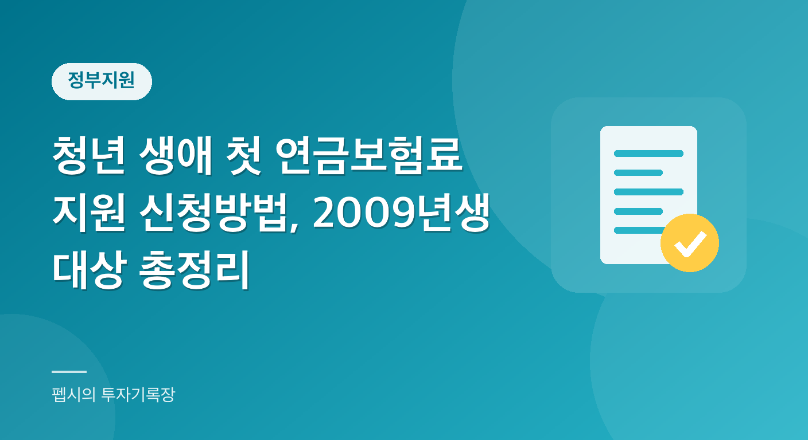

  

"국민연금 첫 달 보험료를 나라가 대신 내준다는데, 우리 애도 받을 수 있나요?"

요즘 이런 질문이 부쩍 늘었습니다. 고3 자녀를 둔 부모님이나 이제 막 성인이 되는 청년이라면 한 번쯤 뉴스에서 보셨을 텐데요.

막상 찾아보면 "신청해야 받는다", "2009년생만 해당된다", "19~26세는 빠진다" 같은 이야기가 섞여 있어서 누가, 언제, 어떻게 받는다는 건지 헷갈리기 쉽습니다. "만 18세부터 26세까지 다 받는 거 아냐?" 하고 넘겨짚기 쉬운데, 부칙을 보면 얘기가 달라집니다.

그래서 오늘은 **청년 생애 첫 연금보험료 지원**을 정리해 보려고 합니다. 국민연금공단 안내 페이지와 관련 보도를 확인해서, 확인된 내용만 담았고 확인이 안 된 부분은 확인이 안 됐다고 적었습니다. 이 글은 2026년 11월 8일 기준입니다.

**📌 한눈에 보기 (2026년 기준)**

- 시행일은 2027년 1월 1일이고, 첫 적용 대상은 2009년생부터입니다.
- 지원 내용은 기준소득월액 하한액에 해당하는 첫 1개월분 연금보험료입니다.
- 금액은 보도에서 약 4만 1천 원 또는 약 4만 2천 원으로 소개됐습니다.
- 자동 지급이 아니라 신청제이며, 본인과 부모(법정대리인) 모두 신청할 수 있습니다.
- 사전신청은 2026년 10월 1일부터 2009년생을 대상으로 받고 있고, 문의는 1355입니다.

**목차**

* TOC
{:toc}

## 청년 생애 첫 연금보험료 지원이란?

국민연금공단 안내에 따르면 이 제도의 취지는 이렇습니다. 학업, 군 복무, 취업 준비 등으로 국민연금 가입 시점이 늦어지는 청년들의 문턱을 낮추려는 것입니다.

그래서 18세부터 일찍 노후 준비를 시작하도록 돕기 위해 생애 첫 연금보험료 1개월분을 국가가 지원합니다. 쉽게 말해 "연금의 첫 단추를 나라가 같이 끼워 준다"는 개념입니다.

보도에 따르면 이 제도는 국민연금법 일부개정안이 2026년 4월 23일 국회 본회의를 통과하면서 근거가 마련됐고, 시행일은 2027년 1월 1일입니다.

금액 자체가 크지는 않습니다. 하지만 국민연금은 가입 이력이 생기는 순간부터 가입기간이 쌓이기 시작하기 때문에, 청년이 연금 제도와 처음 접점을 만드는 계기가 된다는 데 의미를 두는 제도라고 이해하시면 됩니다.

### 자동으로 들어가는 게 아니라 '신청제'

여기서 가장 먼저 짚어야 할 점이 있습니다. 이 제도는 자동 지급이 아니라 **신청제**입니다.

보도에 따르면 정부가 자동 가입 방식도 검토했지만 청년층의 연금 불신을 고려해 신청 방식으로 정했다고 합니다. 신청하지 않으면 지원받지 못합니다. 이 부분이 뒤에서 다룰 오해와도 연결됩니다.

## 지원 대상: 법은 18~26세, 첫 적용은 2009년생부터

대상 조건은 두 겹으로 이해하셔야 헷갈리지 않습니다.

첫째, 법에서 정한 신청 연령은 18세에서 26세까지로 보도되었습니다. 신청 가능 기간을 26세까지 넉넉히 둔 것입니다.

둘째, 부칙상 첫 적용 대상은 2027년 1월 1일 법 시행 이후 18세가 되는 **2009년생**부터입니다. 국민연금공단 안내 페이지도 "2027.1.1. 법 시행 이후 18세가 되는 2009년생 청년부터 지원 신청 대상"이라고 밝히고 있습니다.

즉, 이미 19~26세인 청년이 "나도 신청 연령 안에 드니까 되겠지" 하고 신청하는 것은 지금 기준으로는 해당이 안 됩니다. 소급 적용을 하지 않기로 했다는 보도가 있었습니다.

국회에서는 이미 19~26세가 된 약 413만 명이 제외된다는 지적이 나왔다고 합니다. 시행 첫해 대상은 약 45만 명이라는 보도도 있었습니다. 다만 이 인원 수는 언론 보도 기준이므로 참고만 하시면 좋겠습니다.

| 구분 | 법상 신청 연령 | 부칙상 첫 적용 |
|---|---|---|
| 기준 | 18세~26세 (보도) | 2027년 1월 1일 시행 이후 18세가 되는 2009년생부터 |
| 이미 19~26세인 청년 | 연령 범위에는 포함 | 소급 적용 없음, 현재 대상 아님 |
| 2009년생 | 18세가 되면 신청 가능 | 첫 적용 대상 |

### 제외 대상

공단 안내에 따르면 다음은 지원 대상에서 제외됩니다.

- 국내에 거주하지 않는 27세 미만 재외국민
- 다른 공적연금(공무원연금, 사학연금 등) 가입자
- 외국인

그 밖의 세부 요건은 아래 표와 공단 안내를 함께 보시는 것이 안전합니다.

## 지원 금액은 얼마일까?

공단 안내는 지원 금액을 "기준소득월액 하한액에 해당하는 연금보험료 1개월분"으로 설명합니다. 적용 시점은 두 가지입니다.

18세가 되기 전에 사전 신청을 한 경우에는 18세가 되는 때의 하한액, 18세 이후에 신청하는 경우에는 신청일 기준 하한액이 적용됩니다.

보도에서는 이 금액을 약 4만 1천 원으로 소개한 곳도 있고 약 4만 2천 원으로 쓴 곳도 있습니다. 기준소득월액 하한액이 조정되면 금액이 달라질 수 있기 때문에, 정확한 금액은 신청 시점에 공단 안내에서 확인하셔야 합니다. 이 글에서는 "약 4만 원대"로만 이해해 두시길 권합니다.

| 구분 | 내용 | 확인 출처 |
|---|---|---|
| 시행일 | 2027년 1월 1일 | 공단 안내, 보도 |
| 첫 적용 대상 | 2009년생부터 | 공단 안내 |
| 지원 내용 | 첫 1개월분 연금보험료 | 공단 안내 |
| 지원 금액 기준 | 기준소득월액 하한액에 해당하는 보험료 (약 4만 원대로 보도) | 공단 안내, 보도 |
| 사전 신청 시 기준 | 18세가 되는 때의 하한액 | 공단 안내 |
| 18세 이후 신청 시 기준 | 신청일의 하한액 | 공단 안내 |
| 신청 방식 | 신청제 (자동 지급 아님) | 보도 |
| 제외 대상 | 비거주 재외국민, 타 공적연금 가입자, 외국인 | 공단 안내 |
| 문의 | 국민연금 고객센터 1355 | 공단 안내 |

## 신청 방법: 본인도, 부모도 가능

공단 안내 기준으로 신청 경로는 다양합니다. 홈페이지(모바일 앱), 전화, 우편, 팩스, 방문으로 신청할 수 있습니다.

### 미성년자 본인 신청

미성년자도 본인 인증을 거치면 모바일이나 홈페이지에서 직접 신청할 수 있습니다. 부모 동의서를 꼭 받아 와야 하는 구조는 아니라는 점이 안내에 나와 있습니다.

### 부모(법정대리인) 대리 신청

부모는 "청년 생애 첫 연금보험료 지원(대리 신청)" 화면에서 대신 신청할 수 있습니다. 주민등록상 동일 세대가 아니라면 '자녀 기준 가족관계증명서'를 첨부해야 한다고 안내되어 있습니다.

한 보도에서는 공단 전산망에서 가족관계가 확인되면 별도 서류 없이 신청이 가능하다고도 했는데, 상황에 따라 다를 수 있으니 신청 화면의 안내를 따르시면 됩니다.

### 처리 절차

신청 후에는 다음 순서로 진행됩니다.

1. 신청 접수
2. 지원 적격 여부 확인
3. 지원 여부 결정 통보
4. 보험료 1개월분 지원

관할 지사에서 신청 내용을 확인하고, 필요하면 담당자가 연락할 수도 있습니다.

**⚠️ 결정 뒤에는 변심 취소가 안 됩니다**

공단 안내에는 지원이 결정된 뒤에는 신청인의 변심으로 인한 취소가 불가하다고 적혀 있습니다. 또 지원 요건을 충족하지 못하면 지원이 취소될 수 있다고 합니다. 신청 전에 대상 요건을 한 번 더 확인하세요.

### 신청 전 체크리스트

신청하기 전에 아래 순서로 점검해 보시면 좋습니다.

1. 자녀(본인)가 2009년생인지 확인합니다.
2. 다른 공적연금 가입자이거나 외국인, 비거주 재외국민이 아닌지 확인합니다.
3. 공단 홈페이지·모바일 앱의 안내 화면에서 신청 메뉴와 접수 일정을 확인합니다.
4. 부모가 대신 신청한다면 가족관계 확인이 가능한지(동일 세대 여부)를 확인합니다.
5. 지원 후 가입 상태가 어떻게 되는지 궁금하다면 1355로 문의합니다.

## 사전신청은 이미 시작됐다

이 제도는 2027년 시행이지만, 국민연금공단은 **2026년 10월 1일부터** 2009년생을 대상으로 사전신청을 받고 있다고 알려졌습니다. 오늘이 11월 초이니 이미 신청이 가능한 상태입니다.

한 보도에서는 시작 한 달 만에 1만 명이 신청했다고 전했습니다.

사전신청 종료일은 확인된 공식 안내에서 명시되어 있지 않았습니다. 그래서 "언제까지 해야 한다"고 단정해서 쓰지는 않겠습니다.

다만 법상 신청 연령이 26세까지라는 점을 감안하면 당장 서두르지 않아도 되는 제도일 가능성이 크지만, 일정과 접수 방식은 바뀔 수 있으니 공단 공지를 직접 확인하세요.

한 가지 알아두면 좋은 점은 앞서 말한 금액 기준입니다. 하한액은 매년 조정되는 값이라, 신청 시점에 따라 금액이 약간 달라질 수 있다는 뜻입니다.

| 신청 시점 | 적용되는 하한액 |
|---|---|
| 18세가 되기 전 (사전신청) | 18세가 되는 때의 하한액 |
| 18세 이후 | 신청일의 하한액 |

## 많이 하는 오해 바로잡기

### 오해 1. "18세에서 26세면 누구나 받는다"

법상 신청 연령 범위는 18~26세로 보도되었지만, 부칙상 첫 적용은 2009년생부터입니다. 지금 19세 이상인 청년은 대상이 아닙니다. 이 부분이 가장 많이 헷갈리는 포인트입니다.

### 오해 2. "대상이면 알아서 들어온다"

신청제입니다. 대상이어도 신청하지 않으면 지원이 되지 않습니다. 자녀가 2009년생이라면 부모가 대신 신청할 수 있으니 미리 알아 두시는 편이 좋습니다.

### 오해 3. "한 달 보험료 내주면 연금이 크게 늘어난다"

솔직히 말씀드리면, 한 달 치 보험료 지원이 노후 연금액을 크게 바꿀 정도는 아닙니다. 제도의 취지는 금액 자체보다 "18세부터 연금 제도에 일찍 들어와 보게 하는 것"에 가깝습니다.

연금액은 가입기간과 가입 중 소득 수준 등에 따라 결정되기 때문에, 이 지원금만으로 수령액이 얼마나 달라지는지는 단정할 수 없습니다.

또 지원이 끝난 뒤 가입 상태가 어떻게 이어지는지(납부예외 처리 여부 등)는 확인된 공단 안내 페이지에는 나와 있지 않았습니다. 이 부분은 신청 전에 1355에 문의해 확인하시길 권합니다.

### 오해 4. "신청했다가 마음 바뀌면 취소하면 된다"

공단 안내에는 지원이 결정된 뒤에는 신청인의 변심으로 인한 취소가 불가하다고 적혀 있습니다. 또 지원 요건을 충족하지 못하면 지원이 취소될 수 있다고 합니다. 신청 전에 대상 요건을 한 번 더 확인하세요.

### 오해 5. "다른 지원을 받으면 이건 못 받는다"

공단 안내에는 다른 지원 제도와 관계없이 중복 지원을 받을 수 있다고 되어 있습니다.

## 가상의 예시로 이해해 보기

숫자를 단순화해서 가상의 상황을 하나 들어 보겠습니다. 실제 금액이 아니라 이해를 돕기 위한 예시입니다.

2009년 3월생인 민수(가명)는 2027년 3월에 만 18세가 됩니다. 어머니가 2026년 11월에 공단 모바일 앱에서 대리 신청 메뉴로 사전신청을 했다고 해 봅시다.

같은 주민등록상 세대라면 별도 가족관계증명서 없이 진행될 가능성이 있고, 세대가 다르면 가족관계증명서를 첨부해야 합니다. 이 경우 지원금은 민수가 18세가 되는 시점의 기준소득월액 하한액에 해당하는 보험료 1개월분입니다.

반대로 민수가 사전신청 없이 2027년 가을에 직접 신청한다면 그 시점(신청일)의 하한액이 적용됩니다.

민수와 몇 달 차이밖에 나지 않는 2008년 12월생 지은(가명)은 대상이 아닙니다. 2008년생이기 때문에 부칙상 첫 적용 대상인 2009년생이 아니라서 신청 연령(18~26세) 안에 들어와도 지원 대상이 되지 않습니다.

이처럼 생년이 한 해 차이로 갈리기 때문에 아쉬움이 큰 제도이기도 합니다.

## 왜 하필 18세, 그리고 왜 신청제일까?

국민연금은 소득이 있는 성인이 가입하는 제도인데, 현실에서는 대학 진학, 군 복무, 취업 준비 때문에 첫 가입이 20대 중후반으로 미뤄지는 경우가 많습니다.

공단이 안내 페이지에서 "학업, 군 복무, 취업 준비 등으로 가입 시점이 늦어지는 청년"을 직접 언급하는 이유도 여기에 있습니다. 연금은 일찍 시작할수록 가입기간을 쌓을 시간이 길어지기 때문에, 첫 보험료를 국가가 대신 내 주어 진입 장벽을 낮추겠다는 구상입니다.

신청제로 정한 이유로는 보도에서 청년층의 연금 불신이 언급되었습니다. 억지로 가입시키기보다 본인이 선택해서 들어오게 하자는 취지로 읽힙니다.

이 제도를 어떻게 평가할지는 사람마다 다를 수 있습니다. 어떤 분은 "한 달 치로 뭐가 달라지냐"고 하실 수 있고, 어떤 분은 "그래도 첫 단추를 끼우는 계기"라고 보실 수 있습니다. 중요한 건 대상이 되는 분들이 조건과 절차를 정확히 알고 선택하는 것입니다.

또한 이 제도는 2027년 시행 예정인 청년 지원책 중 하나이며, 다른 청년 지원 제도와 중복해서 받을 수 있다고 공단이 안내하고 있으니 다른 제도 때문에 포기할 필요는 없습니다.

## 정리

- 청년 생애 첫 연금보험료 지원은 **2027년 1월 1일** 시행되고, 첫 적용 대상은 2009년생입니다.
- 자동 지급이 아니라 신청제이며, 본인과 부모 모두 신청할 수 있습니다.
- 금액은 기준소득월액 하한액 기준 첫 1개월분 보험료로, 보도에서는 4만 원대 초반입니다.
- 사전신청은 2026년 10월 1일부터 시작되었고, 결정 뒤에는 변심 취소가 불가합니다.

큰 금액은 아니지만 "대상인데 몰라서 못 받는" 일이 없도록, 주변에 2009년생이 있다면 알려 주시면 좋겠습니다. 반대로 19세 이상이라 해당되지 않는 분들은 아쉽겠지만, 제도가 어떻게 확대될지는 앞으로 지켜볼 일입니다.

세부 요건이나 일정은 바뀔 수 있으니 신청 전 공단 안내를 꼭 다시 확인해 주세요.

## 자주 묻는 질문

**Q1. 2008년생이나 그 이전 출생자도 신청할 수 있나요?**

A1. 공단 안내 기준으로 첫 적용 대상은 2027년 1월 1일 시행 이후 18세가 되는 2009년생부터입니다. 법상 신청 연령이 18~26세로 보도되었어도 2008년생 이전 출생자는 현재 대상이 아닌 것으로 확인됩니다.

**Q2. 지원 금액은 정확히 얼마인가요?**

A2. 신청 시점의 기준소득월액 하한액에 해당하는 연금보험료 1개월분입니다. 보도에는 약 4만 1천 원, 약 4만 2천 원으로 서로 다르게 나와 있어 신청 시점에 공단 안내로 확인하셔야 합니다.

**Q3. 부모가 대신 신청할 수 있나요?**

A3. 가능합니다. 공단의 "청년 생애 첫 연금보험료 지원(대리 신청)" 화면에서 신청할 수 있고, 주민등록상 동일 세대가 아니면 자녀 기준 가족관계증명서를 첨부해야 합니다.

**Q4. 신청 후에 취소할 수 있나요?**

A4. 공단 안내에 따르면 지원이 결정된 뒤에는 신청인의 변심에 따른 취소가 불가합니다. 신청 전에 요건을 확인하세요.

**Q5. 신청 마감일은 언제인가요?**

A5. 사전신청 종료일은 공식 안내에서 확인하지 못했습니다. 법상 신청 연령은 26세까지로 보도되었지만, 세부 접수 일정은 공단 공지를 확인하세요.

## 참고 자료

- 국민연금공단, 청년 생애 첫 연금보험료 지원 안내: https://nps.or.kr/elctcvlcpt/comm/getOHAC0000M5.do?menuId=MN26000015 (2026년 11월 기준)
- 서울신문, 「연금 첫 단추 국가가 함께 끼운다…18세 청년에 첫 보험료 지원」(2026년 4월 23일): https://m.seoul.co.kr/news/2026/04/23/20260423500286
- SBS Biz, 「18세 청년 생애 첫 연금보험료 지원…사전신청 시작」(2026년 10월 1일): https://biz.sbs.co.kr/amp/article/20000337775
- 국민연금 고객센터: 1355

> 이 글은 일반적인 정보 제공을 위한 것으로, 개인 상황에 따라 적용이 다를 수 있습니다. 정확한 내용은 관련 기관에 확인하세요.
