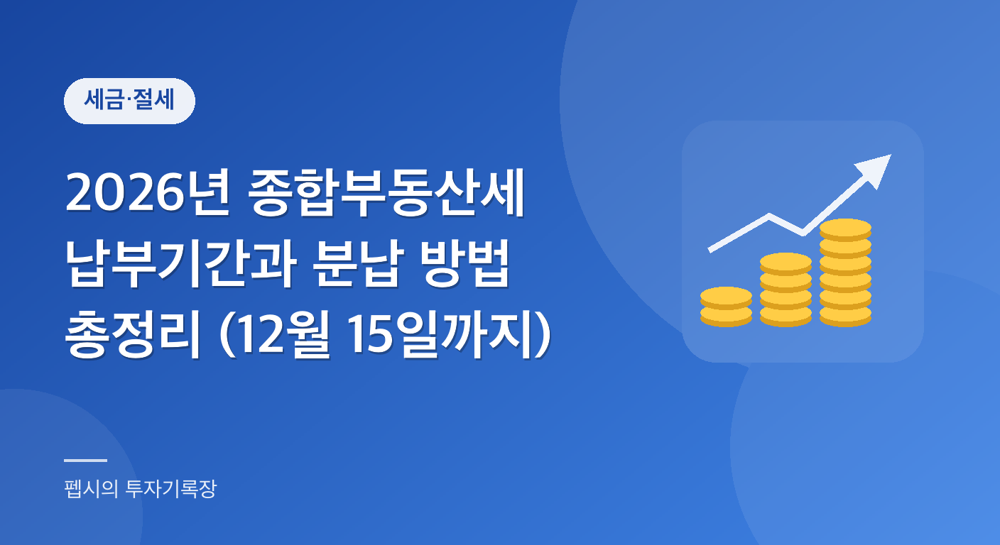

  

"12월에 종부세 고지서가 나온다는데, 내 집은 해당이 되는 걸까?" "세금이 한 번에 몇백만 원씩 나오면 어떻게 내지?" 11월 중순쯤 되면 뉴스에 종합부동산세 이야기가 나오기 시작하고, 집을 가진 사람들 사이에서도 걱정 섞인 대화가 오갑니다.

그래서 이 글에서는 올해(2026년 귀속분) 종합부동산세 납부를 앞두고 꼭 알아야 할 기간, 방법, 분납 한도, 세액 계산 구조를 국세청 안내 기준으로 차근차근 정리합니다.

글의 순서는 이렇습니다. 먼저 종부세가 누구에게 어떤 기준으로 매겨지는지 큰 그림을 보고, 12월에 실제로 해야 하는 일(고지서 확인과 납부)을 짚습니다. 그다음 세금이 부담될 때 쓸 수 있는 분납과 카드 납부, 1세대 1주택자의 세액공제와 납부유예를 설명하고, 마지막으로 많이들 오해하는 부분과 가상의 계산 예시, 자주 묻는 질문으로 마무리하겠습니다.

**📌 한눈에 보기 (2026년 기준)**

- 납부기간은 12월 1일~12월 15일이며, 기한이 토요일·공휴일이면 그다음 첫 평일입니다.
- 기본공제는 주택 9억 원(1세대 1주택자 12억 원), 종합합산토지 5억 원, 별도합산토지 80억 원입니다.
- 납부할 세액이 250만 원을 초과하면 기한이 지난 날부터 6개월 이내 분납이 가능합니다.
- 신용카드 납부는 고지(신고) 금액 1천만 원(농어촌특별세 포함)까지이고, 수수료는 신용카드 0.7%·체크카드 0.4%입니다.
- 농어촌특별세는 납부할 종합부동산세액의 20%가 함께 붙습니다.

**목차**

* TOC
{:toc}

## 종합부동산세, 어떤 세금일까

종합부동산세(종부세)는 매년 6월 1일(과세기준일) 현재 주택이나 토지를 가지고 있는 사람 가운데, 공시가격 합계가 일정 금액을 넘는 사람에게 부과되는 세금입니다.

국세청 안내에 따르면 종부세는 두 단계로 매겨집니다. 먼저 부동산이 있는 시·군·구에서 재산세를 부과하고, 그다음 납세자 주소지 관할 세무서가 재산세 과세 대상 가운데 공제금액을 넘는 부분에 대해 종부세를 부과하는 구조입니다.

그래서 종부세는 재산세와 따로 떼어서 생각하기보다 "재산세 위에 얹히는 세금"이라고 이해하면 쉽습니다.

기본공제 금액은 국세청 개요 페이지 기준으로 다음과 같습니다.

| 구분 | 공제금액(인별 공시가격 합계 기준) |
|---|---|
| 주택(부속토지 포함) | 9억 원 (1세대 1주택자는 12억 원) |
| 종합합산토지 | 5억 원 |
| 별도합산토지 | 80억 원 |

여기서 중요한 포인트가 있습니다. 공시가격 합계가 공제금액을 넘는 사람에게만 종부세가 나온다는 점입니다.

기준은 시세가 아니라 **공시가격**입니다. 1세대 1주택자는 12억 원까지 공제되기 때문에 공시가격 12억 원 이하의 1주택 보유자는 종부세 대상이 아닙니다.

또 법인이 가진 주택에는 2021년 귀속분부터 기본공제가 적용되지 않는다고 국세청이 안내하고 있습니다.

## 2026년 종합부동산세 납부기간과 고지서

### 납부기간과 고지서 받는 방법

종부세 납부기간은 매년 **12월 1일부터 12월 15일까지**입니다. 기한이 토요일이나 공휴일이면 그다음 첫 평일이 기한이 됩니다.

올해 12월 15일은 화요일이라 달력상으로는 그대로 15일이 마감일입니다. 이 요일은 달력으로 계산한 것이니, 고지서에 적힌 기한을 꼭 같이 확인하세요.

원칙적으로 종부세는 국세청이 세액을 계산해서 고지서를 보내는 방식입니다. 우편 고지서가 오기도 하고, 홈택스나 손택스, 모바일 전자고지로 확인하는 분들도 많습니다. 납세자가 스스로 계산해 신고하고 내는 신고납부도 선택할 수 있습니다.

고지서를 받았다면 납부서에 적힌 금액을 은행, 인터넷뱅킹, 홈택스, ATM 등으로 내면 됩니다.

이때 종부세와 함께 **농어촌특별세**가 붙습니다. 국세청은 농어촌특별세를 "납부할 종합부동산세액의 20%"라고 안내하고 있어서, 고지서 총액은 종부세 본세보다 항상 조금 더 큽니다. 고지서 금액을 보고 놀라지 않으려면 이 점을 미리 알아 두면 좋습니다.

### 합산배제와 추가 신고, 9월에 놓쳤다면

임대주택이나 미분양주택 등 일정 요건을 갖춘 주택·토지는 합산배제 신고를 하면 종부세 과세 대상에서 빠지거나 특례가 적용됩니다. 국세청 안내상 이 신청·신고 기간은 9월 16일부터 30일까지입니다.

이 기간을 놓쳤더라도 12월 1일부터 15일까지의 정정기 고지 신고 기간에 신고하는 길이 안내되어 있습니다. 해당될 수 있는 분은 고지서를 받자마자 확인해 보세요.

반대로 요건이 안 되는데 합산배제로 신고했다면 정정해야 한다는 점도 기억해 두셔야 합니다. 구체적인 요건은 개인마다 달라서 이 글에서는 자세히 다루지 않고, 국세청이나 세무서(126)에 문의하시길 권합니다.

## 세금은 이렇게 계산돼요

세액이 어떻게 나오는지 알면 고지서가 훨씬 덜 낯설어집니다. 국세청의 주택분 세액계산 흐름은 아래와 같습니다.

1. 보유한 주택의 공시가격을 모두 더한 뒤 공제금액(9억 원, 1세대 1주택자는 12억 원)을 뺍니다.
2. 그 결과에 공정시장가액비율 60%를 곱해 과세표준을 구합니다.
3. 과세표준 구간에 맞는 세율을 적용해 산출세액을 계산합니다.
4. 이미 낸 재산세 중 종부세 과세표준에 해당하는 부분은 공제합니다.
5. 1세대 1주택자는 세액공제를, 일정 한도를 넘는 세액은 세부담상한을 적용해 최종 납부할 세액이 나옵니다.

### 주택분 세율

세율은 국세청 세율 페이지 기준(2023년 이후 적용)으로 다음과 같습니다.

| 과세표준 | 개인 2주택 이하 | 개인 3주택 이상 |
|---|---|---|
| 3억 원 이하 | 0.5% | 0.5% |
| 6억 원 이하 | 0.7% | 0.7% |
| 12억 원 이하 | 1.0% | 1.0% |
| 25억 원 이하 | 1.3% | 2.0% |
| 50억 원 이하 | 1.5% | 3.0% |
| 94억 원 이하 | 2.0% | 4.0% |
| 94억 원 초과 | 2.7% | 5.0% |

법인 소유 주택은 2주택 이하 2.7%, 3주택 이상 5.0%의 단일세율이 적용된다고 안내되어 있습니다.

위 세율표는 누진 구조입니다. 과세표준이 6억 원이라고 해서 전체에 0.7%를 곱하는 게 아니라 구간별로 나눠 계산하는 방식(또는 누진공제액을 이용하는 방식)입니다.

### 1세대 1주택자 세액공제와 세부담상한

1세대 1주택자에게는 나이와 보유기간에 따른 세액공제가 있습니다. 국세청 안내 기준은 아래 표와 같습니다.

| 구분 | 공제율 |
|---|---|
| 나이 | 만 60세 이상 20%, 65세 이상 30%, 70세 이상 40% |
| 보유기간 | 5년 이상 20%, 10년 이상 40%, 15년 이상 50% |
| 합산 한도 | 두 공제를 합산할 수 있지만 한도는 80% |

또 세부담상한이라는 제도가 있어서, 전년도에 낸 재산세와 종부세 합계액의 150%를 넘는 세액은 부과하지 않습니다.

둘 다 "내가 해당되는지"가 중요한 부분입니다. 고지서에 이미 반영되어 있는지 항목을 살펴보는 습관을 들이면 좋습니다.

## 가상의 계산 예시로 감 잡아보기

아래는 이해를 돕기 위한 가상 예시입니다. 실제 세액은 재산세 공제, 세액공제, 세부담상한 등에 따라 달라지므로 참고만 해주세요.

### 예시 1. 1세대 1주택, 공시가격 15억 원

공시가격 15억 원에서 12억 원을 빼면 3억 원이고, 여기에 공정시장가액비율 60%를 곱하면 과세표준은 1억 8천만 원입니다. 3억 원 이하 구간이라 세율 0.5%를 적용하면 산출세액은 90만 원입니다.

여기서 재산세 공제액 등을 빼고 나면 실제 납부액은 이보다 줄어들 수 있습니다.

농어촌특별세는 납부할 종부세액의 20%라고 했으니, 종부세가 90만 원이라면 18만 원이 따로 붙는 식입니다. 이 정도 금액이면 분납 대상이 아니라서 한 번에 내면 됩니다.

### 예시 2. 2주택자, 공시가격 합계 18억 원

18억 원에서 9억 원을 빼면 9억 원, 60%를 곱한 과세표준은 5억 4천만 원입니다. 구간별로 나누어 계산하면 3억 원까지는 0.5%로 150만 원, 나머지 2억 4천만 원은 0.7%로 168만 원이라 산출세액은 약 318만 원입니다.

재산세 공제 전 금액이므로 실제 납부세액은 더 줄어들 수 있습니다.

만약 납부할 세액이 318만 원으로 확정됐다면 250만 원을 초과하니 분납 신청이 가능하고, 250만 원을 초과하는 68만 원까지 분납할 수 있습니다.

## 부담될 때 쓸 수 있는 분납과 카드 납부

### 분납 요건과 한도

종부세 납부가 부담스러울 때 가장 먼저 떠올릴 수 있는 제도가 분납입니다. 국세청 기준으로 납부할 세액이 **250만 원을 초과**하면 납부기한이 지난 날부터 6개월 이내에 나누어 낼 수 있습니다. 한도는 다음과 같습니다.

| 납부할 세액 | 분납 가능 금액 |
|---|---|
| 250만 원 이하 | 분납 불가(일시 납부) |
| 250만 원 초과 ~ 500만 원 이하 | 250만 원을 초과하는 금액 |
| 500만 원 초과 | 납부할 세액의 50% 이하 |

예를 들어 납부할 세액이 700만 원이라면 최대 350만 원까지 6개월 안에 나눠 낼 수 있습니다. 12월 15일까지는 나머지 350만 원 이상을 내야 한다는 뜻입니다.

이때 농어촌특별세는 종합부동산세의 분납 비율을 따라 같이 분납됩니다. 분납을 신청하는 방법과 서식, 홈택스에서의 절차는 고지서 안내문이나 국세청 안내에서 확인하세요.

**⚠️ 분납 신청은 납부기한 안에**

분납 신청은 납부기한 안에 해야 합니다. 기한을 넘기고 나서는 신청이 어렵습니다.

분납분도 납부기한 경과 후 6개월 이내에 정해진 금액을 내야 하며, 이 기한을 넘기면 가산세 문제가 생길 수 있습니다.

### 신용카드 납부

국세청 안내 기준으로 신용카드 납부는 고지(신고) 금액 1천만 원(농어촌특별세 포함)까지 가능합니다. 수수료는 신용카드 0.7%, 체크카드 0.4%이며 납세자가 부담합니다.

카드 혜택이나 무이자 할부 여부는 카드사마다 다르니 이 글에서는 따로 다루지 않습니다. 수수료율은 바뀔 수 있으므로 납부 전 공식 안내에서 다시 확인하시길 권합니다.

### 1세대 1주택자의 납부유예

1세대 1주택자의 경우 일정 요건을 충족하면 종부세 **납부유예**를 신청할 수 있습니다. 종합부동산세법 제20조의2에 근거한 제도입니다.

요건에는 나이, 보유기간, 소득, 세액이 관련되며 담보를 제공해야 하고 신청 기한이 별도로 있다는 점까지는 확인되었습니다. 다만 구체적인 기준 수치(나이·소득 기준액 등)는 이번에 공식 원문으로 직접 확인하지 못했기 때문에 숫자는 적지 않습니다.

신청 기한이 납부기한보다 며칠 앞서는 걸로 안내되고 있습니다. 해당될 수도 있다고 생각하는 분은 국세청 안내(126)나 관할 세무서에서 요건과 마감일을 꼭 먼저 확인해 보세요.

납부유예는 세금이 면제되는 게 아니라 **미뤄주는 제도**라는 점도 같이 기억해 두셔야 합니다.

## 많은 분들이 오해하는 부분

### 오해 1. "집값이 12억 원이 넘으면 무조건 종부세 대상이다?"

그렇지 않습니다. 기준은 시세가 아니라 공시가격이고, 1세대 1주택자는 공시가격 12억 원까지 공제됩니다. 시세가 15억 원이어도 공시가격이 12억 원 이하라면 대상이 아닐 수 있습니다.

반대로 다주택자는 공제금액이 9억 원이니 훨씬 낮은 기준에서 시작합니다.

### 오해 2. "고지서에 적힌 금액이 종부세 전부다?"

고지서에는 종부세 본세 외에 농어촌특별세가 함께 표시됩니다. 국세청 안내로는 종부세액의 20%입니다.

분납 한도를 계산할 때도 헷갈리기 쉽습니다. 분납 요건인 250만 원 초과 여부는 종부세 본세 기준이고 농특세는 분납 비율을 따라간다는 점이 국세청 FAQ에 안내되어 있습니다.

### 오해 3. "분납하면 이자가 붙는다?"

공식 페이지에서 분납 이자를 별도로 확인한 내용은 없어서 단정해서 말하기 어렵습니다.

다만 분납은 납부기한 경과 후 6개월 이내에 정해진 금액을 내야 하는 제도이므로, 이 기한을 넘기면 가산세 문제가 생길 수 있습니다. 분납분의 정확한 기한은 고지서와 분납 승인 안내에 적힌 날짜를 기준으로 하세요.

### 오해 4. "공시가격 합계가 같으면 세금도 같다?"

아닙니다. 주택 수(2주택 이하 vs 3주택 이상), 1세대 1주택 여부, 나이·보유기간 공제, 재산세 공제액, 세부담상한에 따라 최종 세액이 크게 달라질 수 있습니다.

위 예시처럼 같은 공시가격이라도 구조에 따라 천차만별입니다.

## 12월 전에 미리 해두면 좋은 준비

현실적으로 지금 시점에서 할 수 있는 건 크게 세 가지입니다. 아래 순서로 점검해 보세요.

1. 6월 1일 기준으로 어떤 주택을 얼마나 가지고 있었는지, 공시가격 합계가 공제금액을 넘는지 계산해 봅니다.
2. 12월 1일 이후 고지서(혹은 홈택스 조회)가 나오면 합산배제나 세액공제, 세부담상한이 제대로 반영됐는지 확인합니다.
3. 납부할 금액이 크다면 일시 납부로 갈지, 분납이나 카드 납부, 납부유예(해당 시)를 쓸지 미리 가계 계획을 짜 둡니다.

납부일 직전에 허둥대면 놓치는 부분이 생기기 쉽습니다. 기한(12월 15일)에서 며칠 여유를 두고 움직이시길 권합니다.

## 정리

- 종합부동산세 납부기간은 12월 1일부터 15일까지입니다.
- 납부할 세액이 250만 원을 넘으면 6개월 이내 분납이 가능합니다.
- 1세대 1주택자는 나이·보유기간 세액공제와 납부유예 제도가 따로 있습니다.
- 기준은 시세가 아닌 공시가격이며, 고지서에는 농어촌특별세(종부세액의 20%)가 함께 붙습니다.

세금은 모르면 억울하고 알면 대응할 수 있는 영역입니다. 고지서를 받기 전에 구조만 이해해 두셔도 한결 마음이 편해집니다.

이 글의 숫자는 2026년 11월 기준으로 국세청 안내 페이지에서 확인한 내용이지만, 매년 고지서와 개별 사정이 다르니 최종 확인은 꼭 공식 채널에서 해주세요.

## 자주 묻는 질문

**Q1. 종합부동산세 납부기간은 언제까지인가요?**

A1. 국세청 안내에 따르면 매년 12월 1일부터 12월 15일까지입니다. 기한이 토요일이나 공휴일이면 그다음 첫 평일이 기한입니다. 정확한 날짜는 고지서에 적힌 납부기한을 확인하세요.

**Q2. 종부세도 나눠서 낼 수 있나요?**

A2. 납부할 세액이 250만 원을 초과하면 납부기한이 지난 날부터 6개월 이내에 나눠서 낼 수 있습니다. 250만 원 초과 500만 원 이하는 250만 원을 초과하는 금액, 500만 원 초과는 세액의 50% 이하 금액을 분납할 수 있습니다. 농어촌특별세는 종합부동산세 분납 비율을 따라갑니다.

**Q3. 종부세를 신용카드로 낼 수 있나요?**

A3. 국세청 안내 기준으로 고지(신고) 금액 1천만 원(농어촌특별세 포함)까지 신용카드 납부가 가능하며, 수수료(신용카드 0.7%, 체크카드 0.4%)는 납세자가 부담합니다. 수수료율은 바뀔 수 있으니 납부 전 공식 안내를 확인하세요.

**Q4. 1세대 1주택자는 종부세 공제를 어떻게 받나요?**

A4. 공시가격에서 12억 원까지 기본공제가 적용되고, 여기에 더해 나이(60세 이상 20%, 65세 이상 30%, 70세 이상 40%)와 보유기간(5년 이상 20%, 10년 이상 40%, 15년 이상 50%)에 따른 세액공제가 있습니다. 두 공제를 합산할 수 있지만 한도는 80%입니다.

**Q5. 납부유예는 누구나 신청할 수 있나요?**

A5. 아닙니다. 1세대 1주택자 등 일정 요건을 갖춘 경우에 한해 담보를 제공하고 신청하는 제도입니다. 구체적인 나이·소득 기준과 신청 마감일은 공식 사이트에서 확인이 필요하니 국세청(126)이나 관할 세무서에 문의하세요.

## 참고 자료

- 국세청 종합부동산세 개요: https://www.nts.go.kr/nts/cm/cntnts/cntntsView.do?mi=40375&cntntsId=7733
- 국세청 종합부동산세 세액계산 흐름도: https://www.nts.go.kr/nts/cm/cntnts/cntntsView.do?cntntsId=7735&mi=2353
- 국세청 종합부동산세 세율: https://www.nts.go.kr/nts/cm/cntnts/cntntsView.do?mi=2354&cntntsId=7736
- 국세청 종합부동산세 납부기한: https://www.nts.go.kr/nts/cm/cntnts/cntntsView.do?mi=2352&cntntsId=7734
- 국세청 종합부동산세 납부 종합 안내: https://www.nts.go.kr/nts/cm/cntnts/cntntsView.do?mi=2356&cntntsId=7738
- 국세청 종합부동산세 궁금해요(FAQ): https://www.nts.go.kr/nts/cm/cntnts/cntntsView.do?mi=2357&cntntsId=7739
- 국가법령정보센터 종합부동산세법: https://www.law.go.kr

(2026년 11월 기준)

> 이 글은 일반적인 정보 제공을 위한 것으로, 개인 상황에 따라 적용이 다를 수 있습니다. 정확한 내용은 관련 기관에 확인하세요.
