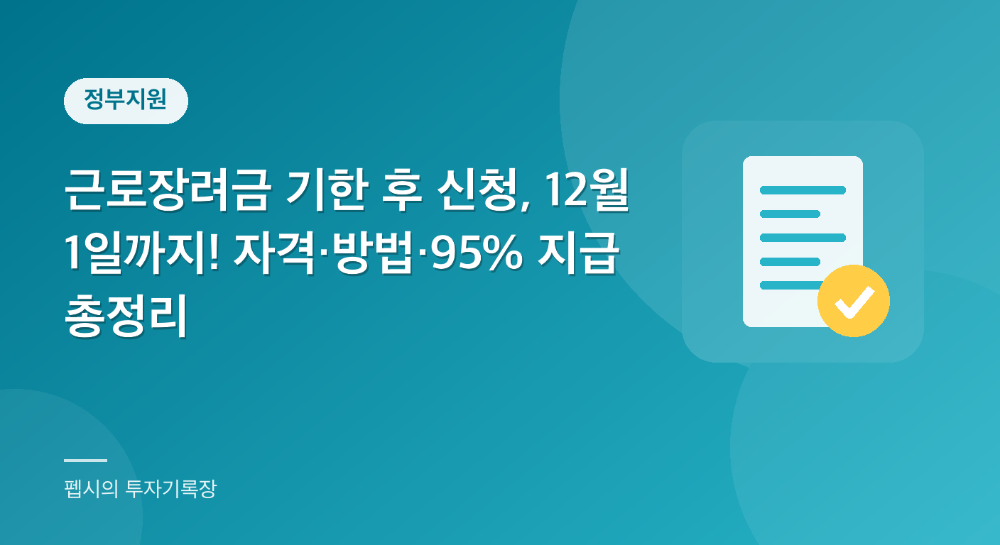

  

"5월에 안내문 문자가 왔던 것 같긴 한데... 그냥 넘겼다가 잊어버렸어요." 이런 경우가 적지 않습니다. 바쁘게 일하다 보면 국세청에서 온 안내 메시지는 스팸처럼 느껴지기도 하고, 나중에 봐야지 하다가 한 달이 훌쩍 지나가 버리기 쉽습니다.

그런데 이 안내문이 하필 수십만 원에서 많게는 수백만 원의 현금이 걸린 근로·자녀장려금 신청 안내였다면 얘기가 달라집니다.

다행히 아직 기회가 남아 있습니다. 5월 정기신청을 놓친 가구도 **기한 후 신청**으로 장려금을 받을 수 있고, 올해(2025년 귀속 소득분) 기한은 **2026년 12월 1일**까지입니다.

오늘이 11월 10일이니 마감까지 3주가 채 안 남았습니다. 이 글에서는 근로장려금 기한 후 신청이 무엇인지, 누가 대상인지, 얼마나 받을 수 있는지, 어떻게 신청하는지를 국세청 공식 안내를 기준으로 차근차근 정리해 보겠습니다.

**📌 한눈에 보기 (2026년 기준)**

- 기한 후 신청 기간은 2026년 6월 2일부터 12월 1일까지입니다.
- 산정된 장려금의 95%가 지급되며, 5%가 감액됩니다.
- 근로장려금 최대 지급액은 단독 165만 원, 홑벌이 285만 원, 맞벌이 330만 원입니다.
- 재산 합계액이 2억 4천만 원 미만이어야 하고, 1억 7천만 원 이상이면 50%만 지급됩니다.
- 지급은 신청일로부터 4개월 이내입니다.

**목차**

* TOC
{:toc}

## 근로장려금 기한 후 신청이란?

근로장려금과 자녀장려금은 일은 하지만 소득이 적은 가구에 국가가 현금을 지원해 주는 제도입니다. 원칙적으로는 해마다 5월 1일부터 6월 1일까지가 정기신청 기간이고, 이 기간 안에 신청해야 합니다.

2026년의 경우 2025년 한 해 동안의 소득을 기준으로 2026년 5월 1일~6월 1일에 정기신청을 받았습니다.

기한 후 신청은 말 그대로 이 정기신청 기한을 지나서 하는 신청입니다. 국세청 안내에 따르면 기한 후 신청 기간은 2026년 6월 2일부터 12월 1일까지입니다.

정기신청과 같은 소득·재산 요건을 적용받지만, 한 가지 차이가 있습니다. 늦게 신청한 만큼 산정된 장려금의 **95%만 지급**됩니다. 즉 5%가 감액됩니다.

**⚠️ 마감일 표기가 다른 곳이 있습니다**

국세상담센터의 일부 Q&A 페이지에는 기한 후 신청 기간 끝이 11월 30일로 표기된 곳도 있었습니다. 국세청 신청기간 안내 페이지와 11월 2일 보도자료는 12월 1일로 되어 있어 이 글에서는 12월 1일을 기준으로 씁니다.

막판에 몰려서 하다가 낭패 보지 않도록 가능하면 11월 안에 미리 신청해 두시는 것을 권합니다.

## 지급액은 얼마일까? 최대 금액과 95% 계산

근로장려금 최대 지급액은 가구 유형에 따라 다릅니다. 국세청 보도자료 기준으로 단독가구는 최대 165만 원, 홑벌이가구는 최대 285만 원, 맞벌이가구는 최대 330만 원이며 최소 지급액은 3만 원입니다.

자녀장려금은 부양자녀 1명당 최소 50만 원에서 최대 100만 원이 지급됩니다.

실제로 받는 금액은 소득 구간에 따라 최대금액보다 적을 수 있습니다. 이 금액을 먼저 계산한 뒤 기한 후 신청이면 여기에 95%를 곱해 지급하는 구조입니다.

아래는 이해를 돕기 위한 **가상의 계산 예시**입니다.

| 구분 | 정기신청 시 산정액(가상) | 기한 후 신청 시 지급액(95%) |
|---|---|---|
| 단독가구, 산정액 100만 원 | 100만 원 | 95만 원 |
| 홑벌이가구, 산정액 200만 원 | 200만 원 | 190만 원 |
| 홑벌이가구, 최대 산정액 285만 원 | 285만 원 | 약 270만 7,500원 |
| 맞벌이가구, 최대 산정액 330만 원 | 330만 원 | 313만 5,000원 |

예를 들어 홑벌이가구로 산정액이 200만 원이라면, 5%인 10만 원이 줄어든 190만 원을 받게 됩니다. 늦게 신청해서 생기는 손해가 10만 원이니 아깝긴 하지만, 아예 신청하지 않아 190만 원 전체를 놓치는 것에 비하면 훨씬 낫습니다.

위 표의 산정액은 어디까지나 가상의 숫자이고, 본인의 실제 금액은 홈택스에서 신청 후 심사를 거쳐 확정됩니다.

## 신청 자격: 소득·재산·가구 요건

기한 후 신청이라고 해서 자격이 느슨해지는 것은 아닙니다. 정기신청과 똑같은 요건을 충족해야 합니다. 국세청이 안내하는 2025년 귀속 기준은 다음과 같습니다.

| 구분 | 단독가구 | 홑벌이가구 | 맞벌이가구 |
|---|---|---|---|
| 근로장려금 소득요건(부부합산 총소득) | 2,200만 원 미만 | 3,200만 원 미만 | 4,400만 원 미만 |
| 자녀장려금 소득요건 | 해당 없음 | 7,000만 원 미만 | 7,000만 원 미만 |

### 가구 유형은 어떻게 나뉘나

가구 유형은 배우자와 부양가족 유무, 총급여액 등에 따라 나뉩니다.

- 단독가구: 배우자, 18세 미만 부양자녀, 70세 이상 직계존속이 없는 가구
- 홑벌이가구: 배우자의 총급여액 등이 300만 원 미만인 가구이거나, 배우자가 없더라도 18세 미만 부양자녀 또는 70세 이상 직계존속이 있는 가구
- 맞벌이가구: 본인과 배우자 각각의 총급여액 등이 300만 원 이상인 가구

### 재산 요건

소득만 맞는다고 끝이 아닙니다. 2025년 6월 1일 현재 가구원 모두가 보유한 재산 합계액이 2억 4천만 원 미만이어야 합니다.

| 재산 합계액 | 지급 |
|---|---|
| 1억 7천만 원 미만 | 산정액 기준 |
| 1억 7천만 원 이상 2억 4천만 원 미만 | 산정액의 50%만 지급 |
| 2억 4천만 원 이상 | 지급 대상 제외 |

재산을 계산할 때는 부채를 빼 주지 않습니다. 대출이 많아도 집값 그대로 재산으로 잡힌다는 뜻입니다.

전세로 살고 있다면 간주전세금(기준시가의 55%)과 실제 전세금 중 작은 금액으로 평가합니다. 부모 등 직계존비속에게서 빌린 집은 간주전세금(주택가액의 100%)으로 평가합니다.

### 신청 제외 대상

다음에 해당하면 원칙적으로 신청 대상에서 제외됩니다.

- 2025년 12월 31일 현재 대한민국 국적이 없는 사람 (다만 대한민국 국적자와 혼인했거나 대한민국 국적의 부양자녀가 있다면 신청 가능)
- 2025년 중 다른 거주자의 부양자녀였던 사람
- 전문직 사업자 (배우자 포함)
- 근로장려금에 한해, 2025년 12월 31일 현재 계속 근무 중인 상용근로자로서 월평균 근로소득이 500만 원 이상인 사람 (배우자 포함)

## 기한 후 신청 방법 (단계별)

국세청 안내를 기준으로 신청 경로는 크게 네 가지입니다. 세무서를 직접 찾아가지 않아도 됩니다.

1. 홈택스(PC·모바일): '장려금·연말정산·전자기부금' 메뉴에서 '근로·자녀장려금 신청하기'를 선택합니다.
2. 안내문 QR코드·모바일 안내문: 종이 안내문의 QR코드를 스캔하거나 모바일 안내문에서 신청 화면으로 넘어갑니다.
3. ARS 전화(1544-9944): 서비스 시간은 오전 6시부터 자정까지입니다.
4. 신청대리: 장려금 상담센터(1566-3636) 상담사나 세무서 직원이 대신 신청합니다.

### 홈택스(PC·모바일)

홈택스에서는 본인 확인 방법이 안내문 유무에 따라 다릅니다.

- 안내문을 받은 분: 주민등록번호 뒤 7자리와 안내문의 개별인증번호 8자리로 로그인
- 안내문이 없는 분: 공동인증서·금융인증서 또는 간편인증으로 본인 확인

본인 확인 후에는 신청 요건을 확인하고 연락처와 환급받을 계좌를 등록하는 순서로 진행됩니다.

### 안내문 QR코드·모바일 안내문

종이 안내문을 받았다면 QR코드를 스마트폰으로 스캔하면 됩니다. 국민비서, 네이버 전자문서, KT 알림문자 같은 모바일 안내문에서도 바로 신청 화면으로 넘어갈 수 있습니다.

개별인증번호가 자동 입력되어 별도 로그인 없이 신청할 수 있어서 가장 간단한 방법입니다.

### ARS 전화(1544-9944)

전화로 주민등록번호 13자리를 입력하고, 문자로 받은 8자리 개별인증번호를 입력하는 방식입니다. 컴퓨터나 스마트폰이 익숙하지 않은 부모님 세대에게 권할 만한 방법입니다.

### 신청대리

평일 오전 9시부터 오후 6시까지 장려금 상담센터(1566-3636) 상담사나 세무서 직원이 대신 신청해 주는 방법도 있습니다. 이때는 안내를 받은 본인의 동의가 필요합니다.

## 언제 입금될까?

국세청 안내에 따르면 기한 후 신청분은 **신청일로부터 4개월 이내**에 지급됩니다. 5월 정기신청분이 9월 말까지(올해는 8월 27일 지급 예정으로 앞당겨 안내됨) 지급되는 것과 달리 개별 심사를 거치므로 시간이 조금 더 걸립니다.

홈택스의 '근로장려금 정기/반기 신청 → 심사진행상황 조회' 메뉴에서 심사 진행 상황을 확인할 수 있습니다. 신청 후에는 한 번씩 들어가 보시면 좋습니다.

## 많은 분들이 오해하는 부분

### 오해 1. "기한이 지났으니 이제 못 받는다"

가장 흔한 오해입니다. 정기신청 기한이 지났어도 12월 1일까지는 기한 후 신청이 가능합니다. 신청 자체가 막히는 것이 아니라 5% 감액이 붙을 뿐입니다.

### 오해 2. "기한 후 신청하면 90%만 준다"

예전 자료에는 90% 지급으로 적힌 글이 인터넷에 아직 남아 있습니다. 하지만 국세청의 최근 안내는 산정액의 95%를 지급한다고 되어 있습니다.

오래된 블로그 글을 보고 판단하면 안 되는 대표적인 사례입니다.

### 오해 3. "안내문을 못 받았으니 대상이 아니다"

안내문은 국세청이 대상일 가능성이 높은 가구에 보내는 것일 뿐, 안내문을 받지 못했다고 해서 자격이 없는 것은 아닙니다. 홈택스에서 본인 인증을 하고 직접 신청 화면에 들어가 요건을 확인해 볼 수 있습니다.

### 오해 4. "소득만 낮으면 된다"

재산 요건이 따로 있습니다. 소득이 낮아도 가구원 합산 재산이 2억 4천만 원 이상이면 받을 수 없고, 1억 7천만 원 이상이면 절반으로 줄어듭니다. 부채를 빼 주지 않는다는 점도 헷갈리기 쉽습니다.

### 오해 5. "받았다가 나중에 문제 생기면 그냥 돌려주면 된다"

허위로 신청하거나 요건을 잘못 적어 받은 장려금은 환수되고, 1일 22/100,000의 가산세가 부과됩니다. 고의 또는 중과실이면 2년, 사기나 부정한 행위면 5년간 장려금 지급이 제한됩니다.

또 체납액이 있는 경우에는 환급금의 30%를 한도로 체납액에 충당될 수 있습니다. 요건이 애매하다면 임의로 판단하지 말고 126이나 장려금 상담센터에 먼저 확인하는 것이 안전합니다.

## 이번에 놓쳤다면 다음엔 이렇게

이번 근로장려금 기한 후 신청을 마쳤다면 다음번에는 같은 일이 반복되지 않도록 미리 대비해 두면 좋습니다.

국세청은 신청 기간에 **자동신청**에 사전 동의하면 이후 2년간 안내 대상이 될 때 자동으로 신청되는 제도를 운영합니다. 소득·재산 요건을 모두 충족한 경우에만 적용된다는 점은 알아 두셔야 합니다.

또 근로소득만 있는 분은 반기신청도 선택할 수 있습니다. 2026년 반기신청은 상반기 소득분이 9월 1일~15일, 하반기 소득분이 2027년 3월 1일~15일입니다.

올해 상반기분은 이미 마감되었고, 사업소득이나 종교인소득이 있는 분은 반기신청이 아니라 정기신청을 해야 합니다. 앞으로의 제도 변경은 확정되기 전에는 단정하기 어려우니, 신청 시기가 다가오면 국세청 공지를 다시 확인하세요.

## 정리

- 근로장려금 기한 후 신청은 2026년 12월 1일까지 홈택스, 모바일 안내문, ARS, 상담센터 대리신청으로 할 수 있습니다.
- 산정액의 95%가 신청일로부터 4개월 이내에 지급됩니다.
- 소득·재산 요건은 정기신청과 같습니다.
- 재산 합계액이 1억 7천만 원 이상이면 50%만, 2억 4천만 원 이상이면 지급 대상에서 제외됩니다.

5% 감액이 아쉽긴 해도 안 받는 것보다는 훨씬 이득이니, 혹시 5월에 놓친 기억이 있다면 오늘 한 번 홈택스를 열어 요건을 확인해 보시길 권합니다. 주변에 소득이 낮은 가구, 부모님, 프리랜서 친구가 있다면 이 소식을 한번 전해 주셔도 좋겠습니다.

국세청을 사칭한 문자도 종종 있으니, 링크를 누르기보다 홈택스 공식 사이트나 앱으로 직접 접속하는 습관도 잊지 마세요.

## 자주 묻는 질문

**Q1. 근로장려금 기한 후 신청은 언제까지 할 수 있나요?**

A1. 국세청 안내 기준으로 2025년 귀속분 기한 후 신청 기간은 2026년 6월 2일부터 12월 1일까지입니다. 일부 안내에 11월 30일로 표기된 곳도 있으니 가급적 11월 안에 미리 신청하는 것이 안전합니다.

**Q2. 기한 후 신청하면 얼마가 감액되나요?**

A2. 산정된 장려금의 95%가 지급됩니다. 5%가 감액되는 것이며, 소득·재산 요건은 정기신청과 같습니다.

**Q3. 지급은 언제쯤 되나요?**

A3. 기한 후 신청분은 신청일로부터 4개월 이내에 지급됩니다. 심사 진행 상황은 홈택스에서 조회할 수 있습니다.

**Q4. 안내문을 못 받았는데 신청할 수 있나요? 문의는 어디로 하나요?**

A4. 안내문이 없어도 홈택스에서 공동·금융인증서 또는 간편인증으로 본인 인증 후 신청할 수 있습니다. 다만 소득·재산 요건은 직접 충족해야 합니다. 문의는 장려금 상담센터 1566-3636(평일 9시~18시) 또는 국세청 126으로 할 수 있습니다.

**Q5. 재산이 2억 원 정도 있는데 받을 수 있나요?**

A5. 2025년 6월 1일 기준 가구원 재산 합계액이 1억 7천만 원 이상 2억 4천만 원 미만이면 산정액의 50%만 지급되고, 2억 4천만 원 이상이면 지급 대상에서 제외됩니다. 부채는 차감하지 않습니다.

## 참고 자료

- 국세청 근로·자녀장려금 신청기간 및 방법: https://www.nts.go.kr/nts/cm/cntnts/cntntsView.do?cntntsId=238977&mi=40397
- 국세청 근로·자녀장려금 신청자격: https://www.nts.go.kr/nts/cm/cntnts/cntntsView.do?mi=2452&cntntsId=7783
- 국세청 근로·자녀장려금 심사 및 지급: https://www.nts.go.kr/nts/cm/cntnts/cntntsView.do?mi=2453&cntntsId=7784
- 국세청 보도자료(정기분 근로·자녀장려금 안내, 2026.4.30.): https://www.nts.go.kr/nts/na/ntt/selectNttInfo.do?mi=2201&bbsId=1028&nttSn=1350768
- 국세청 보도자료 목록(「5월에 놓친 근로·자녀장려금, 12.1.까지 꼭 신청」, 2026.11.2.): https://www.nts.go.kr/nts/na/ntt/selectNttList.do?mi=2201&bbsId=1028
- 홈택스: https://www.hometax.go.kr

2026년 11월 기준 (2025년 귀속 소득분 기준)

> 이 글은 일반적인 정보 제공을 위한 것으로, 개인 상황에 따라 적용이 다를 수 있습니다. 정확한 내용은 관련 기관에 확인하세요.
