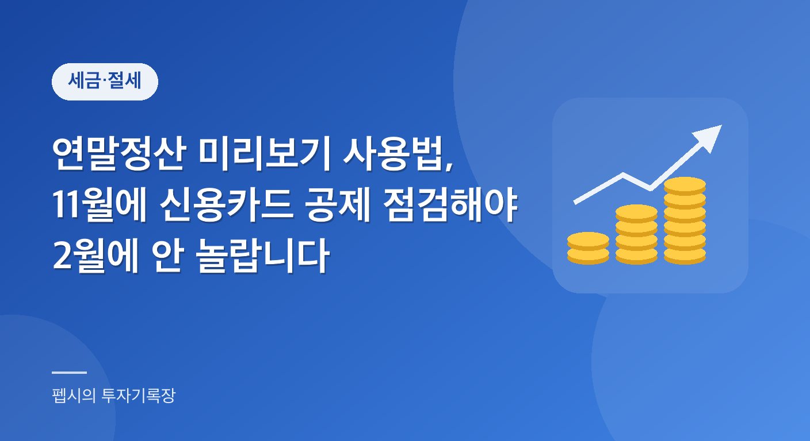

  

"올해는 카드도 열심히 썼는데, 왜 매번 연말정산 때 환급이 쥐꼬리일까?" 한 번쯤 이런 생각 해보신 적 있지 않나요? 반대로 1월 월급명세서를 열었다가 "추가 납부"라는 글자를 보고 당황한 분도 계실 겁니다. 저도 주변에서 이런 이야기를 정말 자주 듣습니다. 그런데 이런 놀람의 상당수는 **11월에 미리 점검만 해뒀어도** 피할 수 있습니다. 12월 31일까지 아직 한 달 반쯤 남아 있으니, 지출 방향을 조금이라도 바꿀 수 있는 시간이거든요.

오늘은 그 점검 도구인 **연말정산 미리보기** 서비스를 중심으로 정리해 보려고 합니다. 어디로 들어가서 무엇을 보는지, 그리고 미리보기 결과를 보고 가장 많이들 고민하는 신용카드·체크카드 공제는 어떤 구조로 계산되는지를 국세청 안내 자료를 기준으로 풀어 보겠습니다. 숫자는 제가 공식 페이지에서 직접 확인한 것만 쓰고, 확인하지 못한 것은 "공식 사이트에서 확인 필요"라고 분명히 적어 두겠습니다.

## 연말정산 미리보기, 정확히 뭘 해주는 서비스인가

연말정산 미리보기는 국세청이 홈택스에서 근로자에게 제공하는 **예상 세액 계산 서비스**입니다. 연말정산 간소화 서비스처럼 실제 공제 자료를 모아주는 것이 아니라, "지금까지의 카드 사용액과 지난해 공제 내역을 바탕으로 올해 정산 결과가 대략 어떻게 나올지" 미리 보여주는 도구라고 보시면 됩니다.

가장 최근에 공식 확인되는 자료는 국세청이 2025년 11월 10일에 낸 안내(2025년 귀속 연말정산 미리보기 서비스 개통)입니다. 이 안내에 따르면 서비스는 2025년 1~9월 신용·체크카드 등 사용액과 지난 연말정산 때 신고한 공제 금액을 이용해 2026년 1월 연말정산 예상 세액을 미리 계산해 줍니다. 즉 **카드 사용액은 자동으로 불러오고, 나머지 공제 항목은 지난해 신고 내용을 기본값으로 쓰는** 방식입니다.

이용 경로는 같은 안내 기준으로 다음과 같습니다. 홈택스에 로그인한 뒤 `장려금·연말정산·기부금` 메뉴로 들어가 `편리한 연말정산`, 그다음 `연말정산 미리보기` 순서입니다. 홈택스 화면 구성은 바뀔 수 있으니, 메뉴 이름이 조금 달라 보이면 검색창에 "연말정산 미리보기"를 입력해 보시면 됩니다.

여기서 한 가지 짚고 갈 점이 있습니다. 위 내용은 **2025년 귀속(2026년 1월 정산)** 기준 안내입니다. 올해 2026년 귀속분(2027년 1월 정산)의 개통일과 이용 기간은 제가 국세청 공식 자료에서 확인하지 못했습니다. 이전 해에 11월 초·중순쯤 열렸으니 올해도 비슷한 시기일 가능성이 있지만, 정확한 날짜는 홈택스 공지사항이나 국세청 보도자료에서 확인하셔야 합니다. 이 글에서는 날짜를 단정하지 않겠습니다.

### 미리보기에서 볼 수 있는 것 두 가지

국세청 안내에 나온 주요 기능은 크게 두 가지입니다.

첫째는 **최근 3년 추이 비교**입니다. 총급여, 주요 항목별 공제금액, 결정세액이 해마다 어떻게 늘고 줄었는지 그래프로 비교해 줍니다. "작년엔 환급이었는데 올해는 왜 줄었지?"의 원인이 총급여가 올라서인지, 의료비·교육비 같은 특정 공제가 줄어서인지 한눈에 보입니다.

둘째는 **수정 계산**입니다. 올해 연봉과 10월 이후 카드 지출 예상액을 직접 넣고, 주택자금·보험료·의료비·교육비 등 공제 항목별 예상 지출액도 입력해서 공제액을 다시 계산해 볼 수 있습니다. "남은 두 달 동안 체크카드를 이만큼 쓰면 어떻게 될까?" 같은 가정을 해볼 수 있다는 점이 가장 쓸모 있습니다.

## 많이들 오해하는 것들

미리보기 결과를 보고 나서 흔히 벌어지는 오해가 몇 가지 있어서, 본격적인 계산 전에 바로잡고 가겠습니다.

**오해 1. 미리보기에 나온 금액이 곧 내 환급액이다?** 아닙니다. 국세청 안내에도 연봉이나 지출이 변동하면 실제 연말정산 결과가 달라질 수 있다고 되어 있습니다. 미리보기는 9월까지의 카드 사용액과 지난해 공제 기준으로 만든 **추정치**입니다. 부양가족 변동, 중간에 낸 월세, 기부금 같은 항목은 반영이 불완전할 수 있으니 방향성을 보는 용도로 쓰세요.

**오해 2. 카드를 많이 쓰면 그만큼 환급이 늘어난다?** 신용카드 등 사용금액 소득공제는 총급여의 **25%를 초과한 금액부터** 공제 대상이 됩니다. 총급여 25%까지는 아무리 써도 공제가 0입니다. 그리고 초과분에 곱하는 공제율도 신용카드는 15% 수준이라, 공제를 받자고 쓸데없이 소비를 늘리면 손해가 훨씬 큽니다. 쓴 돈의 대부분은 공제로 돌아오지 않습니다.

**오해 3. 간소화 자료에 뜨면 전부 공제된다?** 국세청 간소화 서비스 안내에도 "제공 자료는 발급기관이 제출한 그대로이므로 공제 요건 충족 여부는 근로자 본인이 판단해야 한다"고 적혀 있습니다. 예를 들어 안경 구매내역은 시력보정용만 공제 대상이고 선글라스는 아닙니다. 반대로 미취학 아동 학원비, 월세, 일부 기부금 영수증처럼 자료가 안 뜨는 항목도 있어서 발급처에서 직접 받아 회사에 내야 할 수 있습니다.

**오해 4. 소득기준 초과 부양가족 명단에 없으면 안심해도 된다?** 이 명단은 2025년 10월까지 신고된 사업·기타·퇴직·양도소득과 근로소득(상반기까지)을 기준으로 만든 것입니다. 국세청도 명단에 없다고 자동으로 공제되는 것이 아니며, 11~12월 소득까지 포함한 연간 소득을 확인해야 한다고 안내합니다. 부모님이나 배우자의 연말 소득 때문에 기본공제 자격이 사라지는 경우가 실제로 있습니다.

## 신용카드·체크카드 공제, 구조부터 이해하기

미리보기를 열어 보면 가장 먼저 눈에 띄는 것이 카드 사용액일 겁니다. 이 부분의 구조를 국세청 '신용카드 등 사용금액 소득공제' 안내 페이지 기준으로 정리하면 이렇습니다.

공제 대상 금액은 신용카드, 직불카드, 선불카드, 현금영수증 사용액 중 **총급여의 25%(최저사용금액)를 초과한 부분**입니다. 여기에 지출 수단별 공제율을 곱한 것이 소득공제액이고, 총급여 구간별 한도가 있습니다.

| 구분 | 공제율 / 한도 (국세청 안내 기준) |
|---|---|
| 최저사용금액 | 총급여의 25% (이 금액까지는 공제 없음) |
| 신용카드 | 15% |
| 직불카드·선불카드·현금영수증 | 30% |
| 문화체육 사용분(총급여 7천만 원 이하자) | 30% |
| 전통시장 사용분 | 40% |
| 대중교통 이용분 | 40% |
| 기본 공제한도 | 총급여 7천만 원 이하 300만 원 / 7천만 원 초과 250만 원 |
| 한도 초과 추가공제 | 전통시장·대중교통·문화체육 사용분 공제액 범위 안에서 추가. 연간 추가 한도는 총급여 7천만 원 이하 300만 원, 초과 200만 원 |

표에서 보듯이 같은 돈을 써도 신용카드는 15%, 체크카드와 현금영수증은 30%, 전통시장과 대중교통은 40%로 공제율이 두 배 이상 차이가 납니다. 이 차이가 "연말정산엔 체크카드가 유리하다"는 말이 나오는 이유입니다.

다만 **지금 설명한 한도와 공제율은 국세청 안내 페이지에 표기된 현행 기준**입니다. 올해 8월에 정부가 발표한 세제개편안에 이 공제 관련 변경안이 포함됐다는 보도를 봤는데, 국회 통과 여부와 적용 시기는 제가 공식 자료로 확인하지 못했습니다. 2026년 귀속 연말정산에 변경이 적용되는지는 국세청·기획재정부 발표를 꼭 따로 확인해 주세요.

### 25%를 넘기기 전까지는 어느 카드를 쓰든 똑같다?

계산 순서가 조금 헷갈리는 부분인데, 일반적으로 최저사용금액(총급여 25%)은 신용카드 사용액부터 먼저 채워 나간다고 알려져 있고, 이 차감 순서의 세부 규정은 홈택스 안내나 법령에서 한 번 더 확인하시길 권합니다. 이 순서를 전제로 하면 "총급여 25%까지는 신용카드로 쓰고, 그 이후 사용분은 체크카드·현금영수증으로 돌리는 방식"이 왜 거론되는지 이해가 됩니다. 아래 가상의 예시로 보겠습니다.

### 가상의 계산 예시

아래는 이해를 돕기 위해 제가 임의로 만든 숫자입니다. 실제 개인의 사례가 아닙니다.

- 총급여 5,000만 원 (최저사용금액 = 5,000만 원 × 25% = 1,250만 원)
- 연간 카드 사용 총액 1,600만 원, 전통시장·대중교통·문화체육 사용 없음으로 가정
- 한계 소득세율 15%라고 가정(지방소득세는 제외)

**경우 A. 1,600만 원 전부 신용카드**
- 공제 대상 금액: 1,600만 − 1,250만 = 350만 원
- 소득공제액: 350만 × 15% = 52.5만 원
- 세금 절감 효과: 52.5만 × 15% ≒ 약 7.9만 원

**경우 B. 신용카드 1,000만 원 + 체크카드 600만 원**
- 최저사용금액 1,250만 원 중 신용카드 1,000만 원이 먼저 차감되고, 나머지 250만 원은 체크카드에서 차감된다고 가정
- 남은 체크카드 사용액: 600만 − 250만 = 350만 원
- 소득공제액: 350만 × 30% = 105만 원
- 세금 절감 효과: 105만 × 15% ≒ 약 15.75만 원

같은 1,600만 원을 써도 25%를 넘긴 이후 구간이 어떤 수단이었느냐에 따라 공제액이 두 배 차이가 납니다. 다만 이 예시는 어디까지나 **지출 수단만 바꾼 경우**입니다. 카드 혜택(할인, 적립)을 포기하게 될 수 있으니 공제 효과와 카드 혜택을 비교해서 판단하셔야 하고, 특정 카드나 상품을 권하는 글은 아니라는 점 이해해 주세요.

### 한도에 가까운 분들은 추가공제를 확인

총급여가 높고 카드 사용이 많아 기본 한도(7천만 원 이하 300만 원, 초과 250만 원)에 이미 닿을 것 같다면, 전통시장·대중교통·문화체육(도서·공연 등) 사용분은 한도를 넘어도 추가공제가 가능합니다. 국세청 안내에 따르면 한도를 넘는 금액과 이들 항목의 공제액 중 작거나 같은 금액을 추가로 공제하고, 연간 추가 한도는 총급여 7천만 원 이하 300만 원, 초과 200만 원입니다. 반대로 한도에 한참 못 미치는 분들은 이 부분을 신경 쓰실 필요가 거의 없습니다.

## 카드 공제가 안 되는 항목 챙기기

국세청 안내 자료(미리보기 서비스 소개)에 따르면 신용카드 소득공제가 안 되는 항목으로 자동차 구입, 보험료·공과금 납부, 대학등록금, 상품권 구입비, 면세점 지출분, 월세액 세액공제를 받은 월세액이 나와 있습니다. 카드 사용액이 많아 보여도 이런 항목이 섞여 있으면 실제 공제 대상 금액은 줄어듭니다. 특히 **월세를 카드로 내면서 월세 세액공제도 받는 경우**는 이중으로 공제받을 수 없다는 점을 기억해 두세요.

또 하나, 최근에 새로 생긴 항목이 있습니다. 2026년 1월 14일 국세청 보도자료에 따르면 연말정산 간소화 서비스가 제공하는 공제 증명자료가 기존 42종에서 45종으로 늘었고, 새로 추가된 3종 중 하나가 **체육시설 이용료**입니다. 2025년 7월 1일 이후 이용분이 대상이고, 신용카드 등 문화체육 사용분으로 소득공제를 받을 수 있으며 공제율은 30%입니다. 국세청 신용카드 소득공제 안내 페이지에도 수영장·체력단련장 시설이용료를 공제대상금액에 추가한다고 나와 있습니다. 다만 강습비·회원권 비용처럼 시설이용료와 직접 관련 없는 비용은 제외되고, 구분이 안 되면 전체 금액의 50%만 대상으로 본다는 기준이 있으니 영수증을 확인해 두시면 좋습니다.

## 미리보기 결과를 본 뒤, 12월까지 해볼 수 있는 점검

미리보기를 돌려보고 나면 "그래서 뭘 해야 하지?"가 남죠. 제가 보기엔 순서가 있습니다.

먼저 **총급여 25% 선을 넘었는지**부터 보세요. 아직 못 넘었다면 남은 기간의 카드 사용이 공제로 직결되지 않으니 억지로 지출을 몰아 쓸 이유가 없습니다. 이미 넘었다면 그 이후 지출의 수단이 공제율에 영향을 주니 앞의 표를 참고해 판단하면 됩니다.

다음으로 **부양가족 소득 요건**입니다. 간소화 안내에서 소득금액 100만 원 초과(근로소득만 있으면 총급여 500만 원 초과)면 소득 기준을 넘는 것으로 본다고 했습니다. 부모님이나 배우자가 연말에 아르바이트, 퇴직금, 양도 등으로 기준을 넘길 상황이라면 지금 확인해 두는 게 낫습니다. 이 기준은 2026년 1월 정산(2025년 귀속) 안내에 표기된 숫자이고, 2026년 귀속 기준은 개정 여부를 공식 자료에서 확인하셔야 합니다.

마지막으로 **연말에 서류를 따로 챙겨야 하는 항목**을 체크하세요. 앞에서 말한 것처럼 월세, 기부금 영수증, 미취학 아동 학원비 등은 간소화에서 안 뜰 수 있습니다. 1월에 부랴부랴 발급처를 찾는 것보다 12월에 미리 받아 두는 편이 훨씬 편합니다.

## 2026년 1월 연말정산 일정으로 보는 다음 일정 감 잡기

참고로 직전 연말정산 일정을 보면 감이 옵니다. 국세청 보도자료(2026년 1월 14일)에 따르면 간소화 서비스는 2026년 1월 15일에 개통됐고, 최종 확정자료는 1월 20일부터 제공됐습니다. 홈택스 경로는 `장려금·연말정산·기부금 → 연말정산간소화 → 소득·세액공제 자료 조회`였고, 조회되지 않는 의료비 신고센터와 부양가족 자료제공 동의 메뉴도 같은 곳에 있었습니다. 국세상담센터 126번에서는 AI 상담과 생성형 AI 챗봇 시범 상담도 제공됐습니다. 이는 **지난 정산의 일정**이므로, 다음 정산(2027년 1월 예상) 일정은 반드시 새 공지를 확인하세요.

## 마무리하며

정리하면 연말정산 미리보기는 "환급액 예언기"가 아니라 **남은 두 달의 방향을 정하게 도와주는 계기판**에 가깝습니다. 홈택스에서 예상 세액을 확인하고, 총급여 25% 선 도달 여부, 카드 공제율 구조, 부양가족 소득 요건, 별도 서류 항목 이 네 가지만 점검해 두셔도 1월에 훨씬 편하게 정산하실 수 있을 겁니다. 그리고 세법은 해마다 바뀔 수 있으니, 올해 귀속분에서 달라지는 부분은 공식 발표로 한 번 더 확인하는 습관이 중요합니다.

## 자주 묻는 질문

**Q1. 연말정산 미리보기는 누구나 쓸 수 있나요?**

A. 홈택스에 로그인해서 이용하는 서비스이며, 안내 자료상 카드 사용액과 지난 연말정산 신고 내용을 바탕으로 계산합니다. 대상 범위와 올해(2026년 귀속) 개통 일정은 제가 공식 자료로 확인하지 못했으므로 홈택스 공지를 확인해 주세요.

**Q2. 미리보기에서 나온 환급액과 실제 환급액이 다를 수 있나요?**

A. 네, 다를 수 있습니다. 국세청 안내에서도 연봉이나 지출이 변동하면 실제 결과가 달라질 수 있다고 밝혔습니다. 10월 이후 지출, 부양가족 변동, 별도로 제출하는 서류 등이 반영되기 때문입니다.

**Q3. 신용카드와 체크카드 중 무엇이 유리한가요?**

A. 국세청 안내 기준 공제율은 신용카드 15%, 체크카드·현금영수증 30%입니다. 다만 총급여 25%를 넘긴 금액에만 적용되고, 카드 혜택과의 비교도 필요합니다. 어느 쪽을 쓰라고 권하는 것은 아니며, 본인의 사용 패턴에 맞춰 판단하세요.

**Q4. 신용카드 공제가 안 되는 지출도 있나요?**

A. 국세청 안내에 자동차 구입, 보험료·공과금 납부, 대학등록금, 상품권 구입비, 면세점 지출분, 월세액 세액공제를 받은 월세액이 공제 제외 항목으로 소개되어 있습니다.

**Q5. 올해 세법이 바뀌어서 공제 한도가 달라질 수도 있나요?**

A. 가능성이 있습니다. 세제개편안이 발표됐다는 보도가 있으나 국회 확정 여부와 적용 시기는 공식 자료로 확인하지 못했습니다. 국세청, 기획재정부 발표를 확인하세요.

## 참고 자료

- 국세청, 신용카드 등 사용금액 소득공제(발급·수취 시 혜택): https://www.nts.go.kr/nts/cm/cntnts/cntntsView.do?mi=2469&cntntsId=7794 (2026년 11월 기준)
- 정책브리핑(국세청), 2025년 귀속 연말정산 미리보기 서비스 개통: https://www.korea.kr/news/policyNewsView.do?newsId=148954467 (2026년 11월 기준)
- 국세청 보도자료, 연말정산 간소화 서비스 1월 15일 개통(2026.1.14.): https://www.nts.go.kr/nts/na/ntt/selectNttInfo.do?mi=2201&bbsId=1028&nttSn=1347979 (2026년 11월 기준)
- 국세청 홈택스: https://www.hometax.go.kr (2026년 11월 기준)

> 이 글은 일반적인 정보 제공을 위한 것으로, 개인 상황에 따라 적용이 다를 수 있습니다. 정확한 내용은 관련 기관에 확인하세요.
