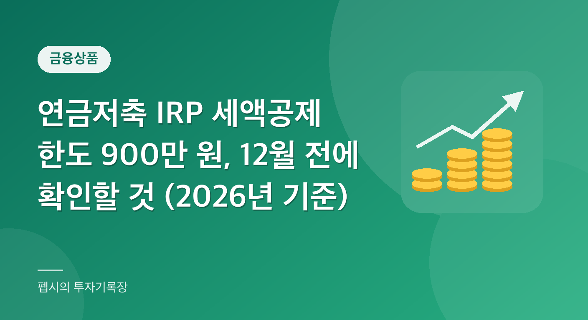

  

"연금저축에 얼마까지 넣어야 세금을 돌려받지?"

11월이 되면 이 질문이 머릿속을 떠나지 않습니다. "12월에 한 번에 넣으면 되나?", "IRP는 또 뭐가 다르지?" 하는 생각도 꼬리를 물고요.

연말정산 공제 항목 중 남은 두 달 동안 내 의지로 바꿀 수 있는 것이 바로 연금계좌 납입입니다.

신용카드 사용액은 이미 쓴 돈이라 되돌릴 수 없습니다. 반면 연금저축이나 IRP(개인형 퇴직연금)는 남은 기간에 납입 금액을 조절해서 공제액을 바꿀 수 있어요.

오늘은 한도, 공제율, 자주 하는 오해를 국세청 안내 기준으로 정리해 보겠습니다. 이 글은 2026년 11월 기준이며, 올해 납입분을 내년 2월 연말정산에서 공제받는 것을 전제로 합니다. 특정 상품 가입을 권하는 글이 아니라 제도 설명이라는 점도 미리 말씀드립니다.

**📌 한눈에 보기 (2026년 납입분 기준)**

- 세액공제 한도: 연금저축 **600만 원**, IRP 합산 **900만 원**
- 공제율: 총급여 5,500만 원 이하 15%, 초과 12% (지방소득세 포함 16.5%, 13.2%)
- 900만 원을 채우면: 약 148만 5천 원 또는 약 118만 8천 원 절세
- 900만 원은 **합산 한도**예요. 1,500만 원이 아니에요
- 연말 납입은 금융회사 마감 시간을 미리 확인하세요

**목차**

* TOC
{:toc}

## 연금계좌 세액공제란?

연금저축이나 IRP에 낸 돈의 일정 비율을 **내 세금에서 바로 빼 주는 제도**입니다.

소득공제는 세금을 매길 소득을 줄여 주는 것이고, 세액공제는 계산이 끝난 세금에서 직접 깎아 줍니다. 그래서 체감 효과가 큰 편입니다.

국세청 안내에 따르면 공제 대상은 종합소득이 있는 거주자가 연금계좌에 낸 금액입니다. 직장인이라면 대부분 해당된다고 보시면 됩니다.

공제 대상 계좌는 두 종류입니다.

| 구분 | 해당 계좌 |
|---|---|
| 연금저축계좌 | 금융회사에서 '연금저축' 이름으로 만든 계좌 |
| 퇴직연금계좌 | 개인형 퇴직연금(IRP), 확정기여형(DC형), 중소기업 퇴직연금 등 |

기준은 **내가 직접 새로 넣은 돈**입니다. 아래 금액은 공제 대상에서 빠집니다.

- 회사가 DC형 퇴직연금에 넣어 주는 사용자부담금
- 다른 계좌에서 옮겨 온(이전) 금액
- 아직 원천징수되지 않은 퇴직소득 등

"내 통장에서 새로 나간 돈"이 공제 대상이라고 기억하면 가장 쉽습니다.

## 세액공제 한도: 600만 원과 900만 원

| 납입 방식 | 공제 대상 한도 (연간) |
|---|---|
| 연금저축만 | 600만 원 |
| 연금저축 + IRP | 합산 900만 원 |
| IRP만 | 최대 900만 원 |

가장 흔한 오해는 "연금저축 600만 + IRP 900만 = 1,500만 원"입니다. 900만 원은 두 계좌를 **합친** 한도예요.

소득세법 조문 구조도 같습니다. 연금저축 납입액이 600만 원을 넘으면 초과분은 없는 것으로 보고, 600만 원 이내 금액과 IRP 납입액을 합쳐 900만 원을 넘으면 그 초과분도 빠집니다.

- 연금저축에 600만 원을 채웠다면 → IRP는 300만 원까지만 추가로 공제
- 연금저축에 안 넣었다면 → IRP만으로 900만 원까지 공제
- 연금저축에만 넣는다면 → 아무리 많이 넣어도 600만 원까지만 공제

한도를 넘겨 넣는 것 자체는 가능합니다. 다만 넘은 부분은 공제가 없어요. 공제 혜택 없이 계좌에 쌓이기만 하는 돈이 됩니다. 초과분을 나중에 꺼낼 때의 과세 방식은 이번에 공식 자료로 확인하지 못해서, 금융회사나 국세청에 따로 확인하시길 권합니다.

## 공제율: 총급여 5,500만 원이 기준선

공제율은 계좌 종류가 아니라 내 소득 구간으로 정해집니다.

| 총급여 (근로소득만 있는 경우) | 공제율 | 지방소득세 포함 | 900만 원 납입 시 효과 |
|---|---|---|---|
| 5,500만 원 이하 | 15% | 16.5% | 약 148만 5천 원 |
| 5,500만 원 초과 | 12% | 13.2% | 약 118만 8천 원 |

근로소득 외에 다른 소득이 있다면 종합소득금액으로 봅니다. 이때는 4,500만 원 이하가 15% 구간입니다.

같은 900만 원을 넣어도 소득 구간에 따라 절세 효과가 약 30만 원 차이 납니다. 소득이 높으면 공제율이 낮다는 점이 조금 아쉬운 부분이에요.

국세청 표에는 15%와 12%만 나와 있어요. 지방소득세를 더한 16.5%와 13.2%는 제가 1.1을 곱해 계산한 값입니다. 실제 환급액은 연말정산 결과로 확인하세요.

## 계산 예시 (가상의 사례)

이해를 돕기 위한 가상의 숫자입니다. 실제 결과는 다른 공제와 결정세액에 따라 달라집니다.

| 사례 | 총급여 | 납입 | 공제 대상 | 공제율 | 절세 효과 (지방세 포함) |
|---|---|---|---|---|---|
| A | 4,800만 원 | 연금저축 600 + IRP 300 | 900만 원 | 15% | 약 148만 5천 원 |
| B | 7,000만 원 | 연금저축 600 + IRP 300 | 900만 원 | 12% | 약 118만 8천 원 |
| C | 6,000만 원 | 연금저축 600 | 600만 원 | 12% | 약 79만 2천 원 |
| D | 6,000만 원 | 연금저축 1,000 | 600만 원 | 12% | 약 79만 2천 원 |

A씨는 총급여가 5,500만 원 이하라 15%가 적용됩니다. 900만 원 × 15% = 135만 원이 세액공제 금액이고, 지방소득세까지 감안하면 약 148만 5천 원입니다.

B씨는 같은 900만 원을 채웠지만 12%가 적용되어 108만 원, 지방소득세 포함 약 118만 8천 원입니다.

C씨가 IRP에 300만 원을 더 넣으면 공제 대상이 900만 원으로 늘어 약 39만 6천 원을 더 아낄 수 있습니다.

D씨는 400만 원을 더 넣었지만 공제는 C씨와 같습니다. 연금저축 한도 600만 원을 넘은 부분은 반영되지 않기 때문이에요. "많이 넣었으니 더 돌려받겠지"라고 생각하기 쉬운데, D씨라면 연금저축을 더 넣는 대신 IRP에 300만 원을 나눠 넣는 편이 공제 면에서는 유리합니다.

## 많이 하는 오해 4가지

### 1. "IRP는 따로 900만 원까지 된다"
아닙니다. 연금저축과 IRP를 합쳐서 900만 원입니다. 이걸 잘못 알고 IRP에 900만 원을 추가로 넣었다가 공제는 그대로인 경우가 의외로 많습니다.

### 2. "납입액의 15%를 현금으로 돌려받는다"
세액공제는 내가 낼 세금(결정세액) 안에서만 빼 줍니다. 연말정산에서 이미 낸 세금(기납부세액)보다 계산된 세금이 적으면 그 차이를 돌려받는 구조예요.

그래서 낼 세금이 원래 적은 분은 공제를 다 못 쓸 수 있습니다. 한도를 채우기 전에 홈택스 모의계산이나 연말정산 미리보기로 예상 세액부터 확인해 보세요.

### 3. "계좌마다 공제율이 다르다"
공제율은 소득 구간으로 정해집니다. 같은 소득이면 연금저축이든 IRP든 같습니다.

### 4. "12월 31일에 넣어도 똑같다"
올해 안에 넣으면 공제 대상인 건 맞습니다. 하지만 마감 시간은 금융회사마다 다르고, 연말 이체가 다음 해로 처리되기도 합니다. 12월 중순 전에 넣는 게 안전합니다.

## 한도를 늘려 주는 특례

**ISA 만기 자금 전환**

- ISA 만기 잔액을 연금계좌에 넣으면, 전환 금액의 10%(최대 300만 원)만큼 한도가 늘어납니다.
- 전환한 그해에만 적용됩니다.
- 예: 3,000만 원을 옮기면 300만 원이 늘어 한도가 최대 1,200만 원이 됩니다(가상 예시).

올해 ISA가 만기되는 분이라면 연금계좌로 옮기는 것만으로 한도가 넓어지니 한 번 따져 볼 만합니다.

**고령 가구 주택 다운사이징**

- 부부 중 한 명이 60세 이상인 1주택 가구가 더 싼 집으로 옮긴 경우가 대상입니다.
- 이때 집값 차액을 IRP에 추가로 넣을 수 있습니다(한도 1억 원).
- 대상이 한정적이니 해당될 때만 참고하시면 됩니다.

두 특례 모두 실제 인정 방식은 금융회사와 국세청 안내로 한 번 더 확인하세요.

## 연말까지 10분 점검표

막상 해 보면 10분이면 끝납니다.

1. 올해 납입액 확인: 증권사·은행 앱에서 연금저축과 IRP 납입액을 봅니다. 여러 금융회사에 나눠 넣었다면 합산하세요. 한도는 계좌가 아니라 사람 기준입니다.
2. 공제율 확인: 내 총급여가 5,500만 원 이하인지 봅니다.
3. 예상 세금 확인: 홈택스 연말정산 미리보기나 모의계산으로 결정세액을 봅니다. 결정세액이 이미 낮다면 한도를 꽉 채우는 의미가 작을 수 있어요.
4. 남은 한도 계산: 600만 원 또는 900만 원에서 이미 넣은 돈을 뺍니다.
5. 여유 자금과 비교: 오래 묶어 둘 수 있는 돈인지 따져 봅니다.
6. 마감 확인: 금융회사의 연말 납입 마감 시간을 확인합니다.

**⚠️ 노후 자금이라는 점을 잊지 마세요**

연금계좌는 노후를 위한 계좌라 중간에 꺼내면 불이익이 있을 수 있습니다. 세금 몇만 원을 아끼려고 생활비까지 넣는 건 피하세요. 인출 시 과세 방식은 가입 전에 금융회사나 국세청에 꼭 확인하세요.

## 2027년에 바뀔까?

내년 이후 제도가 바뀐다는 이야기도 보입니다. 하지만 세법 개정은 국회를 통과해야 확정되고, 이번에 확인한 공식 자료에서는 확정된 변경 내용을 찾지 못했습니다.

그래서 이 글은 2026년 납입분 기준으로만 썼습니다. 내년 계획은 개정이 확정된 뒤 기획재정부와 국세청 공지를 확인하세요.

## 정리

- 한도는 연금저축 600만 원, IRP 합산 900만 원
- 공제율은 총급여 5,500만 원 이하 15%, 초과 12%
- 900만 원을 채우면 약 148만 5천 원 또는 118만 8천 원 절세
- 낼 세금이 적으면 공제를 다 못 쓸 수 있으니 미리보기로 먼저 확인

반대로 오해하기 쉬운 부분도 분명합니다. 900만 원은 합산 한도이고, 한도를 넘은 납입은 공제가 안 되며, 무엇보다 노후를 위한 돈이라 단기 자금으로 쓰면 안 됩니다.

11월인 지금은 아직 시간이 있습니다. 연말정산이 끝난 뒤 후회하기보다, 지금 납입액부터 확인하고 남은 한도를 계산해 보세요.

## 자주 묻는 질문

**Q1. 연금저축 한도가 600만 원인데 IRP는 900만 원까지 되나요?**

A1. 아닙니다. 900만 원은 연금저축과 IRP를 합친 한도입니다. 연금저축에 600만 원을 넣었다면 IRP는 300만 원까지만 추가로 공제됩니다.

**Q2. 공제율 15%와 12%는 어떻게 갈리나요?**

A2. 근로소득만 있으면 총급여 5,500만 원 이하(종합소득금액 4,500만 원 이하)는 15%, 초과는 12%입니다. 지방소득세를 더하면 16.5%, 13.2% 효과입니다.

**Q3. 한도를 넘겨 넣으면 어떻게 되나요?**

A3. 넘은 금액은 세액공제 대상에서 빠집니다. 납입은 되지만 그 부분은 공제 혜택이 없습니다.

**Q4. 회사가 넣어 주는 퇴직연금도 공제되나요?**

A4. DC형 퇴직연금의 사용자부담금은 제외됩니다. 내가 직접 넣은 돈만 대상입니다.

**Q5. ISA 만기 자금을 옮기면 한도가 늘어나나요?**

A5. 네. 전환 금액의 10%(최대 300만 원)만큼 늘어나고, 전환한 해에만 적용됩니다.

## 참고 자료

- 국세청, 연금계좌 세액공제(근로소득 세액공제 안내): [https://www.nts.go.kr/nts/cm/cntnts/cntntsView.do?cntntsId=7875&mi=6439](https://www.nts.go.kr/nts/cm/cntnts/cntntsView.do?cntntsId=7875&mi=6439)
- 국세청, 연금계좌 세액공제 한도·공제율: [https://www.nts.go.kr/nts/cm/cntnts/cntntsView.do?cntntsId=7875&mi=6441](https://www.nts.go.kr/nts/cm/cntnts/cntntsView.do?cntntsId=7875&mi=6441)
- 국가법령정보센터, 소득세법 제59조의3(연금계좌세액공제 등): [https://www.law.go.kr/법령/소득세법/제59조의3](https://www.law.go.kr/법령/소득세법/제59조의3)
- 2026년 11월 기준으로 확인했습니다. 세법 개정에 따라 달라질 수 있으니 최신 내용은 홈택스에서 확인하세요.

> 이 글은 일반적인 정보 제공을 위한 것으로, 개인 상황에 따라 적용이 다를 수 있습니다. 정확한 내용은 관련 기관에 확인하세요.
