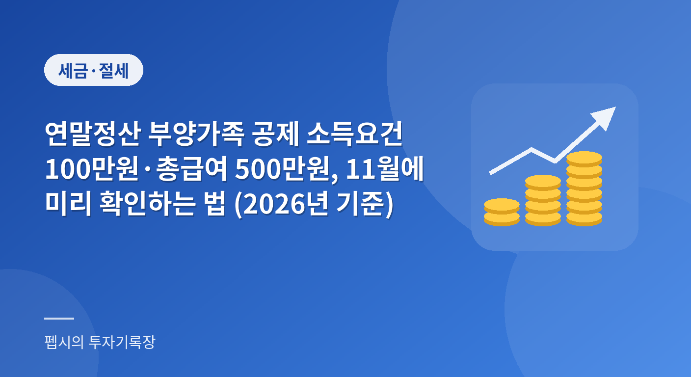

  

부모님이 용돈벌이로 일을 조금 하셨는데, 이분을 부양가족으로 올려도 될까요? 대학생 동생이 아르바이트로 번 돈이 얼마인지 몰라서 공제 신청을 망설인 적이 있으신가요?

연말정산에서 부양가족 공제는 한 명당 기본공제가 걸려 있어서 금액이 꽤 큽니다. 그런데 소득요건 하나를 놓치면 공제가 취소되고 세금을 더 내야 할 수도 있습니다.

11월은 올해 소득이 거의 확정되는 시기라서 지금 점검해 두면 연말에 대응할 시간이 남습니다. 오늘은 **부양가족 공제 소득요건**을 기준 숫자부터 소득 종류별 판단법, 간소화서비스 명단의 함정까지 차근차근 정리해 보겠습니다.

**📌 한눈에 보기 (2026년 기준)**

- 소득요건은 연간 소득금액 100만 원 이하입니다.
- 근로소득만 있으면 총급여 500만 원 이하까지 인정됩니다(근로소득금액 150만 원).
- 나이요건은 직계존속 만 60세 이상, 직계비속 만 20세 이하, 형제자매 만 20세 이하 또는 만 60세 이상입니다. 장애인은 나이 제한이 없습니다.
- 소득요건을 300만 원(총급여 750만 원)으로 높이는 안은 아직 정부안 단계입니다.

**목차**

* TOC
{:toc}

## 왜 11월에 부양가족 소득요건을 봐야 할까

연말정산은 내년 1월에 하지만, 공제 대상 여부는 올해 소득으로 정해집니다. 그래서 올해가 끝나기 전에 가족의 소득을 한 번 훑어보는 게 가장 좋습니다.

특히 12월에는 할 수 있는 일이 많지 않습니다. 이미 지급받은 급여나 이미 신고된 소득은 되돌릴 수 없기 때문에, 기준을 아슬아슬하게 넘기는 가족이 있다면 11월 안에 파악해야 합니다.

또 하나는 세금 문제만이 아닙니다. 부양가족으로 올려서 받은 공제가 나중에 잘못된 것으로 확인되면 가산세와 함께 추징당할 수 있습니다. 국세청 상담 자료에도 신고된 소득만 보고 공제를 받았다가 실제 소득이 기준을 넘는 것으로 확인되면 부당공제로 소득세 등이 추징될 수 있다고 안내되어 있습니다.

## 기본공제 대상이 되는 부양가족 요건 정리

기본공제는 나이요건과 소득요건을 모두 충족해야 받을 수 있습니다. 둘 중 하나만 맞으면 안 됩니다.

먼저 나이요건입니다. 국세청 안내 기준으로 가족 관계별 나이는 아래와 같습니다.

| 구분 | 나이요건 |
|---|---|
| 배우자 | 나이 제한 없음 |
| 직계존속(부모·조부모 등) | 만 60세 이상 |
| 직계비속(자녀·손자녀 등) | 만 20세 이하 |
| 형제자매 | 만 20세 이하 또는 만 60세 이상 |
| 장애인 | 나이 제한 없음 |

표에서 보듯 배우자와 장애인은 나이를 따지지 않습니다. 대신 소득요건은 똑같이 적용됩니다.

소득요건은 연간 소득금액 100만 원 이하입니다. 근로소득만 있는 경우에는 총급여 500만 원 이하이면 요건을 충족한 것으로 봅니다. 총급여 500만 원은 근로소득금액으로 따지면 150만 원에 해당하는데, 국세청은 이 경우를 예외적으로 인정한다고 설명합니다.

부모님처럼 따로 사는 가족도 공제가 가능합니다. 주거 형편상 같이 살지 못하더라도 실제로 부양하고 있다면 요건을 충족할 때 기본공제를 받을 수 있다는 것이 정부 정책뉴스에 소개된 국세청 안내입니다. 다만 다른 형제자매가 같은 부모님을 이미 공제받고 있다면 중복해서 받을 수 없습니다.

## 소득금액과 총급여는 다르다

가장 많이 헷갈리는 부분이 이것입니다. 기준은 "수입"이 아니라 "소득금액"입니다.

소득금액은 수입에서 필요경비나 공제를 뺀 뒤의 금액입니다. 그래서 같은 1,000만 원을 벌었어도 소득 종류에 따라 소득금액이 달라집니다.

국세청 안내에 나온 계산 방식을 정리하면 아래와 같습니다.

- 근로소득: 총급여액에서 근로소득공제를 뺀 금액
- 사업소득: 수입금액에서 필요경비(업종별 단순경비율 적용 등)를 뺀 금액
- 기타소득: 지급액에서 의제필요경비를 뺀 금액
- 양도소득: 양도소득금액(손실이면 0으로 보고, 두 건 이상이면 통산)
- 퇴직소득: 과세 대상 퇴직급여

근로소득과 다른 소득이 함께 있다면 각 소득금액을 모두 더해서 100만 원을 넘는지 봅니다. 이때는 총급여 500만 원 예외가 적용되지 않습니다. 근로소득만 있는 경우에만 쓸 수 있는 기준이기 때문입니다.

국세청 상담 자료의 계산으로는 총급여가 대략 333만 원을 넘으면 근로소득금액만으로도 100만 원을 초과하게 됩니다. 그래서 근로소득 외에 다른 소득이 조금이라도 있는 가족은 총급여 500만 원 기준을 그대로 쓰면 안 됩니다.

## 소득 종류별로 공제 가능한지 보기

이제 실제로 자주 마주치는 경우를 표로 모아 보겠습니다. 아래 내용은 국세청 안내에 나온 기준을 사례 형태로 풀어 쓴 것입니다.

| 소득 종류 | 상황 | 기본공제 가능 여부 |
|---|---|---|
| 근로소득만 | 총급여 500만 원 이하 | 가능 |
| 근로소득만 | 총급여 500만 원 초과 | 불가 |
| 일용근로소득 | 금액과 무관(분리과세) | 가능 |
| 이자·배당 | 금융소득 2,000만 원 이하(분리과세) | 가능 |
| 이자·배당 | 금융소득 2,000만 원 초과(종합과세) | 불가 |
| 기타소득 | 기타소득금액 300만 원 초과 | 불가 |
| 양도소득 | 양도소득금액이 100만 원 초과 | 불가 |
| 주택임대소득 | 비과세 대상 또는 2,000만 원 이하 분리과세 선택 | 가능 |

표에 나온 사례는 모두 가상의 가족이 아니라 국세청 자료의 기준을 정리한 것이고, 실제 판단은 개인별 소득 구성에 따라 달라집니다.

표 아래에서 눈여겨볼 부분은 분리과세입니다. 일용근로소득처럼 분리과세로 끝나는 소득은 소득금액 합산에서 빠지기 때문에 금액이 커도 공제에 영향이 없습니다. 반대로 종합과세로 넘어가는 순간 합산 대상이 됩니다.

국세청 예시도 참고할 만합니다. 학습지 강사로 사업소득 수입이 1,800만 원이고 단순경비율이 75%라면 소득금액은 450만 원이라 기준을 넘습니다. 이건 국세청이 든 예시이고 경비율은 업종마다 다르니, 실제로는 가족의 업종 경비율을 확인해야 합니다.

배우자가 상반기에 월 200만 원씩 6개월 일했다면 상반기 총급여가 1,200만 원이라 500만 원을 넘습니다. 이 경우도 국세청 안내 예시로, 해당 연도 정산에서는 공제 대상이 아닙니다.

공적연금은 과세 대상 연금소득금액이 100만 원 이하여야 합니다. 사적연금은 연 1,500만 원을 넘으면 종합과세와 15% 분리과세 중에서 고를 수 있고, 분리과세를 택하면 합산에서 빠집니다. 부모님이 연금을 받고 계신다면 이 부분을 꼭 확인해 보세요.

**⚠️ 소득이 기준을 넘으면 공제가 통째로 사라집니다**

소득요건은 "조금 넘으면 조금 깎이는" 방식이 아닙니다. 100만 원(근로소득만이면 총급여 500만 원)을 넘기는 순간 그 가족의 기본공제와 그에 딸린 추가공제를 받을 수 없습니다. 잘못 공제받은 사실이 나중에 확인되면 세금을 추가로 내야 할 수 있으니, 경계선에 있는 가족은 미리 확인하세요.

## 간소화서비스 부양가족 명단의 함정

연말정산 간소화서비스에는 소득기준을 초과한 부양가족을 안내하는 기능이 있습니다. 편리하지만 이 명단을 그대로 믿으면 곤란한 경우가 있습니다.

국세청의 작년(2025년 귀속) 안내를 보면 소득기준 초과 여부를 10월까지 신고된 자료로 판정했고, 근로소득은 상반기분만 반영했습니다. 연 소득으로 환산하지 않았다는 점도 안내에 적혀 있습니다.

그래서 명단에 없다고 해서 공제가 가능한 것은 아닙니다. 11~12월 소득이나 근로소득의 하반기분까지 합친 연간 소득금액을 직접 확인해야 합니다. 국세청도 간소화자료는 발급기관이 제출한 자료를 그대로 보여주는 것이므로 공제 요건 충족 여부는 근로자가 직접 판단해야 한다고 안내합니다.

한 가지 알아둘 점은, 위 내용이 2025년 귀속 연말정산 안내라는 것입니다. 올해(2026년 귀속)의 세부 일정과 판정 기준 시점은 내년 초 국세청 공지로 다시 확인하셔야 합니다. 작년에는 간소화서비스가 1월 15일에 열렸습니다.

명단에서 제외되는 가족의 자료 중에도 예외는 있습니다. 소득기준과 관계없이 공제받을 수 있는 부양가족의 의료비, 그리고 근로자가 취업한 부양가족을 위해 취업 전에 쓴 교육비·보험료는 조회됩니다.

## 부양가족 자료제공 동의, 잊지 마세요

부모님이나 형제자매의 의료비·보험료 자료를 간소화서비스에서 보려면 부양가족 본인이 자료제공 동의를 해야 합니다. 동의 안 하면 내 화면에 자료가 뜨지 않습니다.

절차는 아래 순서로 진행됩니다. 작년 국세청 안내 기준이며 메뉴 이름은 달라질 수 있습니다.

1. 부양가족이 홈택스에 로그인합니다.
2. 장려금·연말정산·기부금 메뉴에서 연말정산간소화로 들어갑니다.
3. 부양가족 자료제공동의 신청 화면에서 자료를 받을 근로자를 입력하고 동의를 마칩니다.
4. 근로자는 자료 조회 전에 열람 전 확인사항에 동의합니다.

모바일은 손택스 앱의 연말정산간소화 메뉴에서 같은 절차를 밟을 수 있습니다. 부모님이 어려워하신다면 연말정산 시즌 전에 미리 같이 해 두는 것이 낫습니다.

## 많이 하는 오해 5가지

### 1. "소득이 신고된 게 없으니 무조건 공제된다"

신고된 소득이 없어도 실제 소득이 있었다면 그 금액을 기준으로 판단합니다. 국세청 안내도 신고된 소득이 아니라 실제 연간 소득금액을 기준으로 하라고 설명합니다.

### 2. "수입이 500만 원 이하면 다 된다"

500만 원은 근로소득만 있는 경우의 총급여 기준입니다. 사업소득이나 기타소득이 섞여 있다면 각각의 소득금액을 더해 100만 원 이하인지 봐야 합니다.

### 3. "간소화 명단에 안 뜨면 공제받아도 된다"

앞에서 본 것처럼 명단은 일정 시점까지의 자료만 반영합니다. 이후 소득까지 포함하면 기준을 넘을 수 있어서 공제 가능 여부를 보장하는 도구가 아닙니다.

### 4. "부모님과 따로 살면 공제를 못 받는다"

주거 형편상 따로 살더라도 실제로 부양하고 있다면 요건을 충족할 때 기본공제를 받을 수 있습니다. 다만 다른 형제자매가 같은 부모님을 공제받고 있다면 한 사람만 받아야 합니다.

### 5. "장애인은 소득이 많아도 공제된다"

장애인은 나이요건이 없을 뿐이고 소득요건은 똑같이 적용됩니다. 소득요건을 충족하면 기본공제 150만 원에 장애인 추가공제 200만 원이 더해진다고 국세청 상담 자료에 안내되어 있습니다.

## 2026년 세제개편안: 소득요건이 완화될까

올해 8월 3일에 재정경제부가 발표한 2026년 세제개편안에는 기본공제 소득요건 완화가 들어 있습니다. 정부 정책뉴스에 소개된 내용은 아래와 같습니다.

| 구분 | 소득금액 기준 | 근로소득만 있는 경우 |
|---|---|---|
| 현행 | 100만 원 이하 | 총급여 500만 원 이하 |
| 개편안 | 300만 원 이하 | 총급여 750만 원 이하 |

표처럼 기준이 높아지면 아르바이트나 단기 근로로 지금은 기준을 넘는 가족도 공제 대상에 들어올 수 있습니다.

다만 이건 어디까지나 정부안입니다. 정책뉴스도 국회 심의·의결 과정에서 내용이나 시행 시기가 달라질 수 있다고 밝히고 있습니다. 제가 확인한 공식 자료에는 몇 년 귀속분부터 적용되는지가 나와 있지 않았습니다.

그러니 올해 연말정산은 현행 기준인 소득금액 100만 원(총급여 500만 원)으로 준비하는 것이 안전합니다. 완화안이 국회를 통과해 시행 시기가 확정되면 그때 다시 확인하시면 됩니다.

## 11~12월 부양가족 점검 순서

시간이 없다면 아래 순서대로만 확인해도 큰 실수는 막을 수 있습니다.

1. 가족 한 명씩 나이요건(만 나이 기준)을 먼저 확인합니다.
2. 올해 받은 급여, 사업·기타소득, 이자·배당, 연금을 가족에게 물어 정리합니다.
3. 소득 종류별로 소득금액을 계산하고, 근로소득만 있는 경우에만 총급여 500만 원 기준을 씁니다.
4. 분리과세로 끝나는 소득과 종합과세 대상 소득을 구분합니다.
5. 다른 형제자매나 배우자가 같은 사람을 중복해서 공제받지 않는지 가족끼리 확인합니다.
6. 부양가족의 자료제공 동의를 미리 받아 둡니다.

가족 중 소득이 기준에 가까운 사람이 있다면 11~12월에 들어올 소득까지 예상해서 계산해야 합니다. 퇴사한 가족이 있다면 퇴직소득도 소득금액에 합산한다는 점을 잊지 마세요.

## 정리

- 부양가족 공제 소득요건은 소득금액 100만 원 이하, 근로소득만 있으면 총급여 500만 원 이하입니다.
- 나이요건은 직계존속 60세 이상, 직계비속 20세 이하, 형제자매 20세 이하 또는 60세 이상이며 장애인은 나이 제한이 없습니다.
- 간소화서비스의 소득기준 초과 명단은 일정 시점까지의 자료라서 직접 확인이 필요합니다.
- 소득요건을 300만 원(총급여 750만 원)으로 높이는 안은 정부안 단계이므로 올해는 현행 기준으로 준비하세요.

부양가족 공제는 숫자 하나만 틀려도 결과가 크게 바뀌는 항목입니다. 가족 소득은 본인이 직접 물어보지 않으면 알기 어려우니, 11월에 한 번 대화를 나눠 보시길 권합니다.

경계선에 있는 경우는 홈택스 모의계산이나 국세상담센터(126)에 문의해서 확인하는 것이 가장 안전합니다. 이 글의 내용은 일반적인 기준이라 개인 상황에 맞는지는 꼭 따로 확인하세요.

## 자주 묻는 질문

**Q1. 총급여가 500만 원을 조금 넘는 부모님도 부양가족이 될 수 있나요?**

A1. 근로소득만 있는 경우 총급여 500만 원을 넘으면 소득요건을 충족하지 못해 기본공제를 받을 수 없습니다. 조금 초과하는 경우도 마찬가지입니다.

**Q2. 근로소득과 사업소득이 같이 있으면 어떻게 판단하나요?**

A2. 각 소득의 소득금액을 모두 합산해 100만 원 이하인지 봅니다. 이때는 총급여 500만 원 예외가 적용되지 않습니다.

**Q3. 일용근로소득이 많은 가족도 공제가 되나요?**

A3. 일용근로소득은 분리과세 소득이라 금액과 관계없이 소득요건 판단에서 제외된다고 국세청 상담 자료에 안내되어 있습니다.

**Q4. 간소화서비스 명단에 뜨지 않으면 안심해도 되나요?**

A4. 안심하면 안 됩니다. 명단은 일정 시점까지의 소득만으로 판정하기 때문에 연간 소득금액을 직접 확인해야 합니다.

**Q5. 소득요건이 300만 원으로 바뀌는 건 확정인가요?**

A5. 아직 확정이 아닙니다. 2026년 세제개편안의 정부안이고 국회 심의 과정에서 내용이나 시행 시기가 달라질 수 있습니다.

## 참고 자료

- [국세청 연말정산 간소화서비스 부양가족 소득·자료제공 안내(2025년 귀속)](https://www.nts.go.kr/nts/na/ntt/selectNttInfo.do?mi=&nttSn=1347979)
- [국세청 국세상담센터 Q&A: 기본공제 소득요건](https://call.nts.go.kr/call/qna/selectQnaInfo.do?ctgId=CTG11934&mi=1318)
- [정책뉴스: 청년·서민 세 부담 낮추고 지방 지원 늘린다…세제개편안 살펴보니](https://www.korea.kr/news/policyNewsView.do?newsId=148969870)
- [정책뉴스: 자주 묻는 연말정산 ⑨인적공제](https://m.korea.kr/news/policyNewsView.do?newsId=148937039)
- 2026년 11월 기준

> 이 글은 일반적인 정보 제공을 위한 것으로, 개인 상황에 따라 적용이 다를 수 있습니다. 정확한 내용은 관련 기관에 확인하세요.
