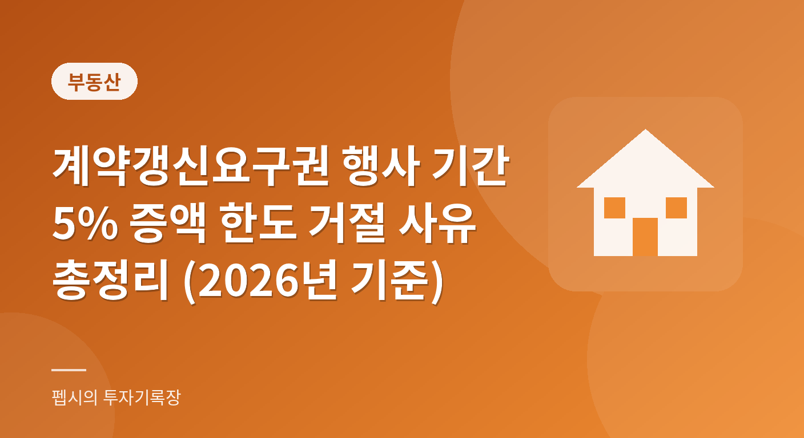

  

전세 만기가 두세 달 뒤인데, 집주인에게 "계속 살고 싶다"는 말을 언제 꺼내야 할지 고민해 본 적 있나요? 말만 꺼내면 되는 건지, 문자나 내용증명으로 남겨야 하는 건지 헷갈리는 분이 꽤 많습니다.

게다가 재계약 시즌이 되면 "보증금을 한 번에 얼마나 올려달라고 할까" 하는 걱정까지 겹칩니다. 법에는 이런 상황을 위해 임차인이 쓸 수 있는 장치가 있는데, 바로 계약갱신요구권입니다.

이 글에서는 주택임대차보호법 기준으로 갱신을 요구할 수 있는 기간, 증액 한도, 집주인이 거절할 수 있는 경우, 그리고 거절하고 나서 약속을 어겼을 때의 손해배상까지 차근차근 정리합니다.

**📌 한눈에 보기 (2026년 기준)**

- 갱신 요구 시기는 임대차 기간이 끝나기 6개월 전부터 2개월 전까지입니다.
- 계약갱신요구권은 임차인이 1회만 쓸 수 있고, 갱신되는 기간은 2년입니다.
- 갱신 때 보증금과 차임의 증액은 약정한 금액의 20분의 1(5%)을 넘지 못합니다.
- 집주인은 차임 2기분 연체, 실거주 등 법에 정한 9가지 사유가 있을 때만 거절할 수 있습니다.
- 실거주를 이유로 거절한 뒤 정당한 사유 없이 제3자에게 임대하면 손해배상 책임이 생깁니다.

**목차**

* TOC
{:toc}

## 계약갱신요구권이란 무엇인가

계약갱신요구권은 임대차 기간이 끝날 때 임차인이 집주인에게 "계약을 한 번 더 이어가자"고 요구할 수 있는 권리입니다. 집주인은 정당한 사유 없이 이 요구를 거절하지 못합니다.

핵심은 임차인이 일방적으로 요구하는 권리라는 점입니다. 집주인이 동의하지 않아도, 법에서 정한 거절 사유에 해당하지 않으면 계약이 이어지는 효과가 생깁니다.

이 제도는 주택임대차보호법 제6조의3에 규정되어 있습니다. 국가법령정보센터 기준으로 이 법은 2026년 1월 2일 시행본이 최신으로 표시되어 있습니다(타법개정 반영).

갱신 요구가 받아들여지면 기존 계약과 같은 조건으로 다시 계약한 것으로 봅니다. 다만 차임과 보증금은 법이 정한 범위 안에서 올리거나 내릴 수 있습니다.

## 언제까지 요구해야 할까: 행사 기간과 횟수

갱신 요구는 임대차 기간이 끝나기 6개월 전부터 2개월 전까지 할 수 있습니다. 이 기간이 지나 버리면 계약갱신요구권을 쓸 수 없으니 달력에 미리 표시해 두는 것이 좋습니다.

횟수는 1회입니다. 한 번 행사해서 2년이 갱신되면, 그다음 만기에는 같은 권리를 다시 쓸 수 없습니다.

아래 표는 만기일별로 요구 가능한 기간을 제가 직접 계산한 값입니다. 실제 만기일은 계약서에 적힌 날짜로 다시 확인하세요.

| 계약서상 만기일 | 갱신 요구 시작일(6개월 전) | 갱신 요구 마감일(2개월 전) |
|---|---|---|
| 2027년 1월 31일 | 2026년 7월 31일 | 2026년 11월 30일 |
| 2027년 3월 31일 | 2026년 9월 30일 | 2027년 1월 31일 |
| 2027년 6월 30일 | 2026년 12월 31일 | 2027년 4월 30일 |
| 2027년 9월 30일 | 2027년 3월 31일 | 2027년 7월 31일 |

표를 보면 만기가 2027년 1월 말인 분은 이번 달 30일이 마지막 날입니다. 달이 바뀌면 이미 늦을 수 있다는 뜻입니다.

기간 계산이 애매한 날짜(말일이나 공휴일 등)에는 하루라도 여유 있게 움직이는 편이 안전합니다. 마감 직전에 몰리면 증거를 남기기도 어렵습니다.

**⚠️ 마감이 지나면 권리를 쓸 수 없습니다**

갱신 요구는 만기 2개월 전까지만 가능합니다. 이 기간을 넘기면 계약갱신요구권 대신 묵시적 갱신이나 새 계약 협상으로 넘어가게 되어 증액 한도 같은 보호를 받기 어려울 수 있습니다. 기한이 임박했다면 오늘 안에 요구 의사를 기록으로 남기세요.

## 갱신 후 조건: 5% 증액 한도 계산

갱신되는 계약의 기간은 2년으로 봅니다. 조건은 기존과 같지만, 집주인은 차임과 보증금을 올려 달라고 청구할 수 있습니다.

이때 증액은 약정한 차임이나 보증금의 20분의 1, 즉 5%를 넘지 못합니다. 헌법재판소도 2024년 2월 28일 결정에서 이 증액 한도가 헌법에 위반되지 않는다고 판단했습니다.

5%는 보증금과 월세에 각각 적용됩니다. 보증금 5%와 월세 5%를 따로 계산해서 상한을 구합니다.

아래는 가상의 예시를 제가 계산한 값입니다. 실제 계약은 금액과 특약에 따라 달라질 수 있습니다.

| 가상 사례 | 현재 보증금 | 현재 월세 | 보증금 최대 인상 후 | 월세 최대 인상 후 |
|---|---|---|---|---|
| 전세 A | 3억 원 | 없음 | 3억 1,500만 원 | 없음 |
| 전세 B | 2억 원 | 없음 | 2억 1,000만 원 | 없음 |
| 반전세 C | 1억 원 | 80만 원 | 1억 500만 원 | 84만 원 |
| 월세 D | 1,000만 원 | 50만 원 | 1,050만 원 | 52만 5,000원 |

전세 A는 3억 원의 5%인 1,500만 원이 최대 인상폭입니다. 이보다 많이 올려 달라는 요구는 갱신 단계에서는 받아들일 필요가 없습니다.

반전세 C처럼 보증금과 월세가 함께 있으면 각각 5% 이내여야 합니다. 합쳐서 한 번에 계산하는 방식이 아니라는 점을 기억해 두세요.

## 집주인이 거절할 수 있는 경우

집주인이 갱신 요구를 거절할 수 있는 사유는 법 제6조의3 제1항에 9가지로 정해져 있습니다. 여기에 해당하지 않으면 거절할 수 없습니다. 대표적인 사유는 다음과 같습니다.

- 임차인이 차임을 2기분 이상 연체한 경우
- 임차인이 거짓이나 부정한 방법으로 임차한 경우
- 집주인이 임차인에게 상당한 보상을 제공하고 합의한 경우
- 임차인이 집주인 동의 없이 집을 다른 사람에게 전대한 경우
- 임차인의 고의나 중대한 과실로 집이 파손되거나 멸실된 경우
- 철거나 재건축이 필요한 경우
- 집주인(직계존속·직계비속 포함)이 실제 거주하려는 경우
- 그 밖에 임차인이 의무를 현저히 위반했거나 임대차를 계속하기 어려운 중대한 사유가 있는 경우

각 호의 정확한 문언과 세부 요건은 국가법령정보센터에서 조문을 직접 확인하세요. 이 글의 목록은 핵심만 줄여 쓴 것입니다.

실무에서 가장 많이 다투는 것은 실거주와 차임 연체입니다. 월세를 두 번 이상 밀린 적이 있다면 갱신 요구 자체가 어려워질 수 있으니 연체 이력은 미리 점검해 두는 것이 좋습니다.

## 실거주 거절 후 약속을 어기면 손해배상

집주인이 "내가 들어가 살겠다"며 갱신을 거절했는데, 정작 갱신 기간이 끝나기 전에 정당한 사유 없이 제3자에게 집을 임대했다면 임차인은 손해배상을 청구할 수 있습니다.

손해배상액은 당사자 사이에 미리 정한 금액이 없으면 아래 세 가지 중 가장 큰 금액입니다.

1. 갱신 거절 당시 월차임(월세로 환산한 금액) 3개월분
2. 집주인이 제3자에게 임대해 얻은 차임과 기존 차임의 차액의 2년분
3. 갱신 거절로 임차인이 입은 실제 손해액

헌법재판소는 앞서 본 결정에서 이 손해배상 규정도 헌법에 위반되지 않는다고 봤습니다. 이 규정에서 말하는 정당한 사유는 집주인이 예상하지 못한 불가피한 사정 정도를 의미한다고 해석했습니다.

실거주 주장이 진짜인지는 집주인의 주거 상황, 가족의 직장이나 학교, 이사 준비 여부, 말과 모순되는 행동 등을 종합해서 판단하는 것이 판례의 큰 흐름입니다. 단순히 "내가 살겠다"는 말만으로는 입증이 부족할 수 있다는 해설도 있습니다.

실거주를 이유로 거절한 직후 시세에 맞춰 새 임차인을 들인 정황이 있다면, 임대 시점과 임대 조건을 증빙으로 확보해 두는 것이 중요합니다.

## 요구는 어떻게 하면 될까: 단계별 절차

법에는 갱신 요구의 방식이 말로만 해도 된다고 읽힐 여지가 있지만, 분쟁을 생각하면 기록으로 남기는 편이 훨씬 안전합니다. 아래 순서를 추천합니다.

1. 계약서에서 만기일을 확인하고, 6개월 전~2개월 전 기간을 계산합니다.
2. 연체 이력, 무단 전대, 파손 등 거절 사유가 될 만한 사항이 없는지 점검합니다.
3. 문자, 카카오톡, 이메일 등 기록이 남는 방법으로 갱신 요구 의사를 전달합니다.
4. 답이 없거나 거절하면 내용증명으로 한 번 더 보냅니다.
5. 증액 요구가 오면 5% 이내인지 계산하고 근거를 남겨 협의합니다.
6. 합의한 내용은 갱신 계약서나 합의서로 작성합니다.

3번에서 중요한 것은 날짜와 내용이 남는 방식입니다. "계약갱신요구권을 행사하겠다"는 문장을 명확하게 쓰고, 주소와 만기일을 함께 적어 두세요.

집주인이 거절 사유로 실거주를 말한다면, 실제 입주 계획이 구체적인지 확인해 달라고 문서로 요청하는 방법도 있습니다.

## 묵시적 갱신과 어떻게 다를까

묵시적 갱신은 만기 때 양쪽이 아무 말도 하지 않아 계약이 이어지는 것을 말합니다. 갱신요구권 행사와는 별개의 제도입니다.

두 제도의 차이를 한눈에 보면 아래와 같습니다. 묵시적 갱신의 세부 내용은 법 제6조와 제6조의2에 있으니 정확한 기준은 법령에서 확인하세요.

| 구분 | 계약갱신요구권 | 묵시적 갱신 |
|---|---|---|
| 시작 | 임차인이 기간 안에 요구 | 양쪽 모두 별다른 통지 없이 만기 경과 |
| 횟수 | 1회 | 법에서 정한 조건 충족 시 발생 |
| 갱신 기간 | 2년 | 법에서 정한 기간 적용 |
| 증액 | 20분의 1 한도 | 법 제7조에 따른 증액 한도 |
| 집주인 거절 | 법정 9가지 사유가 있을 때만 | 해당 없음(별도 규정) |

표에서 보듯 계약갱신요구권은 집주인의 거절 사유가 엄격하게 제한되는 반면, 묵시적 갱신은 요구 절차와 무관하게 발생합니다. 둘 중 어떤 방식으로 계약을 이어갈지에 따라 해지 조건과 협상 구도가 달라질 수 있습니다.

그래서 이사 계획이 불확실한 분이라면 만기 2개월 전 전까지는 가능한 선택지를 정리해 두는 것이 좋습니다.

## 많이 하는 오해 4가지

### 1. "갱신을 요구하면 월세와 보증금을 한 푼도 못 올린다"

아닙니다. 계약갱신요구권으로 갱신될 때에도 집주인은 증액을 청구할 수 있습니다. 다만 약정한 금액의 20분의 1(5%)을 넘지 못할 뿐입니다.

헌법재판소도 증액 자체를 금지한 것이 아니라 한도를 둔 것이라는 취지로 판단했습니다.

### 2. "5% 상한은 새 계약에도 적용된다"

그렇지 않습니다. 새 세입자와 맺는 신규 계약은 시세에 맞춰 협상합니다. 5% 한도는 갱신 계약의 증액 청구에 적용되는 기준입니다.

갱신 요구를 하지 않고 새 계약을 쓰기로 합의했다면 그 합의 금액에 대해서는 이 한도를 그대로 적용하기 어렵습니다.

### 3. "집주인이 실거주한다고 하면 무조건 거절할 수 있다"

실거주는 법에서 인정하는 거절 사유이지만, 말만 하면 끝나는 것은 아닙니다. 실제로 살 계획이 있는지 여러 사정을 종합해서 판단합니다.

또 실거주를 이유로 거절하고 정당한 사유 없이 제3자에게 임대했다면 손해배상 책임이 생길 수 있습니다.

### 4. "한 번 갱신하면 계속 갱신할 수 있다"

계약갱신요구권은 1회만 쓸 수 있습니다. 2년 갱신 후에는 다시 이 권리를 행사할 수 없습니다.

그다음 만기부터는 집주인과의 협의, 새 계약 또는 법에서 정한 다른 갱신 방식으로 넘어갑니다.

## 거절당했을 때 확인할 것들

갱신 요구에 대해 집주인이 거절하면 먼저 거절 사유가 법에서 정한 9가지에 해당하는지 따져 봐야 합니다. 이유를 말하지 않고 "나가 달라"고만 한다면 정당한 사유가 있는지 서면으로 요청해 보세요.

실거주를 이유로 거절했다면 다음 사항을 기록해 두는 것이 도움이 됩니다.

- 집주인이 거절 의사를 밝힌 날짜와 방법
- 주변 중개 사이트나 부동산에 올라온 매물 정보(시점 포함)
- 이사 이후 새 임차인이 입주한 시점과 조건
- 임대차계약서, 이체 내역 등 기존 계약 증빙

분쟁이 길어지면 대한법률구조공단이나 주택임대차분쟁조정위원회 같은 공적 기관의 상담을 활용할 수 있습니다. 구체적인 신청 요건은 각 기관 공지를 확인하세요.

## 정리

- 갱신 요구는 만기 6개월 전부터 2개월 전까지, 1회만 가능합니다.
- 갱신 기간은 2년이고, 증액은 보증금·차임 각각 20분의 1(5%) 이내입니다.
- 집주인은 법에 정한 9가지 사유가 있을 때만 거절할 수 있습니다.
- 실거주를 이유로 거절한 뒤 제3자에게 임대하면 손해배상 책임이 생길 수 있습니다.

만기가 가까운 분이라면 오늘 계약서를 꺼내 만기일부터 확인해 보세요. 기간 계산만 정확히 해 두어도 불필요한 분쟁의 상당 부분을 막을 수 있습니다.

법 조문과 판례는 시간이 지나며 바뀔 수 있고, 같은 사실관계라도 계약 특약에 따라 결과가 달라질 수 있습니다. 중요한 결정 전에는 꼭 최신 법령과 전문가 상담으로 확인하세요.

## 자주 묻는 질문

**Q1. 갱신 요구는 말로만 해도 되나요?**

A1. 법적으로 형식이 엄격하게 정해져 있다고 단정하기는 어렵지만, 분쟁이 생기면 의사를 전달했다는 증거가 필요합니다. 문자나 이메일, 내용증명처럼 기록이 남는 방법을 권합니다.

**Q2. 증액 5%는 보증금과 월세 합계 기준인가요?**

A2. 법 문언은 약정한 차임이나 보증금의 20분의 1을 넘지 못한다고 되어 있어, 보증금과 월세 각각에 적용하는 것으로 이해됩니다. 환산이나 전환 등 특수한 경우는 법령과 전문가 확인이 필요합니다.

**Q3. 갱신 요구 후 중간에 해지할 수 있나요?**

A3. 갱신된 임대차의 해지에는 법 제6조의2가 준용됩니다. 구체적인 해지 통보 기간과 효력은 조문을 확인하세요.

**Q4. 집주인이 집을 팔았는데 새 집주인도 실거주로 거절할 수 있나요?**

A4. 대법원 판례 중에는 일정한 경우 새 소유자도 법정 기간 안에 실거주를 이유로 거절할 수 있다고 본 사례가 있고, 학계에서 비판적 검토도 이어지고 있습니다. 사실관계에 따라 달라지므로 개별 상담이 필요합니다.

## 참고 자료

- [국가법령정보센터 - 주택임대차보호법](https://www.law.go.kr/법령/주택임대차보호법)
- [국가법령정보센터 - 주택임대차보호법 시행령](https://www.law.go.kr/법령/주택임대차보호법시행령)
- [국가법령정보센터 - 헌재결정례 주택임대차보호법 제6조의3 위헌확인 등](https://www.law.go.kr/detcInfoP.do?detcSeq=188893)

2026년 11월 기준으로 확인한 내용입니다. 법령 시행일과 개정 여부는 위 링크에서 다시 확인하세요.

> 이 글은 일반적인 정보 제공을 위한 것으로, 개인 상황에 따라 적용이 다를 수 있습니다. 정확한 내용은 관련 기관에 확인하세요.
