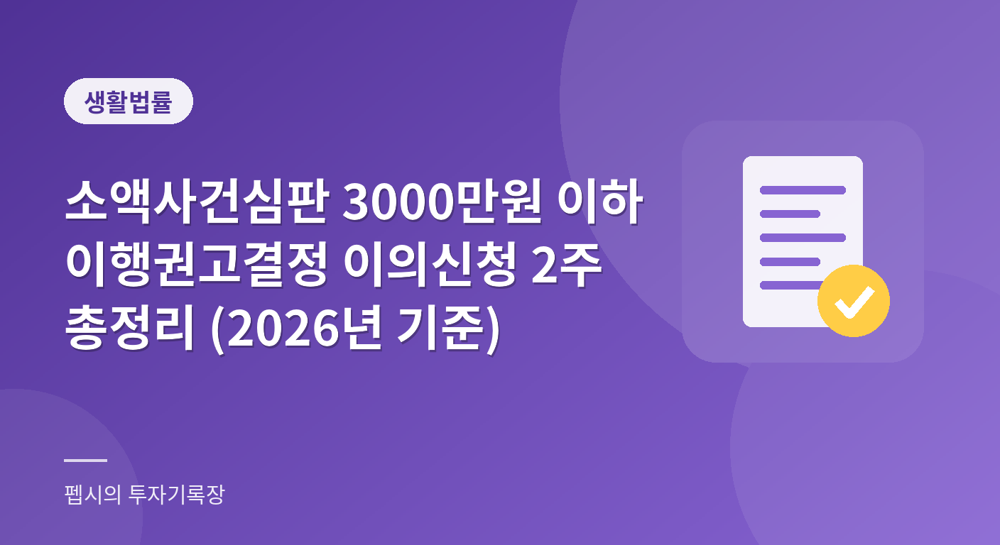

  

친구에게 빌려준 돈, 밀린 임금, 못 받은 물품대금이 있는데 변호사를 쓰자니 비용이 더 나올 것 같아 망설인 적 있으신가요? 금액이 크지 않을수록 "소송까지 해야 하나" 하는 고민이 깊어지죠.

이런 상황을 위해 만들어진 절차가 소액사건심판입니다. 금액이 일정 선 이하이면 절차가 훨씬 간단해서, 혼자서도 진행해 볼 수 있도록 설계되어 있습니다.

반대로 어느 날 법원에서 "이행권고결정"이라는 서류를 받은 분도 계실 겁니다. 이 서류를 가볍게 넘기면 불이익이 생길 수 있어서, 받는 쪽의 입장도 함께 정리해 보겠습니다.

**📌 한눈에 보기 (2026년 기준)**

- 소액사건 대상은 소송물가액 **3,000만원 이하**의 금전 등 지급 청구 제1심 민사사건입니다.
- 소장 대신 법원에 가서 말로 소를 제기하는 구술 제소도 가능합니다.
- 법원이 이행권고결정을 하면 피고는 등본을 받은 날부터 **2주 이내**에 서면으로 이의신청해야 합니다.
- 이의신청이 없으면 이행권고결정은 확정판결과 같은 효력을 가집니다.
- 변론은 원칙적으로 1회로 끝나며, 변론 종결 후 바로 판결을 선고할 수 있습니다.

**목차**

* TOC
{:toc}

## 소액사건심판이란 무엇인가

소액사건심판은 금액이 적은 민사 분쟁을 빠르고 간단하게 해결하기 위한 제1심의 특별 절차입니다. 일반 민사소송보다 절차를 단순하게 만들어 시간과 비용 부담을 줄이는 것이 목적입니다.

법제처 생활법령정보에서는 이 절차를 금전이나 대체물, 유가증권의 지급을 목적으로 하는 사건에 적용되는 제도로 안내합니다. 즉 "얼마를 달라", "이 물건을 인도하라" 같은 청구가 아니라 돈 문제를 다루는 절차라고 보시면 됩니다.

이 글에서는 소액사건심판의 대상 금액부터 소장 접수, 이행권고결정, 이의신청, 확정 후 강제집행까지 흐름대로 살펴봅니다. 청구하는 원고의 입장과 서류를 받은 피고의 입장을 나눠서 정리했습니다.

## 어떤 사건이 소액사건인가

핵심 기준은 소송물가액입니다. 법제처 생활법령정보에 따르면 소송물가액이 **3,000만원 이하**인 금전 등 지급 청구 사건이 소액사건에 해당합니다.

대표적인 사례로는 빌려준 돈을 돌려받는 대여금 청구, 못 받은 물품대금, 밀린 임금, 소비자 분쟁에서의 환급 청구 등을 떠올릴 수 있습니다. 다만 개별 사건이 소액사건에 해당하는지는 청구 내용에 따라 달라질 수 있으니 법원에 확인하시는 것이 안전합니다.

**⚠️ 청구를 쪼개서 낼 수는 없습니다**

사건을 나눠서 소액사건 기준에 맞추는 것은 인정되지 않습니다. 예를 들어 4,000만원짜리 채권을 3,000만원과 1,000만원으로 나눠 두 번 청구하면, 소송이 각하될 수 있다고 안내되어 있습니다. 금액이 기준을 넘는 사건은 일반 민사소송이나 다른 절차를 알아보셔야 합니다.

### 금액별로 보는 가상의 예시

아래는 이해를 돕기 위한 가상의 예시이고, 실제 판단은 법원의 몫입니다. 금액 기준만 단순 비교한 것임을 감안해서 봐주세요.

| 상황(가상) | 청구 금액 | 소액사건 여부 | 비고 |
|---|---|---|---|
| 지인에게 빌려준 돈 | 2,000만원 | 해당 | 3,000만원 이하 |
| 밀린 임금 | 800만원 | 해당 | 지방노동청 상담을 먼저 권하는 안내가 있음 |
| 3,000만원 | 3,000만원 | 해당 | 기준 금액 이하에 포함 |
| 하나의 채권 | 4,000만원 | 해당 안 함 | 3,000만원+1,000만원으로 나눠 청구 불가 |

표에서 보듯 금액만 3,000만원 이하이면 소액사건의 틀에 들어옵니다. 다만 하나의 채권을 인위적으로 나누는 방식은 막혀 있다는 점을 꼭 기억해 두세요.

## 소액사건심판의 특징

소액사건심판은 일반 소송과 다른 점이 몇 가지 있습니다. 모든 것이 간소화되어 있다고 보시면 되는데, 핵심만 짚어 보겠습니다.

### 1. 말로 소를 제기할 수 있다

소장을 써서 내는 방식이 기본이지만, 소액사건에서는 법원에 직접 가서 말로 소를 제기하는 구술 제소가 가능합니다(소액사건심판법 제4조). 이 경우 법원 직원이 내용을 적어 제소조서를 만듭니다.

서류 작성이 낯선 분께는 부담을 크게 덜어 주는 장치입니다. 다만 청구 취지와 원인을 분명히 말할 수 있도록 미리 정리해 가는 편이 좋습니다.

### 2. 변론은 원칙적으로 한 번이다

판사는 가급적 1회 변론으로 끝내려 하고, 필요하면 당사자에게 증거를 미리 제출하라고 요청할 수 있습니다. 변론이 끝나면 바로 판결을 선고할 수도 있습니다.

따라서 증거 자료는 변론기일 전에 정리해 두어야 합니다. 차용증, 계좌이체 내역, 문자메시지, 계약서 같은 자료를 한 묶음으로 준비해 두면 유리합니다.

### 3. 가족이 대리인이 될 수 있다

법제처 안내에 따르면 배우자, 직계혈족, 형제자매는 법원의 허가 없이 소송대리인이 될 수 있습니다. 직접 법원에 가기 어려운 상황이라면 이 경우에 해당하는지 확인해 보세요.

가족이 아닌 사람은 대리인이 되려면 별도의 요건이 필요할 수 있습니다. 이 부분은 법원에 확인이 필요하다고 보시면 됩니다.

## 소액사건심판 신청 절차

원고가 청구를 시작하는 순서를 단계별로 정리했습니다. 세부 서식과 비용은 법원 안내를 따라야 하므로, 아래는 큰 흐름만 보시기 바랍니다.

1. 청구할 금액, 상대방의 주소, 청구의 근거를 정리하고 증거를 모읍니다.
2. 관할 법원을 확인합니다. 일반적으로는 피고의 주소지를 관할하는 법원입니다.
3. 소장을 제출하거나, 법원에 가서 말로 소를 제기합니다.
4. 법원 사무관이 소장 부본이나 제소조서를 피고에게 송달합니다.
5. 법원이 직권으로 이행권고결정을 내리거나, 변론기일을 정합니다.

관할은 피고의 주소지가 기본이라고 안내되어 있으나, 법인이나 국가 등이 상대방일 때는 특별한 규정이 있습니다. 해당된다면 법원에 문의하세요.

인지대와 송달료는 법원이 정한 금액에 따르는데, 이번에 확인한 공식 안내 페이지에는 구체적인 금액이 나오지 않았습니다. 그래서 이 글에서는 금액을 적지 않고, 법원 민원실이나 대법원 전자소송 사이트에서 확인하시길 권합니다.

## 이행권고결정이란

소액사건에서는 법원이 변론을 열기 전에 먼저 이행권고결정을 하는 경우가 많습니다. 법원이 피고에게 "원고가 청구한 대로 갚으라"고 권고하는 결정입니다.

생활법령정보 설명으로는 법원이 직권으로 하는 것이 일반적이고, 이행권고결정은 원고의 소장 부본과 함께 피고에게 송달됩니다. 법적으로는 원고가 전부 승소할 수 있는 사건에서 가능한 절차입니다(소액사건심판법 제5조의3 제1항).

### 이행권고결정이 안 되는 경우

다음 경우에는 이행권고결정을 하지 않습니다.

- 독촉절차나 조정절차에서 소송절차로 넘어온 사건
- 청구 취지나 청구 원인이 분명하지 않은 사건
- 그 밖에 이행권고를 하기에 적절하지 않다고 법원이 인정하는 사건

송달이 되지 않아 결정을 전달할 수 없을 때는, 법원이 지체 없이 변론기일을 정하는 것으로 안내되어 있습니다. 또 판사가 처음부터 변론기일을 바로 정할 수도 있습니다.

## 이의신청 2주, 놓치면 어떻게 되나

서류를 받은 피고에게 가장 중요한 부분입니다. 피고는 이행권고결정 등본을 송달받은 날부터 **2주 이내**에 서면으로 이의신청을 할 수 있습니다(소액사건심판법 제5조의4 제1항).

등본이 송달되기 전에도 이의신청이 가능하고, 이 2주는 불변기간이라 법원이 임의로 늘려 주지 않는 기간입니다. 이의신청서 양식은 법원에 비치되어 있다고 안내되어 있습니다.

**⚠️ 2주를 넘기면 확정판결과 같은 효력**

이행권고결정을 받고 2주 안에 이의신청을 하지 않으면, 그 결정은 확정판결과 같은 효력을 가집니다. 이후 원고가 강제집행을 신청할 수 있으니, 억울한 부분이 있다면 기한 안에 반드시 서면으로 이의신청을 하세요.

### 이의신청서에 이유를 길게 써야 할까

법제처 안내에 따르면 피고가 이의신청을 하면 원고가 주장한 사실을 다툰 것으로 봅니다. 구체적인 이의 사유를 적지 않아도 되는 것으로 안내되어 있습니다(소액사건심판법 제5조의4 제5항).

물론 변론에서는 실제로 다툴 내용을 설명해야 하니, 근거 자료는 미리 준비해 두는 편이 좋습니다. 이의신청이 있으면 법원은 지체 없이 변론기일을 지정합니다.

### 이행권고결정 이후 흐름 한눈에 보기

| 상황 | 결과 | 근거 |
|---|---|---|
| 2주 안에 이의신청 없음 | 확정판결과 같은 효력 | 소액사건심판법 제5조의7 |
| 이의신청함 | 변론기일 지정, 재판 진행 | 제5조의4 |
| 이의신청이 각하되고 그 결정이 확정됨 | 확정판결과 같은 효력 | 제5조의7 |
| 이의신청을 취하함 | 확정판결과 같은 효력 | 제5조의7, 제5조의4 제4항 |

이의신청 취하는 제1심 판결이 선고되기 전까지 가능하지만, 취하하면 결정이 확정되는 효과가 따릅니다. 가볍게 취하하기 전에 결과를 꼭 생각해 보세요.

### 기한을 놓친 경우: 추후보완

부득이한 사정으로 2주 안에 이의신청을 하지 못했다면, 그 사유가 없어진 뒤 2주 안에 추후보완 신청을 할 수 있습니다. 사유가 없어질 당시 외국에 있던 피고는 30일입니다(소액사건심판법 제5조의6 제1항).

이때는 이의신청과 동시에 추후보완 사유를 서면으로 소명해야 합니다. 사유가 이유 없다고 인정되면 법원은 이의신청을 각하할 수 있고, 이 결정에는 즉시항고가 가능합니다.

## 확정 후 강제집행

이행권고결정이 확정되면 원고는 강제집행을 신청할 수 있습니다. 생활법령정보에 따르면 원칙적으로 집행문 없이 이행권고결정 정본만으로 집행이 가능합니다.

다만 조건이 붙은 결정이거나 당사자가 승계된 경우에는 예외가 있다고 안내되어 있습니다. 구체적인 강제집행 방법과 절차는 별도로 법원에서 확인하셔야 합니다.

변론을 거쳐 판결을 받은 경우도 마찬가지로, 상대방이 임의로 돈을 주지 않으면 별도의 집행 절차가 필요합니다. 판결을 받았다고 해서 돈이 자동으로 입금되는 것은 아니라는 점을 알아 두세요.

## 많이 하는 오해 4가지

소액사건심판을 둘러싸고 흔히 나오는 오해를 정리했습니다.

### 1. "3,000만원이 넘으면 나눠서 내면 된다"

앞에서 짚은 대로 하나의 채권을 쪼개서 소액사건으로 접수하는 것은 인정되지 않습니다. 소송이 각하될 수 있어 시간만 허비하게 될 수 있습니다.

### 2. "법원에서 온 서류는 일단 두고 봐도 된다"

이행권고결정은 이의신청 기한이 2주로 짧습니다. 기한이 지나면 확정판결과 같은 효력이 생기니, 서류를 받으면 바로 내용을 확인하셔야 합니다.

### 3. "이의신청서에 반박 이유를 자세히 써야 한다"

이의신청 자체로 원고의 주장을 다툰 것으로 보기 때문에, 구체적인 사유를 반드시 적어야 하는 것은 아닙니다. 다만 이후 변론에서 다툴 내용은 준비해야 합니다.

### 4. "변호사가 없으면 소송을 못 한다"

소액사건은 말로 소를 제기할 수 있고, 배우자나 직계혈족, 형제자매는 법원의 허가 없이 대리인이 될 수 있습니다. 그렇다고 사건이 항상 쉽다는 뜻은 아니니, 복잡한 사건은 전문가 상담이 필요합니다.

## 소액사건심판 전에 확인할 것들

소액사건심판을 시작하기 전에 점검하면 좋은 항목들입니다. 준비가 곧 승패를 가를 수 있습니다.

- 상대방의 정확한 이름과 주소(송달이 되지 않으면 절차가 지연됩니다)
- 돈을 주고받은 증거(차용증, 계좌이체 내역, 문자, 계약서 등)
- 청구 금액과 청구 취지(얼마를 언제까지 달라는 것인지)
- 청구 금액이 3,000만원 이하인지 여부
- 임금 문제라면 지방노동청에 먼저 신고하여 화해를 시도하는 방안

생활법령정보는 미지급 임금의 경우 먼저 지방노동청에 신고해 해결을 시도하고, 그래도 지급되지 않으면 소액사건심판을 제기하는 방법을 안내합니다. 자신의 사건 성격에 맞는 절차를 골라야 합니다.

지급명령 신청 같은 다른 절차와 비교하는 것도 도움이 됩니다. 소액사건에서 지급명령이나 조정에서 넘어온 사건은 이행권고결정 대상에서 빠진다는 점도 알아 두세요.

## 법 개정 시행일 안내

생활법령정보 페이지에는 소액사건심판법이 2028년 3월 1일 시행 예정이라는 안내가 붙어 있고, 개정 사항은 검토 후 업데이트할 예정이라고 되어 있습니다. 이 안내는 2026년 10월 15일 기준으로 작성된 것입니다.

어떤 내용이 어떻게 바뀌는지는 이번에 확인한 공식 페이지에서 구체적으로 나오지 않았습니다. 따라서 이 글의 내용은 현재 안내 기준이며, 시행 전후 변경 사항은 국가법령정보센터에서 확인하시길 바랍니다.

## 정리

- 소액사건심판은 소송물가액 3,000만원 이하의 금전 등 지급 청구에 쓰는 간이 절차입니다.
- 청구를 쪼개서 소액사건으로 만들 수 없고, 말로 소를 제기하는 것도 가능합니다.
- 이행권고결정을 받은 피고는 등본을 받은 날부터 2주 안에 서면으로 이의신청을 해야 합니다.
- 이의신청이 없으면 결정이 확정판결과 같은 효력을 가지고, 원고는 강제집행을 신청할 수 있습니다.

돈 문제는 마음이 앞서기 쉬운데, 소액사건심판은 기한과 증거가 결과를 크게 좌우합니다. 청구하는 쪽이든 서류를 받은 쪽이든 날짜부터 챙기는 습관이 필요합니다.

구체적인 사건은 대법원 전자소송, 법원 민원실, 대한법률구조공단 등에 확인하시고 진행하시길 권합니다.

## 자주 묻는 질문

**Q1. 소액사건은 얼마까지 가능한가요?**

A1. 법제처 생활법령정보 기준으로 소송물가액 3,000만원 이하의 금전 등 지급 청구 사건입니다. 하나의 청구를 나누어 기준 금액에 맞추는 것은 인정되지 않습니다.

**Q2. 소장을 쓰지 않고도 소송을 시작할 수 있나요?**

A2. 가능합니다. 법원에 직접 가서 말로 소를 제기하면 법원이 제소조서를 작성합니다(소액사건심판법 제4조). 다만 청구 취지와 원인은 미리 정리해 가시는 것이 좋습니다.

**Q3. 이행권고결정을 받았는데 2주가 지났습니다. 방법이 없나요?**

A3. 부득이한 사유로 기한을 지키지 못했다면, 사유가 없어진 후 2주 안에 추후보완 신청을 할 수 있습니다. 이때 이의신청과 함께 사유를 서면으로 소명해야 하고, 인정 여부는 법원이 판단합니다.

**Q4. 이의신청하면 바로 재판이 끝나나요?**

A4. 아닙니다. 이의신청이 있으면 법원이 지체 없이 변론기일을 정해 재판을 진행합니다. 변론은 원칙적으로 1회로 진행되고, 변론 종결 후 바로 판결이 선고될 수도 있습니다.

**Q5. 가족이 대신 재판에 나갈 수 있나요?**

A5. 배우자, 직계혈족, 형제자매는 법원의 허가 없이 소송대리인이 될 수 있다고 안내되어 있습니다. 그 밖의 대리인은 요건이 다를 수 있으니 법원에 확인하세요.

## 참고 자료

- [찾기쉬운 생활법령정보 - 소액사건재판의 대상 등](https://easylaw.go.kr/CSP/CnpClsMainBtr.laf?popMenu=ov&csmSeq=239&ccfNo=1&cciNo=1&cnpClsNo=2)
- [찾기쉬운 생활법령정보 - 소액사건재판 이행권고결정 이의신청](https://www.easylaw.go.kr/CSP/CnpClsMain.laf?csmSeq=239&ccfNo=3&cciNo=1&cnpClsNo=2)
- [찾기쉬운 생활법령정보 - 나홀로 민사소송 소액사건심판 및 이행권고](https://easylaw.go.kr/CSP/CnpClsMain.laf?popMenu=ov&csmSeq=568&ccfNo=3&cciNo=5&cnpClsNo=2)
- [찾기쉬운 생활법령정보 - 소액사건심판 신청하기](https://easylaw.go.kr/CSP/CnpClsMain.laf?popMenu=ov&csmSeq=669&ccfNo=5&cciNo=1&cnpClsNo=1)
- 2026년 11월 기준

> 이 글은 일반적인 정보 제공을 위한 것으로, 개인 상황에 따라 적용이 다를 수 있습니다. 정확한 내용은 관련 기관에 확인하세요.
