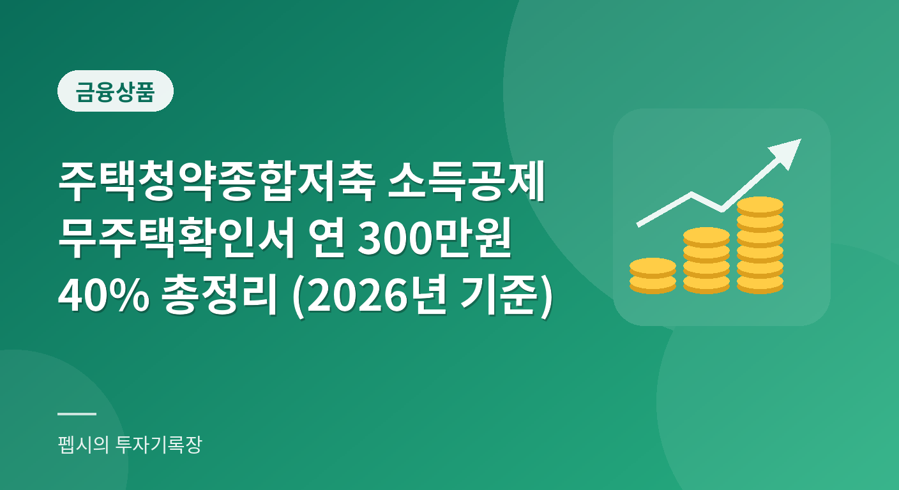

  

청약통장에 매달 돈을 넣고 있는데, 연말정산에서 공제를 받고 있는지 확인해 보셨나요? 통장은 있는데 정작 공제는 한 번도 못 받은 분이 의외로 많습니다.

이유는 대부분 하나입니다. 청약통장은 가입할 때 무주택 여부를 따지지 않기 때문에, 공제를 받으려면 따로 서류를 내야 하는 구조입니다.

11월 중순은 연말정산 전에 공제 항목을 점검하기 딱 좋은 시기입니다. 이번 글에서는 주택청약종합저축 소득공제의 대상, 한도, 무주택확인서 제출 방법, 해지할 때 조심할 점을 차근차근 정리해 보겠습니다.

**📌 한눈에 보기 (2026년 기준)**

- 대상은 총급여 7천만 원 이하 근로자 중 해당 연도 내내 무주택인 세대의 세대주(배우자 포함)입니다.
- 연 납입액 300만 원까지의 40%, 최대 120만 원이 소득에서 공제됩니다.
- 처음 공제를 신청하는 해의 다음 해 2월 말까지 무주택확인서를 은행에 내야 합니다.
- 해당 연도에 해지하면 그 해 납입분은 공제를 받을 수 없습니다.
- 현행 조문은 2028년 12월 31일까지 납입하는 경우를 대상으로 합니다.

**목차**

* TOC
{:toc}

## 주택청약종합저축 소득공제, 어떤 제도일까

주택청약종합저축 소득공제는 무주택 근로자가 내 집 마련을 위해 청약통장에 넣은 돈의 일부를 소득에서 빼 주는 제도입니다. 세액에서 직접 깎아 주는 세액공제가 아니라, 세금을 매기는 기준이 되는 소득을 줄여 주는 소득공제입니다.

근거는 조세특례제한법 제87조입니다. 국세청에서는 이 제도를 주택마련저축 소득공제라는 이름으로 안내합니다.

공제 대상이 되는 저축은 주택청약저축과 주택청약종합저축(청년우대형 포함)입니다. 예전에 있던 근로자주택마련저축은 2010년 1월 1일 이후 폐지되어, 종전 가입자에게만 기존 규정이 적용됩니다.

소득공제이기 때문에 실제로 돌려받는 돈은 공제 금액에 본인의 소득세율을 곱한 만큼입니다. 이 부분은 뒤의 계산 예시에서 다시 보겠습니다.

## 공제 대상자 조건

공제를 받으려면 두 가지를 모두 충족해야 합니다. 하나는 소득 조건, 다른 하나는 무주택 조건입니다.

국세청 안내 기준으로 대상자는 아래와 같습니다.

- 총급여액 7천만 원 이하인 근로소득자 (일용근로자는 제외)
- 과세연도 중 주택을 소유하지 않은 세대의 세대주 또는 배우자
- 본인 명의로 가입한 저축

배우자가 대상에 들어간 것은 비교적 최근 변화입니다. 국세청 안내에는 2025년 1월 1일 이후 납입분부터 배우자도 공제 대상에 포함된다고 되어 있습니다.

다만 국세상담센터의 예전 답변에는 세대주만 가능하다고 적혀 있는 경우가 있습니다. 두 안내가 다를 때는 법령과 국세청의 최신 안내가 기준이니, 본인이 배우자 입장이라면 회사 담당자나 국세청에 한 번 더 확인하시기 바랍니다.

## 공제율과 한도, 얼마나 줄어들까

공제율은 연 납입액의 40%이고, 납입액 한도는 연 300만 원입니다. 그러니 한 해에 최대로 받을 수 있는 소득공제는 120만 원입니다.

연 300만 원을 월로 나누면 25만 원입니다. 월 25만 원씩 12개월을 넣으면 한도를 딱 채우는 셈이죠.

한 해에 실제로 낸 돈이 기준이라, 다음 해 분을 미리 낸 금액도 그해에 실제 납입했다면 포함됩니다. 반대로 납입 한도를 넘는 금액은 공제 계산에서 빠집니다.

참고로 청약통장은 매월 25만 원 이상 넣어도 되지만, 소득공제는 연 300만 원까지만 인정된다는 점을 기억해 두세요.

아래 표는 월 납입액별 공제액을 제가 계산한 값입니다. 가상의 예시이고, 12개월 모두 납입했다고 가정했습니다.

| 월 납입액 | 연 납입액 | 공제 대상 금액 | 소득공제액(40%) |
|---|---|---|---|
| 5만 원 | 60만 원 | 60만 원 | 24만 원 |
| 10만 원 | 120만 원 | 120만 원 | 48만 원 |
| 20만 원 | 240만 원 | 240만 원 | 96만 원 |
| 25만 원 | 300만 원 | 300만 원 | 120만 원 |
| 30만 원 | 360만 원 | 300만 원 | 120만 원 |

표에서 보듯 월 25만 원을 넘겨 넣어도 공제액은 늘지 않습니다. 공제만 보면 월 25만 원이 효율의 끝입니다.

## 실제로 돌려받는 세금은 얼마일까

소득공제는 공제액에 세율을 곱한 만큼 세금이 줄어듭니다. 세율은 과세표준 구간에 따라 다르므로 사람마다 환급액이 다릅니다.

아래는 공제액 120만 원을 받는다고 가정하고, 적용 세율을 6%, 15%, 24%로 놓았을 때의 대략적인 세금 감소분입니다. 지방소득세는 포함하지 않았고, 제가 단순 계산한 가상의 예시입니다.

| 적용 소득세율 | 120만 원 공제 시 세금 감소 | 48만 원 공제 시 세금 감소 |
|---|---|---|
| 6% | 약 7만 2천 원 | 약 2만 9천 원 |
| 15% | 약 18만 원 | 약 7만 2천 원 |
| 24% | 약 28만 8천 원 | 약 11만 5천 원 |

숫자만 보면 큰돈은 아닙니다. 그래서 공제만 보고 청약통장에 넣기보다는, 청약 가입 기간과 납입 횟수를 쌓는다는 본래 목적에 공제가 덤으로 붙는다고 생각하는 편이 맞습니다.

본인에게 적용되는 정확한 세율은 연말정산 결과나 홈택스의 모의계산으로 확인할 수 있습니다.

## 무주택확인서, 꼭 내야 하는 이유

청약통장은 가입할 때 집이 있는지 없는지 묻지 않습니다. 그래서 은행은 이 통장 주인이 무주택 세대의 세대주인지 스스로 알 수 없습니다.

이를 증명하는 서류가 무주택확인서입니다. 국세청 안내에 따르면 공제를 처음 신청하는 해의 다음 해 2월 말까지 저축을 취급하는 금융기관에 제출해야 하고, 한 번 내면 매년 다시 낼 필요는 없습니다.

예를 들어 2026년 납입분으로 처음 공제를 받으려면 2027년 2월 말까지 내야 합니다. 이 기한을 놓치면 해당 납입분의 공제가 어려워질 수 있으니 일정부터 챙기세요.

**⚠️ 무주택확인서 제출 기한을 놓치지 마세요**

처음 공제를 받는 해의 다음 해 2월 말까지 금융기관에 무주택확인서를 제출해야 합니다. 이 서류가 제출되어야 연말정산 간소화 서비스에서 납입액이 조회되고 공제가 가능합니다. 기한이 지나면 공제를 받지 못할 수 있으니 11~12월에 미리 준비하는 것이 안전합니다.

## 공제 신청 순서

절차 자체는 복잡하지 않습니다. 처음 한 번만 하면 이후에는 자동으로 이어지는 구조입니다.

1. 해당 연도 내내 무주택이었는지, 12월 31일 현재 세대주(또는 해당되는 배우자)인지 확인합니다.
2. 청약통장을 만든 은행에 무주택확인서를 신청해 발급받습니다. 주민등록등본 등 필요한 서류는 은행 안내를 따릅니다.
3. 다음 해 2월 말까지 은행에 제출합니다.
4. 연말정산 간소화 서비스에서 주택마련저축 납입 내역이 조회되는지 확인합니다.
5. 조회되지 않으면 금융회사에서 납입증명서를 발급받아 회사에 제출합니다.

준비물은 아래와 같습니다.

- 무주택확인서 (은행 제출용)
- 주택마련저축 납입증명서 또는 통장 사본 (조회가 안 될 때)
- 본인 신분증

은행마다 온라인 신청이 가능한 곳도 있고 방문이 필요한 곳도 있어서, 자세한 방법은 거래 은행에 확인이 필요합니다.

## 공제를 받을 수 없는 경우

조건을 충족한 것 같아도 아래에 해당하면 공제를 받지 못합니다. 특히 무주택 기간 계산을 많이 헷갈려 하십니다.

- 납입한 해 1월 1일부터 12월 31일까지 한 번이라도 주택을 소유한 경우 (취득 전 납입분도 공제 불가)
- 총급여액이 7천만 원을 넘는 경우
- 해당 연도에 청약통장을 해지한 경우
- 무주택확인서를 기한까지 제출하지 못한 경우
- 통장 명의가 본인이 아닌 경우

해지의 경우, 법 조문에는 대통령령으로 정한 사유가 아닌 이유로 그해에 해지하면 그 해 납입분은 공제하지 않는다고 되어 있습니다. 국세청 답변에는 주택 당첨 후 청년우대형 주택청약종합저축으로 갈아타며 해지하는 경우처럼 예외가 있다고 나옵니다.

또한 5년 이내에 중도해지하면 이미 공제받은 세액에 대해 해지 추징세액이 부과될 수 있고, 일부 사유는 추징 대상에서 제외된다고 안내되어 있습니다. 구체적인 사유와 계산은 국세청이나 거래 은행에서 확인하세요.

## 많이 하는 오해 4가지

### 1. "청약통장이 있으면 자동으로 공제된다"

그렇지 않습니다. 통장을 만들었다고 공제가 되는 것이 아니라, 무주택확인서를 금융기관에 내야 합니다. 서류가 없으면 간소화 서비스에도 공제 대상 금액이 뜨지 않는 경우가 많습니다.

### 2. "월 50만 원씩 넣으면 공제도 두 배"

공제 대상 납입액은 연 300만 원까지입니다. 그 이상을 넣어도 공제액은 최대 120만 원에서 멈춥니다. 공제 때문에 무리해서 넣을 이유는 없습니다.

### 3. "집을 연말에 샀으니 사기 전 납입분은 괜찮다"

국세청 답변은 반대입니다. 연중 한 번이라도 주택을 소유하면 그해에는 취득 전 납입분도 공제를 받을 수 없습니다. 이사나 매수 계획이 있다면 시점을 미리 계산해야 합니다.

### 4. "무주택확인서는 매년 새로 내야 한다"

국세청 안내로는 처음 공제를 신청하는 해의 다음 해 2월 말까지 한 번 내면 매년 다시 낼 필요가 없습니다. 다만 중간에 주택을 취득해 무주택 상태가 깨지면 그해에는 공제를 받을 수 없습니다.

## 다른 공제와 함께 볼 때 알아둘 점

연말정산에서는 신용카드 공제, 연금계좌 세액공제 등 여러 항목이 함께 계산됩니다. 청약통장 공제는 그중 하나일 뿐이라, 전체 환급액에서의 비중은 크지 않습니다.

그래도 소득공제는 소득 자체를 줄이는 방식이라 총급여가 일정 수준 이하인 사회초년생에게는 체감이 있을 수 있습니다.

공제 한도가 걸려 있는 다른 항목이 있는지는 연말정산 안내를 통해 확인하는 것이 좋습니다. 이 글에서는 공식 자료로 확인하지 못한 종합한도 관련 내용은 다루지 않았습니다.

## 정리

- 주택청약종합저축 소득공제는 총급여 7천만 원 이하, 연중 무주택인 세대주(배우자 포함) 대상입니다.
- 연 300만 원까지 납입한 금액의 40%, 최대 120만 원을 공제받습니다.
- 무주택확인서는 처음 신청하는 해의 다음 해 2월 말까지 은행에 한 번 제출합니다.
- 해당 연도 해지, 연중 주택 소유, 서류 미제출이 공제를 못 받는 대표 사례입니다.

청약통장 공제는 금액이 크지 않아서 놓치기 쉽지만, 한 번 서류를 내 두면 이후에는 크게 신경 쓸 일이 없습니다. 올해 납입분부터 챙기고 싶다면 서류 준비를 미리 해 두세요.

공제 요건은 법 개정에 따라 바뀔 수 있으니, 연말정산 시기에는 국세청 안내를 한 번 더 확인하는 것이 안전합니다.

## 자주 묻는 질문

**Q1. 월 25만 원씩 넣으면 소득공제를 얼마나 받나요?**

A1. 연 납입액이 300만 원이므로 40%인 120만 원이 소득에서 공제됩니다. 실제 세금 감소액은 본인의 소득세율에 따라 달라집니다.

**Q2. 무주택확인서는 언제까지 내야 하나요?**

A2. 국세청 안내에 따르면 공제를 처음 신청하는 해의 다음 해 2월 말까지 저축취급기관에 내면 됩니다. 한 번 제출하면 매년 다시 낼 필요는 없습니다.

**Q3. 연중에 집을 샀다면 공제를 못 받나요?**

A3. 네, 납입한 해 1월 1일부터 12월 31일까지 계속 무주택이어야 합니다. 연중 주택을 소유한 사실이 있으면 취득 전 납입분도 그해에는 공제되지 않습니다.

**Q4. 청약통장을 해지하면 공제는 어떻게 되나요?**

A4. 대통령령으로 정한 사유가 아닌 이유로 해당 연도에 해지하면 그 해 납입분은 공제받을 수 없습니다. 또한 5년 이내 중도해지 시 해지 추징세액이 부과될 수 있으므로 해지 전에 은행이나 국세청에 확인하세요.

## 참고 자료

- [국세청 - 주택마련저축 소득공제](https://www.nts.go.kr/nts/cm/cntnts/cntntsView.do?mi=40610&cntntsId=239022)
- [국세상담센터 - 주택청약종합저축 소득공제 자주묻는 Q&A](https://call.nts.go.kr/call/qna/selectQnaInfo.do?mi=1318&ctgId=CTG11896)
- [국가법령정보센터 - 조세특례제한법 제87조](https://www.law.go.kr/법령/조세특례제한법/제87조)
- 2026년 11월 기준

> 이 글은 일반적인 정보 제공을 위한 것으로, 개인 상황에 따라 적용이 다를 수 있습니다. 정확한 내용은 관련 기관에 확인하세요.
