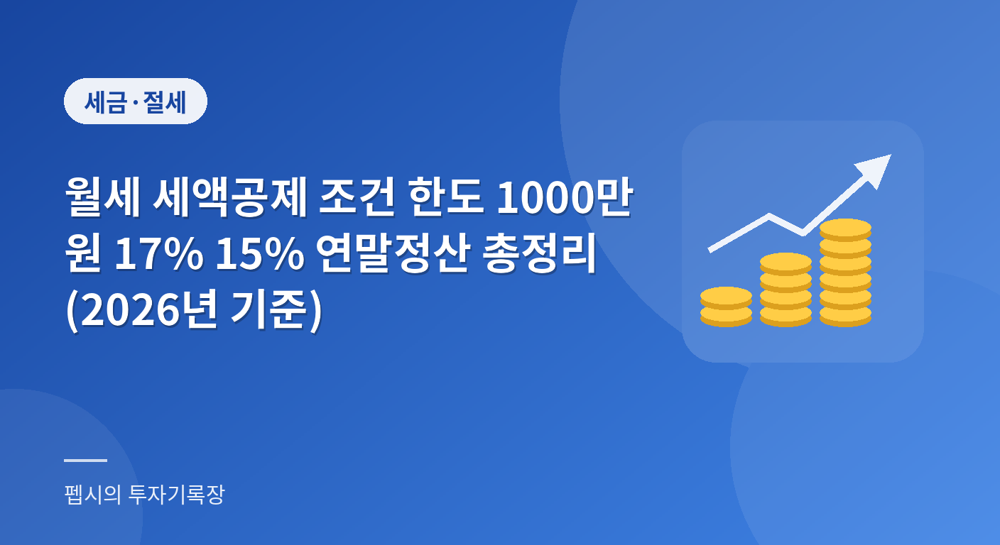

  

매달 꼬박꼬박 월세를 내고 있는데, 연말정산에서 얼마를 돌려받을 수 있는지 정확히 아는 분은 의외로 많지 않습니다. 월세 세액공제라는 제도가 있다는 건 알아도 "나도 대상인가?" 하는 순간 막히는 경우가 많거든요.

특히 전입신고, 세대주 여부, 집 면적 같은 조건이 겹겹이 걸려 있어서 하나라도 어긋나면 공제를 못 받습니다. 반대로 조건만 맞으면 최대 170만 원까지 세금에서 바로 빠지니 놓치기 아까운 항목입니다.

12월 31일이 지나면 전입 여부와 무주택 여부가 그대로 확정되기 때문에, 지금 11월이 점검하기 가장 좋은 시기입니다. 이 글에서 월세 세액공제의 조건, 한도, 서류, 흔한 오해를 차례로 정리해 보겠습니다.

**📌 한눈에 보기 (2026년 기준)**

- 대상은 총급여 8,000만 원 이하 무주택 근로자(종합소득금액 7,000만 원 이하)입니다.
- 공제율은 총급여 5,500만 원 이하 17%, 5,500만 원 초과~8,000만 원 이하 15%입니다.
- 공제 대상 월세액은 연 1,000만 원까지이며, 최대 공제액은 170만 원입니다.
- 주택은 전용 85㎡ 이하 또는 기준시가 4억 원 이하여야 하고, 전입신고가 필수입니다.
- 서류는 주민등록등본, 임대차계약서 사본, 월세 이체 증빙을 회사에 냅니다.

**목차**

* TOC
{:toc}

## 월세 세액공제란 무엇인가

월세 세액공제는 무주택 근로자가 집을 빌려 살면서 낸 월세의 일부를 **내야 할 세금에서 직접** 빼 주는 제도입니다. 소득에서 빼는 소득공제와 달리, 계산된 세금 자체를 줄여 주기 때문에 체감 효과가 큽니다.

예를 들어 공제액이 100만 원이라면 내야 할 세금이 정확히 100만 원 줄어듭니다. 같은 100만 원이라도 소득공제였다면 세율을 곱한 금액만큼만 줄어들겠죠.

연말정산 때 회사에 서류를 내면 월급에서 미리 떼인 세금(원천징수 세금)과 비교해서 환급이나 추가 납부가 결정됩니다. 그래서 월세 세액공제를 받으면 2027년 초 연말정산에서 환급액이 늘어나는 구조입니다.

참고로 2026년 11월 현재 하고 있는 준비는 2026년 귀속 연말정산, 즉 2027년 1~2월에 하는 정산을 위한 것입니다. 2026년 1월 1일부터 12월 31일까지 낸 월세가 계산 대상입니다.

## 월세 세액공제 조건 4가지

국세청 안내를 기준으로 하면, 월세 세액공제를 받으려면 사람 조건과 집 조건을 모두 충족해야 합니다. 하나라도 빠지면 공제가 안 됩니다.

먼저 사람 조건입니다. 총급여 8,000만 원 이하의 근로자여야 하고(종합소득금액 기준으로는 7,000만 원 이하), 무주택 세대의 세대주 또는 세대원이어야 합니다.

세대원이 공제를 받으려면 세대주가 주택 관련 공제(주택자금 공제 등)를 받지 않아야 한다는 단서가 붙습니다. 이 부분은 뒤에서 오해 섹션에서 한 번 더 다루겠습니다.

### 사람과 집 조건 한눈에 보기

- 총급여 8,000만 원 이하 근로자(종합소득금액 7,000만 원 이하)
- 무주택 세대의 세대주, 또는 세대주가 주택 공제를 받지 않은 세대원
- 본인 또는 기본공제대상자 명의로 임차한 주택
- 전용 85㎡(국민주택규모) 이하 또는 기준시가 4억 원 이하 주택
- 임대차계약서 주소와 주민등록등본 주소가 같을 것

주거용 오피스텔과 고시원도 공제 대상 주택에 포함됩니다. 반면 학교 기숙사처럼 주택으로 보기 어려운 곳은 대상이 아닙니다.

무주택 여부는 과세기간 마지막 날인 12월 31일 기준으로 판단합니다. 연중에 집을 샀다가 연말에 유주택자가 되어 있으면 그해 월세 세액공제는 받을 수 없습니다.

## 공제율과 한도, 얼마나 돌려받나

공제율은 총급여에 따라 두 구간으로 나뉩니다. 총급여 5,500만 원 이하(종합소득금액 4,500만 원 이하)는 월세액의 17%, 총급여 5,500만 원 초과 8,000만 원 이하는 15%입니다.

공제 대상이 되는 월세액은 연 1,000만 원까지만 인정됩니다. 월세를 1,000만 원 넘게 냈더라도 초과분은 계산에 들어가지 않습니다.

그래서 최대 공제액은 17% 구간 170만 원, 15% 구간 150만 원입니다. 월세 약 83만 원 이상을 1년 내내 내면 한도에 닿게 됩니다.

| 총급여 구간 | 공제율 | 월세 인정 한도 | 최대 공제액 |
|---|---|---|---|
| 5,500만 원 이하 | 17% | 연 1,000만 원 | 170만 원 |
| 5,500만 원 초과~8,000만 원 이하 | 15% | 연 1,000만 원 | 150만 원 |
| 8,000만 원 초과 | 대상 아님 | - | 0원 |

표에서 보듯 총급여 5,500만 원을 넘는 순간 공제율이 2%포인트 낮아집니다. 다만 구간 전체에 15%가 적용되는 것이 아니라 총급여를 기준으로 한 번 정해지는 공제율입니다.

공제율은 2023년 연말정산분부터 지금의 17%·15%로 올랐고, 총급여 8,000만 원 기준은 2024년 과세연도부터 적용되고 있다고 국세상담센터 Q&A에서 안내하고 있습니다.

## 계산 예시로 확인해 보기

숫자로 보면 이해가 훨씬 빠릅니다. 아래는 제가 국세청 공제율을 곱해서 계산한 가상의 예시입니다. 실제 환급액은 개인의 다른 공제와 결정세액에 따라 달라집니다.

| 사례(가상) | 연 월세액 | 공제율 | 공제액 |
|---|---|---|---|
| 총급여 4,000만 원, 월 30만 원 | 360만 원 | 17% | 61만 2천 원 |
| 총급여 4,000만 원, 월 50만 원 | 600만 원 | 17% | 102만 원 |
| 총급여 6,000만 원, 월 50만 원 | 600만 원 | 15% | 90만 원 |
| 총급여 5,000만 원, 월 70만 원 | 840만 원 | 17% | 142만 8천 원 |
| 총급여 7,000만 원, 월 100만 원 | 1,200만 원 → 1,000만 원 인정 | 15% | 150만 원 |
| 총급여 3,500만 원, 6개월간 월 40만 원 | 240만 원 | 17% | 40만 8천 원 |

마지막 사례처럼 연중에 이사해서 월세를 6개월만 냈다면, 낸 기간 만큼만 계산됩니다. 반대로 다섯 번째 사례처럼 월세가 높아서 한도를 넘으면 초과분은 공제에 반영되지 않습니다.

한 가지 짚을 점은, 세액공제는 내야 할 세금이 있어야 의미가 있다는 점입니다. 결정세액이 이미 0원이라면 공제액이 아무리 커도 그 이상 돌려받을 수는 없습니다. 이 부분은 개인별 상황에 따라 다르니 홈택스 모의계산 등으로 확인해 보세요.

## 준비 서류와 신청 방법

월세 세액공제는 연말정산 때 회사에 서류를 내는 방식으로 신청합니다. 국세청 안내 기준 필요한 서류는 아래와 같습니다.

- 주민등록표등본
- 임대차계약서 사본
- 계좌이체 영수증 또는 무통장입금증 등 월세 지급 증빙

월세는 가급적 계좌이체로 보내 두는 것이 좋습니다. 현금으로 건네면 지급 사실을 증명하기 어려워 공제가 막힐 수 있습니다.

### 신청 순서

1. 임대차계약서의 주소와 주민등록등본 주소가 같은지 확인합니다.
2. 12월 31일 기준 무주택 상태인지, 세대원이라면 세대주가 주택 공제를 받지 않는지 확인합니다.
3. 월세 이체 내역(통장 사본, 이체확인증)을 연간 단위로 모아 둡니다.
4. 연말정산 시기(보통 1월)에 회사가 안내하는 방식대로 서류를 제출합니다.

회사마다 서류를 받는 방식이 다릅니다. 홈택스 간소화 서비스에는 월세 지급 내역이 자동으로 나오지 않으니, 증빙은 직접 챙기셔야 합니다.

**⚠️ 전입신고가 없으면 공제가 안 됩니다**

임대차계약서와 주민등록등본의 주소가 같지 않으면 월세 세액공제를 받을 수 없습니다. 이사했는데 전입신고가 늦어졌다면 12월 31일 전에 마무리하고, 주소가 일치하는지 등본으로 확인하세요.

## 많이 하는 오해 5가지

월세 세액공제는 조건이 복잡해서 오해가 많습니다. 국세상담센터 Q&A 내용을 기준으로 자주 헷갈리는 부분을 바로잡아 보겠습니다.

### 1. "확정일자를 받아야 공제된다"

확정일자가 없어도 공제를 받을 수 있습니다. 2014년 귀속분부터 확정일자 요건은 없어졌다고 국세상담센터에서 안내하고 있습니다. 다만 전입신고는 반드시 필요합니다.

### 2. "부부 소득을 합쳐서 8,000만 원을 판단한다"

총급여 8,000만 원 이하인지는 공제를 받는 근로자 본인의 총급여만으로 판단합니다. 부부합산이 아닙니다. 배우자 소득이 높아도 본인 총급여가 기준 이하이고 다른 조건을 충족하면 공제를 받을 수 있습니다.

### 3. "세대원은 월세 공제를 못 받는다"

세대주가 아니어도 받을 수 있습니다. 무주택 세대원이라도 세대주가 주택 관련 공제를 받지 않고 나머지 요건을 갖추면 대상입니다. 반대로 같은 세대 부모님이 집을 갖고 있다면 무주택 세대가 아니라서 받을 수 없습니다.

### 4. "계약서에 내 이름이 없으면 안 된다"

본인 명의가 아니라도 기본공제대상자(예: 배우자) 명의로 계약했고, 근로자 본인이 실제로 거주하며 월세를 부담하면 가능합니다. 단, 그 기본공제대상자가 나이와 소득 요건을 충족해야 합니다.

### 5. "월세 세액공제와 현금영수증 공제를 둘 다 받을 수 있다"

둘은 중복 공제가 되지 않습니다. 월세 세액공제와 월세 현금영수증을 통한 신용카드 등 소득공제 중 유리한 하나를 골라야 한다고 국세상담센터에서 안내합니다. 보통은 세액공제 쪽이 유리하지만, 개인 상황에 따라 비교해 보는 것이 좋습니다.

## 세액공제 대상이 아니라면: 월세 현금영수증

총급여가 8,000만 원을 넘거나, 12월 31일 기준 유주택자라서 월세 세액공제를 못 받는 분도 방법이 완전히 막힌 것은 아닙니다. 국세청은 이런 경우 월세를 현금영수증으로 인정받아 신용카드 등 소득공제를 받을 수 있다고 안내합니다.

신청은 홈택스(또는 손택스 앱)에서 '주택임차료(월세) 현금영수증 발급 신청'을 검색해서 합니다. 임대차계약서와 월세 지급 내역을 첨부하면 세무서 담당자가 검토한 뒤 현금영수증을 발급하는 순서입니다.

이 방식은 월세를 신용카드 사용액처럼 인정받는 구조라서, 총급여의 일정 비율을 넘겨 써야 공제가 생기는 소득공제 특성이 그대로 적용됩니다. 구체적인 공제율과 한도는 국세청 안내에서 확인하세요.

국세청은 이런 신청을 연말정산 직전에 몰아서 하면 처리가 늦어질 수 있으니 미리 신청해 두라고 권하고 있습니다.

| 구분 | 월세 세액공제 | 월세 현금영수증 |
|---|---|---|
| 대상 | 총급여 8,000만 원 이하 무주택 근로자 | 세액공제를 못 받는 월세 지출자 |
| 방식 | 세액공제(세금에서 직접 차감) | 신용카드 등 소득공제 |
| 증빙 | 등본, 계약서, 이체 증빙을 회사에 제출 | 홈택스에서 신청 후 현금영수증 발급 |
| 중복 | 둘 중 하나 선택 | 둘 중 하나 선택 |

## 놓쳤다면 어떻게 하나

연말정산 때 월세 서류를 내지 못했다고 해서 기회가 사라지는 것은 아닙니다. 이미 연말정산이 끝난 뒤라도 경정청구 등을 통해 공제를 반영하는 길이 있습니다.

다만 구체적인 청구 기한과 방법은 개인별로 다를 수 있어서, 국세청 126 상담센터나 홈택스 안내를 확인하시길 권합니다. 이 글에서는 기한 숫자를 따로 단정하지 않겠습니다.

이런 사후 정정을 하려면 임대차계약서, 등본, 월세 이체 내역이 필요합니다. 그러니 올해 월세 증빙은 미리 파일로 모아 두면 좋습니다.

2026년 세제개편안에서 월세 공제 대상액을 넓히는 방안이 논의됐다는 보도도 있었지만, 법으로 확정됐는지는 제가 공식 자료로 확인하지 못했습니다. 이 글의 숫자는 국세청이 현재 안내하는 한도와 공제율 기준입니다.

## 정리

- 월세 세액공제는 총급여 8,000만 원 이하 무주택 근로자가 대상이며, 공제율은 17%(5,500만 원 이하)와 15%입니다.
- 월세 인정 한도는 연 1,000만 원이라 최대 공제액은 170만 원(17%) 또는 150만 원(15%)입니다.
- 집은 전용 85㎡ 이하 또는 기준시가 4억 원 이하이며, 전입신고로 계약서 주소와 등본 주소가 같아야 합니다.
- 월세 현금영수증 공제와는 중복이 안 되니, 해당하는 쪽을 골라 서류를 준비하세요.

월세 세액공제는 서류만 제대로 갖추면 비교적 확실하게 돌려받는 항목입니다. 반대로 전입신고나 무주택 요건 같은 기본 조건에서 탈락하면 한 푼도 못 받으니, 연말 전에 조건표를 한 번 훑어보시는 것이 좋습니다.

올해 낸 월세 이체 내역과 계약서를 지금 정리해 두면 1월 연말정산이 한결 편해집니다.

## 자주 묻는 질문

**Q1. 월세 세액공제는 부부가 각각 받을 수 있나요?**

A1. 공제는 월세를 실제로 부담하고 조건을 충족한 근로자 기준입니다. 부부가 각자 요건을 갖췄는지, 세대 구성이 어떻게 되는지에 따라 달라질 수 있으니 국세상담센터(126)에 확인하세요.

**Q2. 연중에 이사했는데 두 집 월세를 합쳐도 되나요?**

A2. 각 집이 모두 공제 요건(전입신고, 면적·기준시가 등)을 충족한다면 해당 기간 월세를 합산해 연 1,000만 원 한도 안에서 계산하는 것이 일반적인 방식입니다. 다만 세부 판단은 개인 상황에 따라 다를 수 있습니다.

**Q3. 묵시적으로 계약이 연장됐는데 서류는 어떻게 하나요?**

A3. 국세상담센터 Q&A에 따르면 묵시적 갱신으로 월세를 내는 경우에도 기존 임대차계약서와 월세 지급 내역을 제출하면 공제가 가능합니다.

**Q4. 연도 중간에 집을 샀는데 월세 공제를 받을 수 있나요?**

A4. 무주택 여부는 12월 31일 기준으로 판단하기 때문에, 연말에 유주택자가 되어 있으면 그해 월세 세액공제는 받을 수 없습니다.

**Q5. 집주인이 세금 문제로 계약서 제출을 꺼리면요?**

A5. 월세 세액공제는 임대차계약서 사본과 이체 증빙, 등본을 임차인이 회사에 제출하는 방식입니다. 구체적인 대응이 필요하면 국세청 126 상담을 이용하세요.

## 참고 자료

- [국세청 - 월세액 세액공제 조건](https://www.nts.go.kr/nts/cm/cntnts/cntntsView.do?mi=40613&cntntsId=239025)
- [국세상담센터 - 월세세액공제 자주묻는Q&A](https://call.nts.go.kr/call/qna/selectQnaInfo.do?mi=1318&ctgId=CTG11906)
- [정책브리핑(국세청) - 연말정산, 놓치지 말아야 할 포인트 ②](https://www.korea.kr/news/policyNewsView.do?newsId=148957247)
- [국가법령정보센터 - 조세특례제한법](https://www.law.go.kr/법령/조세특례제한법)

2026년 11월 기준

> 이 글은 일반적인 정보 제공을 위한 것으로, 개인 상황에 따라 적용이 다를 수 있습니다. 정확한 내용은 관련 기관에 확인하세요.
