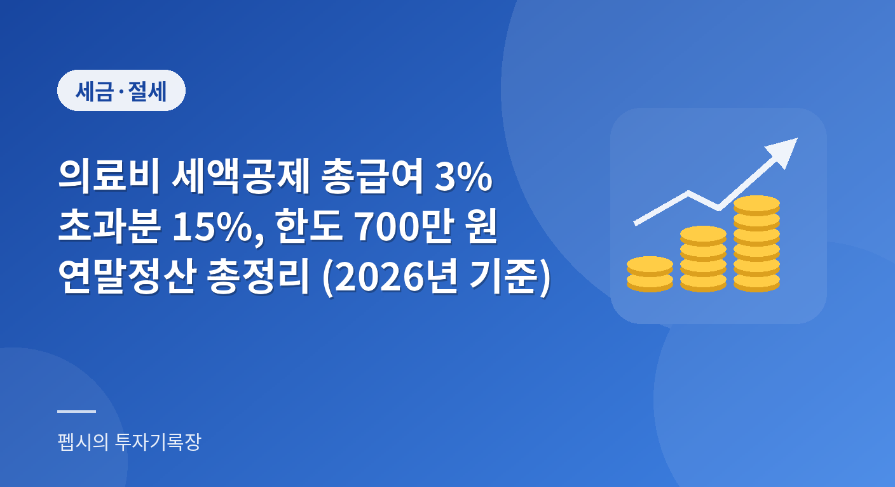

  

병원비를 꽤 많이 썼는데, 연말정산 미리보기에서 의료비 공제액이 0원으로 뜨는 걸 본 적 있으신가요? 영수증은 수북한데 돌려받는 돈이 없으니 당황스럽습니다.

이건 여러분이 뭘 잘못해서가 아닙니다. 의료비는 쓴 금액 전부가 아니라 **총급여의 3%를 넘는 부분**만 공제 대상이 되기 때문입니다.

11월은 12월 31일 전에 지출 계획을 조정할 수 있는 마지막 시기입니다. 이 글에서는 의료비 세액공제의 계산 구조, 한도, 공제되는 항목과 안 되는 항목을 하나씩 정리해 보겠습니다.

**📌 한눈에 보기 (2026년 기준)**

- 공제 대상은 총급여의 3%를 초과하는 의료비입니다.
- 일반 부양가족 의료비는 연 700만 원까지, 공제율은 15%입니다.
- 본인·6세 이하·65세 이상·장애인 의료비는 한도 없이 15%입니다.
- 미숙아·선천성이상아는 20%, 난임시술비는 30%(모두 한도 없음)입니다.
- 안경·콘택트렌즈는 1인 연 50만 원, 산후조리원은 출산 1회당 200만 원까지입니다.

**목차**

* TOC
{:toc}

## 의료비 세액공제, 어떤 제도일까

근로소득이 있는 거주자가 기본공제 대상자를 위해 그해에 지출한 의료비가 있으면, 산출세액에서 일정 금액을 빼 주는 제도입니다. 소득공제가 아니라 세액공제라서 계산된 공제액이 그대로 세금에서 빠집니다.

국세청 안내에 따르면 기본공제 대상자는 나이와 소득 제한을 받지 않고 의료비 공제 대상이 됩니다. 이 부분이 부양가족 공제와 가장 크게 다른 점입니다.

예를 들어 소득이 있어서 인적공제를 받을 수 없는 부모님이라도, 기본공제 대상자에 해당하는 경우라면 의료비 공제 여부를 따로 따져 볼 수 있다는 뜻입니다. 기본공제 대상자인지는 연말정산 부양가족 요건을 먼저 확인해야 합니다.

올해 지출한 의료비가 기준입니다. 12월 31일까지 결제한 분이 올해 연말정산에 반영되므로, 연말에 몰아서 치료를 받을지 고민하시는 분은 이 기준일을 기억해 두세요.

## 공제액 계산 구조: 3% 문턱과 공제율

계산 순서는 단순합니다. 먼저 그해 쓴 의료비를 모두 더하고, 실손보험 등으로 돌려받은 금액을 뺍니다. 그다음 총급여의 3%를 뺀 나머지에 공제율을 곱합니다.

공제율과 한도는 누구를 위해 쓴 의료비인지, 어떤 종류인지에 따라 달라집니다. 국세청 안내 기준으로 정리하면 아래와 같습니다.

| 구분 | 공제 대상 금액 한도 | 공제율 |
|---|---|---|
| 일반 기본공제대상자 | 연 700만 원 | 15% |
| 본인·6세 이하·65세 이상·장애인 | 한도 없음 | 15% |
| 미숙아·선천성이상아 | 한도 없음 | 20% |
| 난임시술비 | 한도 없음 | 30% |

표에서 '한도'는 세액공제 대상이 되는 의료비 금액의 상한입니다. 공제받는 세금이 700만 원이라는 뜻이 아닙니다. 700만 원 × 15%인 105만 원이 일반 부양가족 의료비로 받을 수 있는 최대 세액입니다.

참고로 총급여 3% 차감이 한도 없는 항목에도 적용되므로, 본인 의료비라고 해서 쓴 만큼 15%가 돌아오는 것은 아닙니다. 이 점은 아래 계산 예시에서 확인해 보겠습니다.

## 계산 예시로 확인하기

숫자로 보면 훨씬 이해가 쉽습니다. 아래는 이해를 돕기 위한 가상의 사례이며, 제가 위 공제율에 맞춰 계산한 값입니다. 실제 공제액은 개인 상황에 따라 다를 수 있습니다.

| 사례 | 총급여 | 3% 기준액 | 인정 의료비 | 공제 대상 | 세액공제 |
|---|---|---|---|---|---|
| A. 본인 치료비 300만 원 | 4,000만 원 | 120만 원 | 300만 원 | 180만 원 | 27만 원 |
| B. 본인 치료비 140만 원 | 5,000만 원 | 150만 원 | 140만 원 | 0원 | 0원 |
| C. 배우자 1,000만 원 | 3,000만 원 | 90만 원 | 1,000만 원 | 910만 원 → 700만 원 | 105만 원 |
| D. 본인 400만 원, 실손 150만 원 수령 | 4,000만 원 | 120만 원 | 250만 원 | 130만 원 | 19만 5천 원 |
| E. 난임시술 400만 원 | 4,000만 원 | 120만 원 | 400만 원 | 280만 원 | 84만 원 |

A는 가장 기본적인 경우입니다. 300만 원에서 120만 원을 빼고 남은 180만 원에 15%를 곱해 27만 원이 나옵니다.

B는 안타까운 경우입니다. 의료비가 140만 원이면 총급여 5,000만 원의 3%인 150만 원에 미치지 못해 공제액이 0원입니다. 이런 분은 올해 의료비 공제를 기대하기 어렵습니다.

C는 한도에 걸린 경우입니다. 배우자 의료비가 일반 부양가족 기준이라 910만 원이 아니라 700만 원까지만 인정되고, 세액은 105만 원이 됩니다.

D는 실손보험금을 받은 경우입니다. 의료비 400만 원에서 보험금 150만 원을 먼저 빼야 하므로 실제 대상은 250만 원입니다. 보험금을 빼지 않고 신고하면 나중에 문제가 될 수 있습니다.

E는 난임시술비입니다. 같은 280만 원이라도 공제율이 30%라서 15%일 때보다 두 배인 84만 원이 됩니다.

## 공제되는 의료비, 안 되는 의료비

국세상담센터 안내를 기준으로 공제 대상에 해당하는 대표 항목은 다음과 같습니다.

- 질병 치료·진료·예방을 위해 의료기관에 낸 비용(조산원 포함)
- 치료·요양을 위한 의약품 구입비
- 장애인 보장구 구입·임차비, 의사 처방에 따른 의료기기 구입·임차비
- 시력보정용 안경·콘택트렌즈(1인 연 50만 원 한도)
- 보청기 구입비, 노인장기요양 본인부담금
- 건강진단비, 라식·라섹 수술비, 스케일링, 보철·틀니
- 치열교정비(저작기능장애 진단서 첨부 필요)
- 임신 중 검사비와 분만비용

반대로 공제가 안 되는 항목도 분명합니다. 이쪽이 더 헷갈리는 분이 많습니다.

- 미용·성형 목적의 비용
- 건강기능식품·건강증진 의약품 구입비
- 간병인에게 지급한 비용
- 보험회사 보험금으로 돌려받은 의료비
- 국민건강보험공단 본인부담상한제 사후환급금
- 외국 소재 의료기관에 지출한 비용
- 사내복지기금에서 지급받은 의료비

영양제나 건강식품은 몸을 위해 샀더라도 의료비가 아니라는 점을 기억하세요. 약국 영수증이라도 치료 목적의 의약품인지에 따라 달라집니다.

2024년 1월 1일 이후 지출분부터는 장애인활동지원급여 비용 중 실제로 낸 본인부담금도 공제 대상에 포함됩니다. 활동보조, 방문목욕, 방문간호 등이 여기에 해당합니다.

## 안경, 산후조리원, 난임시술비 따로 보기

의료비 중에서도 따로 한도나 조건이 붙는 항목이 있습니다. 한눈에 정리해 보겠습니다.

| 항목 | 조건·한도 | 비고 |
|---|---|---|
| 안경·콘택트렌즈 | 1인 연 50만 원 | 시력보정용만 해당 |
| 산후조리원 | 출산 1회당 200만 원 이내 | 총급여 7천만 원 이하 근로자 |
| 난임시술비 | 한도 없음, 공제율 30% | 3% 기준액은 차감 |
| 미숙아·선천성이상아 | 한도 없음, 공제율 20% | 3% 기준액은 차감 |

안경은 가족 한 명당 50만 원씩이라서, 가족이 여럿이면 합산 한도가 그만큼 늘어납니다. 다만 선글라스처럼 시력보정이 목적이 아닌 제품은 해당하지 않습니다.

산후조리원 비용은 소득 요건이 붙는다는 점이 특징입니다. 총급여가 7천만 원을 넘으면 산후조리원 비용은 의료비로 공제받을 수 없습니다. 이 부분을 놓치는 분이 의외로 많습니다.

다른 의료비는 소득과 상관없이 공제 대상이지만, 산후조리원만 소득 기준이 있다고 기억해 두시면 됩니다.

## 누구의 의료비를 누가 공제받나

의료비는 기본공제 대상자를 위해 지출한 금액이 대상입니다. 나이와 소득 요건은 따로 없다는 점이 국세청 안내에 명시되어 있습니다.

그래서 맞벌이 부부라면 누가 공제를 받을지가 고민이 됩니다. 의료비는 실제로 낸 사람이 공제를 받는 구조이고, 3% 문턱은 공제받는 사람의 총급여로 계산됩니다.

일반적으로는 총급여가 낮은 쪽에 의료비를 모으면 3% 기준액이 작아져 공제 대상 금액이 커집니다. 다만 부부의 세율 구간, 카드 공제 등 다른 항목과의 관계도 있으니 한 번에 단정하기는 어렵습니다.

**⚠️ 실손보험금은 반드시 빼고 신고하세요**

실손보험 등으로 보전받은 금액은 의료비에서 제외됩니다. 보험금을 받고도 병원 영수증 금액 전체를 올리면 나중에 추징될 수 있으니, 간소화 자료와 보험 청구 내역을 꼭 대조해 보세요.

실손보험금을 이듬해에 받는 경우도 있습니다. 이럴 때는 해당 보험금을 받은 연도에 공제 금액을 다시 정리해야 하는 경우가 있으니, 구체적인 처리 방법은 국세상담센터(126)에서 확인하는 것이 안전합니다.

## 연말 전에 해 볼 점검 순서

12월이 오기 전에 아래 순서로 한 번 확인해 보시면 좋겠습니다. 의료비 세액공제 가능 여부는 이 점검만으로도 대략 감이 옵니다.

1. 올해 의료비 영수증과 카드 내역을 모두 모은다.
2. 실손보험금을 받았거나 받을 예정인 금액을 정리한다.
3. 총급여를 확인해 3% 기준액을 계산한다.
4. 의료비가 3% 기준액을 넘을 가능성이 있는지 본다.
5. 부부 중 누구에게 지출을 모을지 검토한다.
6. 부양가족 중 기본공제 대상자가 맞는지 확인한다.

점검 결과 3% 문턱을 넘지 못할 것 같다면 의료비 공제는 포기하고, 다른 공제 항목에 집중하는 편이 낫습니다.

반대로 문턱을 살짝 넘길 것 같은 경우에는 안경, 치과 치료처럼 12월 안에 필요한 지출을 미리 하느냐가 차이를 만들 수 있습니다. 다만 공제를 받기 위해 불필요한 지출을 하는 것은 권하지 않습니다.

## 많이 하는 오해 5가지

### 1. "병원비를 쓴 만큼 15%가 돌아온다"

그렇지 않습니다. 총급여의 3%를 먼저 빼고 남은 금액에만 공제율이 적용됩니다. 의료비가 총급여의 3%에 못 미치면 공제액은 0원입니다.

### 2. "본인 의료비는 한도가 없으니 전부 공제된다"

한도가 없다는 말은 공제 대상 금액 상한이 없다는 뜻입니다. 3% 차감은 그대로 적용되므로 쓴 금액 전체가 대상이 되는 것은 아닙니다.

### 3. "부모님은 소득이 있으면 의료비 공제가 안 된다"

의료비 공제는 기본공제 대상자의 나이와 소득 제한을 받지 않는다고 국세청이 안내하고 있습니다. 다만 기본공제 대상자에 해당하는지 여부는 별도로 확인해야 합니다.

### 4. "건강기능식품도 의료비로 넣을 수 있다"

건강기능식품과 건강증진 의약품은 공제 제외 항목입니다. 미용·성형 비용과 간병인 비용도 마찬가지입니다.

### 5. "실손보험금은 신고하지 않아도 된다"

보험금으로 돌려받은 금액은 의료비에서 빼야 합니다. 간소화 자료에 병원 결제 전체가 잡혀 있어도, 보험금을 받은 부분은 직접 차감해야 합니다.

## 정리

핵심만 다시 한번 짚어 보겠습니다.

- 의료비는 총급여의 3%를 초과하는 금액부터 공제 대상이다.
- 일반 부양가족은 연 700만 원 한도에 15%, 본인·6세 이하·65세 이상·장애인은 한도 없이 15%이다.
- 난임시술비 30%, 미숙아·선천성이상아 20%이며 안경은 1인 연 50만 원까지이다.
- 실손보험금과 미용·성형, 건강기능식품은 공제 대상이 아니다.

의료비 세액공제는 쓴 돈이 많다고 무조건 크게 돌아오는 제도가 아닙니다. 3% 문턱을 먼저 계산해 보는 것이 출발점입니다.

올해 의료비가 얼마인지, 실손보험금은 얼마나 받았는지 지금 한 번 정리해 보세요. 12월 31일이 지나면 지출 시기를 바꿀 수 없습니다.

## 자주 묻는 질문

**Q1. 의료비가 총급여의 3%보다 적으면 어떻게 되나요?**

A1. 공제 대상 금액이 없어 의료비 세액공제는 받을 수 없습니다. 이 경우 다른 공제 항목을 점검하는 편이 낫습니다.

**Q2. 부모님 의료비도 제가 공제받을 수 있나요?**

A2. 기본공제 대상자인 부모님을 위해 직접 지출했다면 대상이 될 수 있습니다. 의료비 공제는 기본공제 대상자의 나이와 소득 제한을 받지 않는다고 국세청이 안내합니다. 기본공제 대상자 여부는 따로 확인하세요.

**Q3. 안경은 가족 모두 합쳐 50만 원인가요?**

A3. 국세상담센터 안내는 시력보정용 안경·콘택트렌즈를 1인 연간 50만 원 한도로 보고 있습니다. 가족 합산이 아니라 사람별 한도입니다.

**Q4. 산후조리원 비용은 누구나 공제되나요?**

A4. 총급여 7천만 원 이하 근로자가 출산 1회당 200만 원 이내로 지급한 금액이 대상입니다. 소득이 이를 넘으면 공제되지 않습니다.

**Q5. 증빙은 어떻게 준비하나요?**

A5. 대부분은 홈택스 연말정산 간소화 서비스로 조회됩니다. 다만 간소화 자료에 빠진 항목의 증빙 방식은 이 글에서 공식 출처로 확인하지 못했으니 국세상담센터나 홈택스에서 확인이 필요합니다.

## 참고 자료

- [국세청 - 의료비·보험료 세액공제](https://www.nts.go.kr/nts/cm/cntnts/cntntsView.do?cntntsId=7874)
- [국세상담센터 - 연말정산 의료비 공제](https://call.nts.go.kr/call/qna/openPrufView.do?prufHtml=sub00_%EC%97%B0%EB%A7%90%EC%A0%95%EC%82%B0_%EC%9D%98%EB%A3%8C%EB%B9%84%EA%B3%B5%EC%A0%9C)
- [국가법령정보센터 - 소득세법](https://www.law.go.kr/법령/소득세법)

2026년 11월 기준으로 작성했으며, 이후 세법 개정에 따라 달라질 수 있습니다.

> 이 글은 일반적인 정보 제공을 위한 것으로, 개인 상황에 따라 적용이 다를 수 있습니다. 정확한 내용은 관련 기관에 확인하세요.
