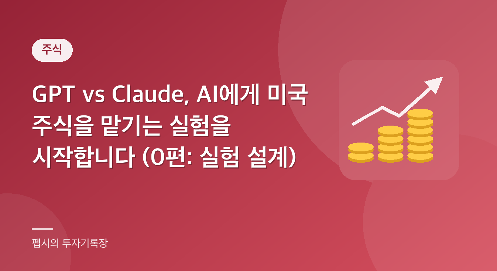
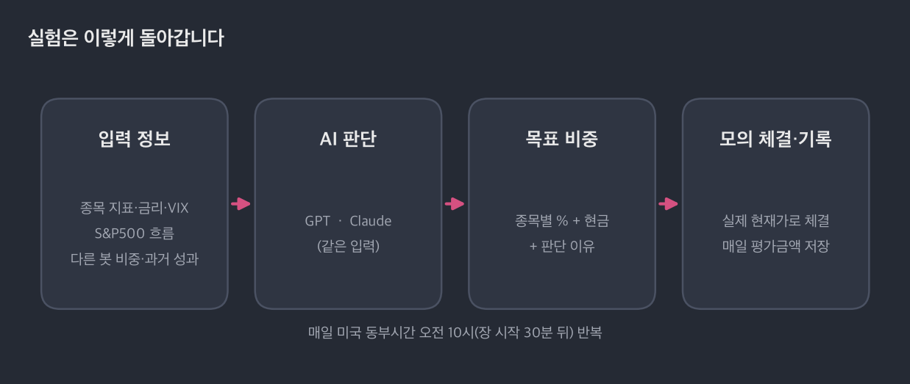

  

"AI한테 주식을 맡기면 정말 사람보다 잘할까?"

요즘 이런 이야기를 자주 듣습니다. 그래서 직접 실험해 보기로 했습니다. GPT와 Claude에게 같은 정보를 주고, 매일 미국 주식 비중을 정하게 한 뒤 결과를 기록합니다.

이 글은 실험의 규칙을 정리한 기준 글입니다. 결과는 이어지는 글에서 주기적으로 공개하겠습니다.

**📌 실험 한눈에 보기**

- 참가자: AI 2개(GPT, Claude) + 규칙 기반 봇 3개, 그리고 비교 기준 SPY
- 종목: 미국 주식 5개 (XOM, PLTR, TQQQ, TSLA, JNJ)
- 조건: 모두 가상의 **$10,000**에서 시작, 같은 비용 조건
- 방식: 매일 장 시작 30분 뒤 비중을 정하는 **모의투자**
- 시작일: 2026년 11월 5일

**목차**

* TOC
{:toc}

## 투자 종목 5개

| 종목 | 설명 |
|---|---|
| XOM | 엑슨모빌 (에너지) |
| PLTR | 팔란티어 |
| TQQQ | 나스닥100 3배 레버리지 ETF |
| TSLA | 테슬라 |
| JNJ | 존슨앤존슨 (방어주) |

성격이 다른 종목을 섞었습니다. 에너지, 성장주, 레버리지 ETF, 방어주가 함께 있어서 시장 상황에 따라 어떤 종목을 고르는지 차이가 잘 드러납니다.

## 경쟁하는 봇 5개

| 봇 | 비중을 정하는 방법 |
|---|---|
| **GPT (astra)** | gpt-6-astra 모델이 매일 비중을 결정 |
| **Claude** | Claude Opus 5.5가 매일 비중을 결정 |
| 위험 균형 | 최근 1년 변동성이 작은 종목일수록 많이 담음 |
| 모멘텀 | 최근 20거래일 수익률 상위 3종목을 1/3씩 |
| S&P 추세 | S&P500이 250일선 위면 SPY·SSO, 아래면 채권·현금 |

규칙 기반 봇 3개는 "AI가 아니어도 이 정도는 한다"는 기준선입니다. AI가 정말 의미가 있는지 보려면, 단순한 규칙보다 나은지를 같이 봐야 합니다.

## 두 AI는 같은 정보를 받습니다

공정한 비교를 위해 두 AI에게 **완전히 같은 입력**을 줍니다.

- 종목별 지표: 이동평균, 기간별 수익률, 변동성 등
- 거시 지표: 금리, VIX 등
- S&P500의 흐름
- 다른 봇들의 오늘 비중
- 자기 과거 판단의 성과

AI는 매일 종목별 비중과 함께 **판단 이유**를 글로 남깁니다. 결과 글에서는 이 이유를 그대로 인용해서, 두 AI가 같은 상황을 어떻게 다르게 읽었는지 비교하겠습니다.

## 매매는 이렇게 진행됩니다

1. 미국 장이 열린 지 30분 뒤(동부시간 오전 10시, 한국시간 자정 무렵)에 판단합니다.
2. 전날까지 완성된 일봉 데이터를 봅니다.
3. 목표 비중과 현재 비중이 일정 이상 벌어진 날에만 사고팝니다.
4. 체결은 실제 현재가를 기준으로 흉내 내는 모의투자입니다.

## 왜 백테스트가 아니라 모의투자인가

규칙 기반 봇은 과거 데이터로 백테스트를 할 수 있습니다. 하지만 AI는 그럴 수 없습니다.

AI 모델은 과거 주가와 뉴스를 이미 학습했습니다. 2022년 데이터를 보여 주며 "이때 뭘 살래?"라고 물으면, 그 뒤에 무슨 일이 있었는지 알고 답할 수 있습니다.

그래서 AI의 실력은 **앞으로의 시장에서 실시간으로만** 공정하게 비교할 수 있습니다. 시간이 걸리더라도 모의투자로 기록을 쌓는 이유입니다.

**⚠️ 이 실험의 한계**

5종목은 지금 결과를 아는 상태에서 고른 종목이라 편향이 있습니다. 또 모의투자는 실제 매매와 체결 가격이 다를 수 있습니다. 이 실험은 투자 방법을 권하려는 것이 아니라 기록입니다.

## 앞으로 지켜볼 것

1. **AI가 단순한 규칙보다 나을까?** 특히 모멘텀 봇과의 차이가 궁금합니다.
2. **두 AI의 성격은 어떻게 다를까?** 같은 정보를 받고도 다른 판단을 하는지 봅니다.
3. **하락장과 상승장에서 각각 어떻게 움직일까?** 한쪽 장에서만 잘하는 건 아닌지 확인합니다.

결과는 [1편: 2주차 중간 결과](/economy/AI_주식_모의투자_GPT_vs_Claude_1편_2주차_결과/)부터 이어집니다.

## 자주 묻는 질문

**Q1. 실제 돈으로 투자하나요?**

A1. 아닙니다. 실제 현재가로 체결을 흉내 내는 모의투자입니다. 시작 금액 $10,000도 가상의 금액입니다.

**Q2. AI는 매일 무엇을 결정하나요?**

A2. 5종목 각각의 비중(%)과 현금 비율을 정하고, 종목별 판단 이유를 남깁니다.

**Q3. 왜 과거 데이터로 AI 백테스트를 하지 않나요?**

A3. AI 모델이 과거 시세와 그 뒤의 결과를 이미 학습했기 때문입니다. 공정한 비교는 앞으로의 시장에서 실시간으로만 할 수 있습니다.

> 이 글은 개인적인 모의투자 실험 기록이며 투자 권유가 아닙니다. 투자 판단과 그 결과의 책임은 투자자 본인에게 있습니다.
