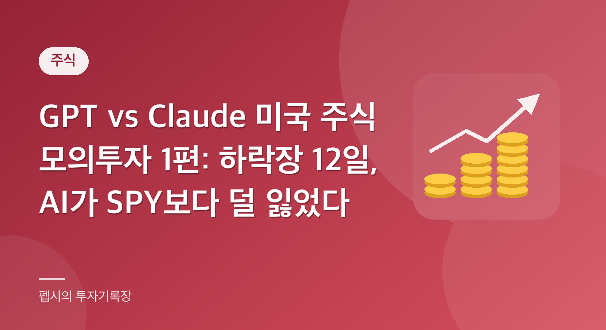
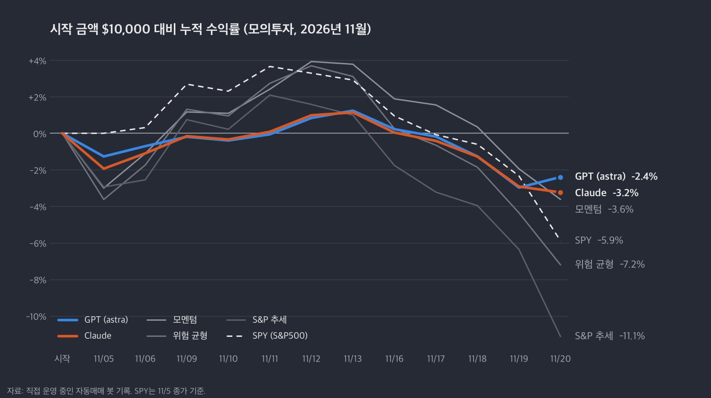
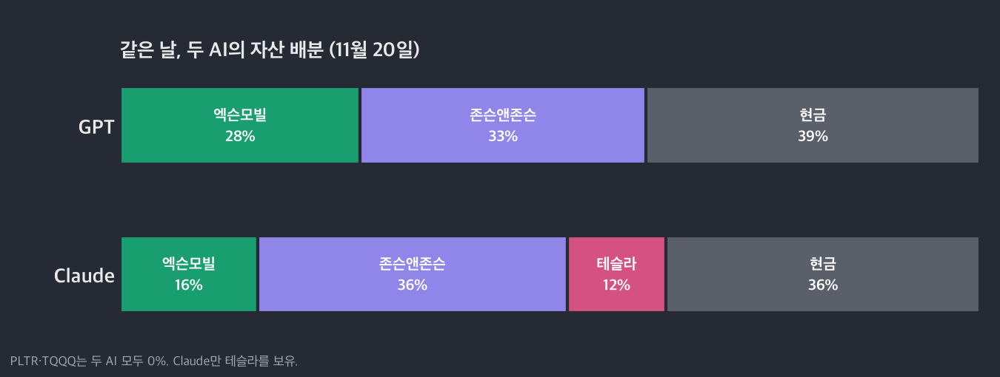
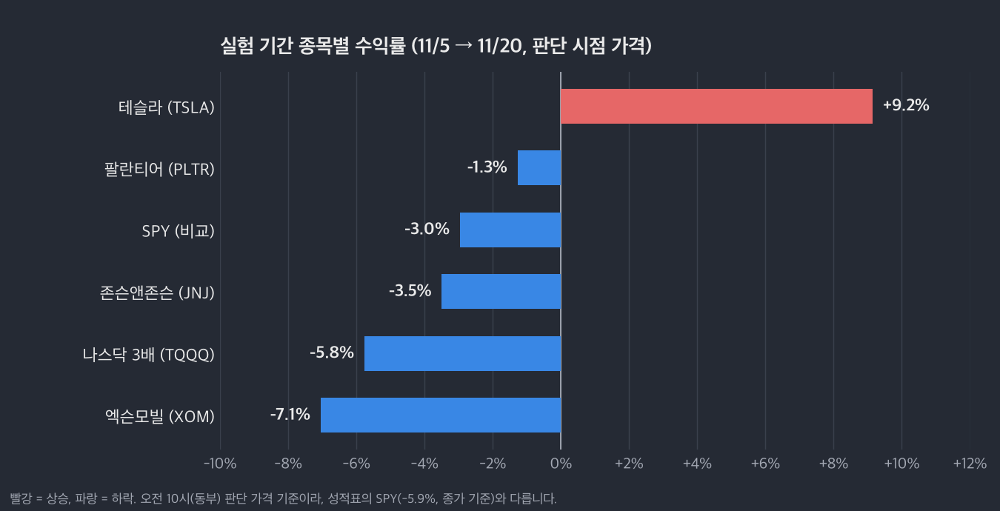

  

GPT와 Claude에게 미국 주식 비중을 매일 맡기는 실험의 첫 결과입니다. 실험 규칙은 [0편: 실험 설계](/economy/AI_주식_모의투자_GPT_vs_Claude_0편_실험_설계/)에 정리해 두었습니다.

시작한 지 12거래일(2026년 11월 5일~20일)밖에 안 됐지만, 마침 시장이 크게 흔들려서 두 AI의 성격 차이가 벌써 보이기 시작했습니다.

**📌 한눈에 보기 (12거래일, 시작 금액 $10,000)**

- 결과: GPT **-2.4%**, Claude **-3.2%**, 같은 기간 SPY -5.9%
- 두 AI 모두 현금 30~40%와 방어주(JNJ)로 하락장을 버텼습니다
- 가장 큰 차이: Claude는 테슬라를 담았고, GPT는 끝까지 담지 않았습니다
- 둘의 성적 차이는 대부분 첫날에 생겼습니다

**목차**

* TOC
{:toc}

## 12거래일 성적표

| 봇 | 평가금액 | 수익률 | 최대 낙폭 |
|---|---|---|---|
| **GPT (astra)** | $9,760 | **-2.4%** | -4.2% |
| **Claude** | $9,676 | **-3.2%** | -4.3% |
| 모멘텀 | $9,638 | -3.6% | -7.3% |
| 위험 균형 | $9,279 | -7.2% | -10.5% |
| S&P 추세 | $8,887 | -11.1% | -13.0% |
| *(비교) SPY* | | *-5.9%* | |

이 기간 시장은 좋지 않았습니다. SPY가 -5.9%였고, 11월 중순 이후 하락이 가팔라졌습니다. 그 속에서 두 AI 봇이 가장 덜 잃었고, 최대 낙폭도 -4% 수준으로 가장 작았습니다.

## 두 AI는 어떻게 버텼나

실험 첫날인 11월 5일, 기술주가 크게 흔들렸습니다. 두 AI 모두 이걸 위험 신호로 읽었습니다.

> "오늘 TQQQ -17.7%, PLTR -10%, TSLA -11%로 기술주가 급락하고 있어 위험 회피가 필요합니다. … 30% 정도는 현금으로 둡니다." (Claude, 11/5)

> "낮은 VIX만으로 위험이 작다고 판단하지 않고, 중장기 추세가 유지되는 XOM·JNJ에 합계 65%를 배분하고 현금 35%를 남깁니다." (GPT, 11/5)

그 뒤로 두 AI 모두 **TQQQ와 PLTR은 끝까지 0%**였습니다. 레버리지 ETF와 급락 중인 종목은 아예 손대지 않았습니다.

11월 20일 기준으로 두 AI가 돈을 나눈 모습은 이렇습니다.

## 가장 큰 차이: 테슬라

GPT는 12일 내내 테슬라를 담지 않았습니다.

> "60일 상대 강도는 양호하지만 20일·50일·200일선을 모두 하회해 추세 확인이 부족합니다." (GPT, 11/20)

Claude는 첫날 7%를 담았고, 11월 12일에 12%로 늘렸습니다.

> "20일·50일·200일선 위에 있고 20일 수익률이 +6.6%로 모멘텀이 살아났습니다. 변동성이 크므로 … 낮은 수준까지만 늘립니다." (Claude, 11/12)

이 기간 종목별 움직임을 보면 이 선택이 왜 중요했는지 보입니다.

테슬라는 오히려 약 9% 올랐습니다. 반면 GPT가 더 많이 담은 엑슨모빌은 약 7% 떨어졌습니다. (이 그래프는 매일 오전 10시 판단 가격 기준이라, 종가로 계산한 성적표의 SPY와 수치가 다릅니다.)

## 그런데 왜 GPT가 앞설까?

테슬라는 Claude가 맞혔는데 성적은 GPT가 조금 앞섭니다. 기록을 보면 이유가 보입니다.

- 11월 5일 마감 기준으로 이미 GPT $9,873, Claude $9,806이었습니다.
- 첫날은 진입 시각이 달랐습니다(Claude 오전 10시 55분, GPT 오전 11시 41분). 크게 출렁이던 날이라 체결 가격 차이가 컸습니다.
- 첫날 이후만 보면 GPT 약 -1.1%, Claude 약 -1.3%로 거의 같습니다.

즉 지금의 0.8%p 차이는 실력보다는 **첫날 진입 시각과 비중** 차이에 가깝습니다.

**⚠️ 아직 결론 내기 이릅니다**

12거래일, 하락장 한 번뿐인 결과입니다. 현금을 많이 든 전략은 반등장에서 뒤처질 수 있습니다. 이 글은 실험 기록이며 투자 권유가 아닙니다.

## 규칙 기반 봇은?

- **모멘텀 (-3.6%)**: 상승 종목으로 빠르게 갈아타서 AI 다음으로 선방했습니다.
- **위험 균형 (-7.2%)**: 모든 종목을 조금씩 담다 보니 하락한 TQQQ와 PLTR도 들고 있었습니다.
- **S&P 추세 (-11.1%)**: 시작 때 S&P500이 250일선 위라서 SPY와 2배 ETF(SSO)를 담았고, 하락을 그대로 맞았습니다.

## 정리

- 하락장 12일 동안 두 AI 모두 SPY보다 덜 잃었습니다
- 핵심은 높은 현금 비중과 레버리지·급락 종목 회피였습니다
- 성적 차이는 아직 실력이라기보다 첫날 진입 차이에 가깝습니다

다음 편에서는 기록이 더 쌓인 뒤, 시장이 반등할 때 두 AI가 언제 현금을 줄이는지 살펴보겠습니다.

## 자주 묻는 질문

**Q1. 실제 돈으로 투자한 결과인가요?**

A1. 아닙니다. 실제 현재가로 체결을 흉내 내는 모의투자이고, 시작 금액 $10,000도 가상의 금액입니다.

**Q2. 이 결과를 보고 AI 투자를 해도 될까요?**

A2. 권하지 않습니다. 12거래일은 너무 짧고 하락장 한 번만 겪은 결과라, 기간이 길어지면 얼마든지 바뀔 수 있습니다.

> 이 글은 개인적인 모의투자 실험 기록이며 투자 권유가 아닙니다. 투자 판단과 그 결과의 책임은 투자자 본인에게 있습니다.
