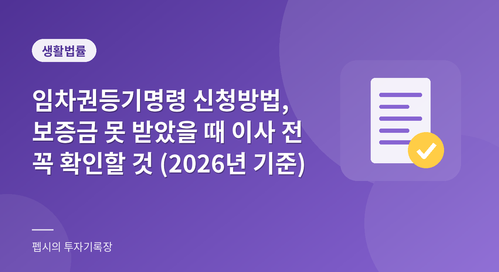

  

계약 기간이 끝났는데 집주인이 보증금을 돌려주지 못하겠다고 하면 어떻게 해야 할까요? 새 세입자가 구해지면 주겠다는 말만 반복되는데, 이미 다음 집 계약금은 나가 있는 상황이라면 마음이 정말 급해집니다.

그렇다고 보증금을 받기 전에 짐을 빼고 전입신고를 옮겨 버리면, 지금까지 지켜 오던 권리가 흔들릴 수 있습니다. 이럴 때 쓰는 제도가 바로 **임차권등기명령**입니다.

오늘은 임차권등기명령이 무엇인지, 누가 어디에 어떻게 신청하는지, 등기가 끝나면 무엇이 달라지는지를 주택임대차보호법 조문 기준으로 차근차근 정리해 보겠습니다.

**📌 한눈에 보기 (2026년 기준)**

- 근거 법: 주택임대차보호법 제3조의3 (2026년 1월 2일 시행 버전 기준).
- 신청 요건: 임대차가 끝난 뒤 보증금을 돌려받지 못한 임차인.
- 신청 장소: 임차주택 소재지 관할 지방법원, 지방법원지원 또는 시·군법원.
- 효과: 등기를 마치면 대항력과 우선변제권을 취득하고, 이미 가진 권리는 이사해도 유지.
- 비용: 신청·등기에 든 비용은 임대인에게 청구 가능.

**목차**

* TOC
{:toc}

## 임차권등기명령이란 무엇인가

임차권등기명령은 임대차가 끝났는데도 보증금을 돌려받지 못한 임차인이 법원에 신청해, 해당 주택의 등기부에 임차권을 기록하게 하는 제도입니다. 법원이 등기를 하라고 명령하고, 그 명령에 따라 등기부에 기록이 올라갑니다.

쉽게 말해 "이 집에는 아직 돌려받지 못한 보증금이 있는 세입자가 있다"는 사실을 등기부에 공식적으로 남기는 절차입니다.

집을 비워야 하는 사정이 생겼을 때, 임차인이 보증금 반환 소송이나 경매 절차를 진행하는 동안에도 기존 권리를 지켜 주는 안전장치라고 이해하시면 됩니다.

## 왜 필요한가: 이사를 가면 생기는 문제

대항력은 보통 주택의 인도(실제 거주)와 주민등록(전입신고)을 갖추었을 때 생깁니다. 그래서 보증금을 받지 못한 채 이사를 가거나 전입신고를 옮기면, 이 요건을 잃어버릴 위험이 생깁니다.

반대로 보증금을 받을 때까지 그 집에 계속 살아야 한다면, 새 직장이나 새 학교 때문에 이동해야 하는 사람은 큰 부담을 안게 됩니다.

임차권등기가 마쳐지면 이 딜레마가 풀립니다. 조문은 등기를 마친 후에는 임차인이 대항요건을 잃더라도 이미 취득한 대항력과 우선변제권을 잃지 않는다고 정하고 있습니다.

**⚠️ 등기부에 기록이 올라온 것을 확인한 뒤에 이사하세요**

신청서를 접수했다고 해서 바로 효력이 생기는 것은 아닙니다. 법원 결정이 나고 등기가 실제로 마쳐져야 하므로, 등기사항증명서에 임차권등기가 기록된 것을 직접 확인한 다음에 짐을 빼고 전입신고를 옮기는 것이 안전합니다.

## 신청 요건과 관할법원

신청 요건은 단순합니다. 임대차가 끝난 후 보증금이 반환되지 않았다는 것입니다. 계약 기간이 만료됐거나 해지로 계약이 끝났는데도 돈을 받지 못한 경우가 해당합니다.

관할은 임차주택이 있는 곳을 기준으로 합니다. 임차주택 소재지를 관할하는 지방법원, 지방법원지원 또는 시·군법원에 신청합니다.

임대인이 사는 곳이나 임차인의 주소가 아니라 **집이 있는 곳**이 기준이라는 점을 기억해 두세요.

| 구분 | 내용 | 근거 |
|---|---|---|
| 신청인 | 보증금을 돌려받지 못한 임차인 | 제3조의3 제1항 |
| 시점 | 임대차가 끝난 후 | 제3조의3 제1항 |
| 신청 법원 | 임차주택 소재지 관할 지방법원·지원·시군법원 | 제3조의3 제1항 |
| 대위 신청 | 금융기관 등이 임차인을 대신해 신청 가능 | 제3조의3 제9항 |

표의 마지막 줄처럼, 임차인에게 대출을 해 준 금융기관 등이 임차인을 대위하여 신청할 수 있는 길도 법에 열려 있습니다.

## 신청서에 적어야 할 내용과 소명 자료

신청서에는 법에서 정한 사항을 적어야 합니다. 신청의 취지와 이유, 임대차의 목적인 주택, 임차권등기의 원인이 된 사실, 그리고 대법원규칙으로 정하는 사항입니다.

주택의 일부분만 임차했다면 그 부분의 도면을 붙여야 합니다. 대항력이나 우선변제권을 이미 취득했다면 그 사실도 함께 적습니다.

또한 신청 이유와 등기의 원인이 된 사실을 **소명**해야 합니다. 소명이란 법원이 어느 정도 그럴듯하다고 판단할 수 있도록 자료로 보여 주는 것을 뜻합니다.

법원 안내에서 확인되는 준비 서류는 대체로 다음과 같습니다. 법원마다 요구하는 서류가 조금씩 다를 수 있으니 신청 전에 관할 법원 안내를 꼭 보세요.

- 임차권등기명령 신청서
- 임대차계약서 사본 (확정일자 관련 확인 필요)
- 주민등록등본 또는 초본 (발급 시점 제한이 있을 수 있음)
- 부동산 등기사항증명서
- 일부만 임차한 경우 해당 부분의 도면
- 대리인이 신청하는 경우 위임 관련 서류

## 신청 절차 한눈에 보기

처음 해 보는 분들이 헷갈리는 건 순서입니다. 아래 순서로 진행한다고 생각하면 훨씬 수월합니다.

1. 임대차 종료와 보증금 미반환 상황을 정리한다. (해지 통지, 문자, 내용증명 등 증빙 모으기)
2. 계약서, 주민등록등본, 등기사항증명서 등 서류를 준비한다.
3. 신청서를 작성한다. 법원 방문 접수 또는 전자소송 접수 중 가능한 방법을 고른다.
4. 인지와 송달료 등 비용을 납부한다.
5. 법원의 결정을 기다린다. 결정이 나면 법원이 등기소에 등기를 맡긴다.
6. 등기사항증명서를 떼어 임차권등기가 기록됐는지 확인한다.
7. 기록 확인 후에 이사하고 필요한 후속 절차를 진행한다.

법원 전자민원 안내에는 신청서에 붙이는 인지 2,000원과 당사자 수에 따른 송달료 납부가 안내되어 있습니다. 다만 송달료 단가와 등기 관련 수수료는 안내 자료마다 금액이 다르고 시점도 달라서, 이 글에서는 금액을 단정하지 않겠습니다. 접수 전에 관할 법원이나 전자민원센터에서 현재 금액을 확인하세요.

## 등기가 끝나면 무엇이 달라지나

조문의 핵심은 두 가지입니다. 임차권등기를 마치면 임차인은 대항력과 우선변제권을 취득합니다. 그리고 등기 전에 이미 가지고 있던 대항력이나 우선변제권은 그대로 유지됩니다.

여기에 더해, 등기를 마친 후에는 임차인이 대항요건(점유와 주민등록)을 잃더라도 이미 취득한 대항력과 우선변제권이 없어지지 않습니다. 그래서 등기 후에는 이사를 해도 보증금 회수 순위에 대한 권리를 보전할 수 있습니다.

한 가지 주의할 점이 있습니다. 조문 제5항은 등기 후의 이사만 명확히 다루고 있어서, 등기가 마쳐지기 전에 먼저 이사를 해 버리는 경우는 이 조문만으로 안전하다고 말할 수 없습니다. 등기 완료를 확인한 뒤 이사하라고 권하는 이유입니다.

## 새 임차인이 못 받는 권리와 비용 청구

임차권등기가 끝난 주택에 그 이후 새로 들어온 임차인은 주택임대차보호법 제8조에 따른 우선변제를 받을 권리가 없습니다. 이 조항은 집주인이 등기를 풀기 위해 서둘러 새 세입자를 들이기 어렵게 만드는 효과도 있습니다.

새 세입자 입장에서는 등기부에 임차권등기가 있는 집은 위험 신호로 읽히기 때문에, 이 점은 임대인에게 보증금 반환 압박으로 작용하기도 합니다.

비용은 어떨까요? 조문 제8항은 임차인이 임차권등기명령의 신청과 그에 따른 등기에 든 비용을 임대인에게 청구할 수 있다고 정하고 있습니다. 영수증은 꼭 보관해 두세요.

| 항목 | 내용 | 비고 |
|---|---|---|
| 인지 | 2,000원 | 법원 안내 기준 |
| 송달료 | 당사자 수 × 3회분 | 1회분 단가는 법원 확인 필요 |
| 등기 관련 비용 | 등록면허세, 지방교육세, 등기신청수수료 등 | 금액은 안내마다 달라 확인 필요 |
| 임대인 청구 | 신청·등기 비용 청구 가능 | 제3조의3 제8항 |

표처럼 금액이 달라질 수 있는 부분은 접수 창구에서 확인하시고, 낸 돈은 임대인에게 청구한다는 점만 기억하시면 됩니다.

## 사례로 보는 판단 순서

아래는 이해를 돕기 위해 제가 만든 가상의 상황입니다. 실제 사건은 사정이 다르므로 참고용으로만 보세요.

| 가상 상황 | 해야 할 일 | 이유 |
|---|---|---|
| A씨: 만기가 지났고 집주인이 한 달 뒤 준다고만 함 | 증빙을 모으고 임차권등기명령 신청 | 임대차 종료 후 보증금 미반환 요건 충족 |
| B씨: 이사 날짜가 이번 주인데 등기가 아직 안 됨 | 등기부에서 기록 확인 후 이사 시점 조정 검토 | 등기 완료 전 대항요건 상실 위험 |
| C씨: 건물 한 칸만 임차한 다가구 세입자 | 임차 부분 도면 첨부 | 일부 임차 시 도면 첨부 규정 |
| D씨: 계약 기간이 아직 남았는데 집주인이 반환 거부 | 계약 종료 여부부터 확인 | 신청 요건이 임대차 종료 후이므로 |

A씨처럼 요건이 분명하면 바로 준비하면 되고, B씨나 D씨처럼 시점이 걸리는 경우에는 먼저 상황을 정리해야 합니다.

특히 D씨의 경우 계약이 종료되었는지 자체가 쟁점이 되므로, 계약서의 기간과 해지 통지 여부를 먼저 점검하는 것이 좋습니다.

## 많이 하는 오해 4가지

### 1. "임차권등기명령을 신청하면 보증금이 바로 나온다"

그렇지 않습니다. 임차권등기는 돈을 받아 주는 절차가 아니라 권리를 지켜 주는 절차입니다. 실제로 돈을 받으려면 임대인과 합의하거나 별도의 소송, 경매 절차가 필요할 수 있습니다.

### 2. "신청서만 내면 그날부터 이사 가도 된다"

접수와 등기 완료는 다릅니다. 법원 결정이 나고 등기가 마쳐져 등기사항증명서에 기록된 것을 확인한 뒤에 이사하는 편이 안전합니다.

### 3. "비용은 전부 내가 부담해야 한다"

신청과 등기에 든 비용은 법 제3조의3 제8항에 따라 임대인에게 청구할 수 있습니다. 다만 임대인이 자발적으로 주지 않으면 별도로 청구해야 하니 영수증을 챙기세요.

### 4. "임대차 기간 중에도 언제든 신청할 수 있다"

신청 요건은 임대차가 끝난 후 보증금이 반환되지 않은 경우입니다. 계약이 아직 유효한 상태라면 요건을 갖췄는지부터 따져 봐야 합니다.

## 신청 전에 확인할 점과 한계

임차권등기명령은 만능이 아닙니다. 등기를 해도 선순위 근저당이나 다른 권리자가 있으면 배당 순서에서 밀릴 수 있습니다. 대항력과 우선변제권은 그 취득 시점을 기준으로 판단되기 때문입니다.

그래서 신청 전에 등기사항증명서로 근저당 설정 금액과 선순위 권리를 한 번 점검하는 것이 좋습니다. 집값 대비 대출이 많다면 소송과 경매까지 염두에 두고 준비해야 합니다.

임대인의 이의신청이나 신청 기각 시의 항고 등은 민사집행법 등을 준용하도록 되어 있고, 구체적인 기간은 이 글에서 확인하지 못했습니다. 이 부분은 법원 안내나 법률구조기관 상담에서 꼭 확인하세요.

## 정리

- 임차권등기명령은 임대차가 끝난 뒤 보증금을 못 받은 임차인이 임차주택 소재지 관할 법원에 신청하는 제도입니다.
- 등기를 마치면 대항력과 우선변제권을 취득하고, 이미 가진 권리는 이사 후에도 유지됩니다.
- 등기부에 기록이 올라온 것을 확인한 뒤 이사하는 것이 안전합니다.
- 신청·등기 비용은 임대인에게 청구할 수 있으니 영수증을 보관하세요.

보증금 문제는 마음이 급해지기 쉬운 일입니다. 하지만 순서만 지키면 권리를 잃지 않고 다음 단계로 넘어갈 수 있습니다.

혼자 진행하기 어렵다면 대한법률구조공단이나 법원 민원실 상담을 먼저 이용해 보세요. 이 글이 막막한 순서를 정리하는 데 도움이 되었으면 좋겠습니다.

## 자주 묻는 질문

**Q1. 임차권등기명령은 누가 신청하나요?**

A1. 임대차가 끝난 후 보증금을 돌려받지 못한 임차인이 신청합니다. 법에는 금융기관 등이 임차인을 대위하여 신청할 수 있다는 규정도 있습니다.

**Q2. 어느 법원에 신청하나요?**

A2. 임차주택 소재지를 관할하는 지방법원, 지방법원지원 또는 시·군법원에 신청합니다.

**Q3. 등기를 하면 이사를 가도 보증금 권리가 유지되나요?**

A3. 조문은 등기를 마친 후에는 대항요건을 잃더라도 이미 취득한 대항력과 우선변제권을 잃지 않는다고 정합니다. 다만 등기가 실제로 마쳐진 것을 확인한 뒤 이사하세요.

**Q4. 신청 비용은 누가 부담하나요?**

A4. 일단 임차인이 내지만, 신청과 등기에 든 비용은 임대인에게 청구할 수 있습니다. 구체적인 금액은 관할 법원에서 확인하세요.

**Q5. 임차권등기 후 새로 들어온 세입자는 어떻게 되나요?**

A5. 등기 후에 해당 주택을 새로 임차한 사람은 주택임대차보호법 제8조에 따른 우선변제를 받을 권리가 없습니다.

## 참고 자료

- 국가법령정보센터, 주택임대차보호법 제3조의3 (임차권등기명령): [https://www.law.go.kr](https://www.law.go.kr)
- 대법원 전자민원센터, 임차권등기명령 신청 안내: [https://www.scourt.go.kr](https://www.scourt.go.kr)
- 인천지방법원·광주지방법원 민원 안내(임차권등기명령 신청 서류 및 비용)
- 대한법률구조공단: [https://www.klac.or.kr](https://www.klac.or.kr)

2026년 11월 기준입니다. 수수료와 서류 요건은 바뀔 수 있으니 접수 전 관할 법원에서 확인하세요.

> 이 글은 일반적인 정보 제공을 위한 것으로, 개인 상황에 따라 적용이 다를 수 있습니다. 정확한 내용은 관련 기관에 확인하세요.
