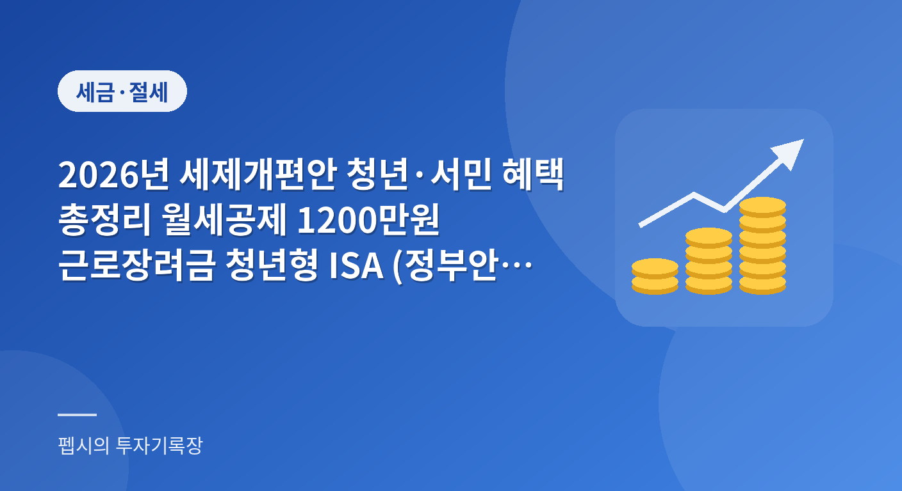

  

"내년부터 월세 공제 한도가 늘어난다던데, 나도 해당되나?" 뉴스에서 이런 소식을 보고 한 번쯤 궁금했던 분이 많을 거예요.

그런데 기사마다 숫자가 조금씩 다르고, 이미 확정된 것처럼 쓴 글도 있어서 헷갈리기 쉽습니다. 특히 정부가 발표한 안과 국회를 통과해 법이 된 내용은 완전히 다른 이야기입니다.

그래서 이번 글에서는 재정경제부가 2026년 8월 3일 발표한 세제개편안 원문을 열어서, 청년과 서민에게 직접 영향을 주는 항목만 골라 정리했습니다. 숫자는 모두 원문에서 확인한 것만 적었습니다.

**📌 한눈에 보기 (2026년 8월 발표 정부안 기준)**

- 월세 세액공제 대상 월세 한도를 연 1,000만 원에서 1,200만 원으로 늘리는 안입니다.
- 근로장려금 단독가구 소득요건은 2,200만 원에서 2,600만 원, 최대 지급액은 165만 원에서 180만 원으로 올리는 안입니다.
- 청년의 퇴직연금 납입액 세액공제율을 15%로, 청년 월세 세액공제율을 17%로 적용하는 안입니다.
- 청년형 생산적금융 ISA는 34세 이하·총급여 7,500만 원 이하가 대상이고 납입금의 10%를 소득공제합니다.
- 이 내용은 정부안이며, 국회 통과 여부와 최종 내용은 확인이 필요합니다.

**목차**

* TOC
{:toc}

## 세제개편안, 정부안과 확정은 어떻게 다를까

매년 여름이 되면 정부가 다음 해부터 바꾸고 싶은 세금 제도를 묶어 발표하는데, 이것이 세제개편안입니다. 2026년 세제개편안은 8월 3일에 공개됐습니다.

발표 이후에는 입법예고를 거치고, 국무회의를 통과한 뒤 정기국회에 법안으로 제출됩니다. 원문 추진일정에는 8월 4일부터 20일까지 입법예고, 9월 1일 국무회의, 9월 3일 이전 정기국회 제출이라고 적혀 있습니다.

여기서 중요한 점은 국회가 법안을 고치거나 일부를 빼고 통과시킬 수 있다는 거예요. 그래서 발표된 숫자가 그대로 확정된다고 단정하면 안 됩니다.

이번 개편안은 소득세법, 조세특례제한법, 상속세 및 증여세법 등 내국세 10개와 관세법 1개, 총 11개 법률을 고치는 내용입니다. 이 글은 그중 청년·서민과 관련된 부분만 다룹니다.

이 글을 쓰는 시점(2026년 11월 22일)에 국회 통과 여부는 공식 자료로 확인하지 못했습니다. 그래서 모든 항목을 "정부안은 이렇다"라는 방식으로 적었고, 시행 시기도 원문에 명시된 것만 옮겼습니다.

**⚠️ 이번 연말정산에는 아직 적용하지 마세요**

정부안은 법이 확정되기 전의 계획이라서, 지금 진행 중인 2026년 귀속 연말정산 계산에 미리 넣으면 환급액을 잘못 예상하게 됩니다. 올해 공제는 현재 시행 중인 기준으로 계산하고, 개편안은 내년 이후 계획을 세울 때 참고용으로만 보세요.

## 근로장려금, 소득요건과 최대 지급액이 올라간다

개편안에서 숫자 변화가 가장 큰 항목 중 하나가 근로장려금(EITC)입니다. 소득요건을 완화하고, 최대 지급액을 올리고, 평탄구간을 넓히는 내용이에요.

평탄구간은 소득이 늘어도 지급액이 깎이지 않고 최대 금액을 받는 소득 구간을 말합니다. 원문 표를 그대로 옮기면 아래와 같습니다. 단위는 만 원입니다.

| 구분 | 소득요건 현행 | 소득요건 개정안 | 평탄구간 현행 → 개정안 | 최대지급액 현행 | 최대지급액 개정안 |
|---|---|---|---|---|---|
| 단독 | 2,200 | 2,600 | 400~900 (변경 없음) | 165 | 180 |
| 홑벌이 | 3,200 | 3,700 | 700~1,400 (변경 없음) | 285 | 310 |
| 맞벌이 | 4,400 | 5,200 | 800~1,700 → 800~1,800 | 330 | 360 |

표를 보면 소득요건은 세 유형 모두 올라가고, 평탄구간은 맞벌이 가구의 상한만 1,700만 원에서 1,800만 원으로 넓어집니다.

최대 지급액은 단독 15만 원, 홑벌이 25만 원, 맞벌이 30만 원씩 늘어나는 구조예요. 이 차이는 원문 숫자를 제가 빼서 계산한 값입니다.

다만 근로장려금은 소득 외에도 재산 요건, 가구 구성 같은 다른 조건이 함께 따라붙습니다. 이 글에서는 개편안 원문에 나온 소득요건과 지급액만 다뤘고, 나머지 조건은 변경 여부를 확인하지 못했습니다.

기한후 신청이나 현재 기준의 신청 방법은 이미 다른 글에서 정리해 두었으니, 필요하시면 함께 보시면 됩니다.

## 월세 세액공제, 한도 1,200만 원과 청년 17%

월세 세액공제는 총급여 8,000만 원 이하 근로자(성실사업자 등은 종합소득금액 7,000만 원 이하)가 낸 월세에 대해 공제해 주는 제도입니다. 현행은 연 1,000만 원 한도로 15%, 소득이 낮으면 17%를 적용해요.

원문에 적힌 현행 17% 대상은 총급여 5,500만 원 이하 또는 종합소득금액 4,500만 원 이하입니다. 개편안은 이 구조에서 두 가지를 바꿉니다.

첫째, 공제 대상 월세 한도를 연 1,000만 원에서 1,200만 원으로 확대합니다. 월 평균으로 나누면 약 83만 원까지 반영되던 것이 월 100만 원까지 반영되는 셈입니다(제가 계산한 값입니다).

둘째, 청년이 월세 세액공제를 받는 경우에는 세액공제율을 17%로 적용합니다. 원문에는 이 청년 17% 적용기한이 2029년 12월 31일까지로 표시돼 있습니다.

원문에서 확인하지 못한 부분도 있습니다. 청년을 몇 세까지로 볼지는 제가 읽은 쪽에는 나와 있지 않았어요. 그래서 나이 기준은 법안이 확정된 뒤 공식 자료에서 확인하셔야 합니다.

월세 세액공제의 현행 조건이나 연말정산 방법은 앞선 글에서 따로 정리했으니, 이번 글에서는 "무엇이 달라지는가"에만 집중했습니다.

## 청년 퇴직연금 납입액 세액공제율 15%

연금저축과 퇴직연금(IRP)은 연말정산 때 세액공제를 받는 대표적인 방법이죠. 원문에 적힌 현행 기준은 총급여 5,500만 원(종합소득금액 4,500만 원) 이하면 15%, 그 이상이면 12%입니다.

공제 대상 납입 한도는 연 900만 원이고, 연금저축계좌 납입액을 포함한 금액입니다. 이 구조는 개편안에서도 그대로입니다.

개편안은 청년층의 자산형성과 노후보장을 지원하기 위해 청년의 퇴직연금 납입액에 세액공제율 15%를 적용하겠다는 내용입니다. 즉 소득이 5,500만 원을 넘더라도 청년이라면 15%를 적용받는 방향이에요.

앞서 말한 것처럼 청년의 범위와 구체적인 시행 시기는 제가 읽은 원문 부분에서 확인하지 못했습니다. 그래서 정확한 대상은 법안이 나오면 다시 확인해야 합니다.

참고로 연금계좌 세액공제 한도에 대한 오해도 많은데, 이 부분은 뒤의 오해 섹션에서 짚겠습니다.

## 청년형 생산적금융 ISA, 일반 ISA와 무엇이 다른가

세제개편안에서 가장 눈에 띄는 신설 항목이 생산적금융 ISA입니다. 자본시장 활성화를 위해 국내 투자에 혜택을 강화한 계좌를 새로 만들고, 기존 일반 ISA는 정비한다는 내용이에요.

원문 비교표를 정리하면 아래와 같습니다. 일반 ISA는 개정안 기준 내용입니다.

| 구분 | 일반 ISA (개정안) | 생산적금융 ISA (신설안) | 청년형 ISA |
|---|---|---|---|
| 가입대상 | 19세 이상 거주자 (15세 이상 근로자) | 19세 이상 거주자 (15세 이상 근로자) | 34세 이하 청년 (총급여 7,500만 원 이하) |
| 세제혜택 | 한도 내 이자·배당 비과세, 초과분 9% 저율과세 (한도 일반 200만 원, 서민 400만 원) | 이자·배당 전액 비과세 | 이자·배당 전액 비과세 + 납입금 10% 소득공제 |
| 투자대상 | 예적금, 국내주식, 펀드 등 | 국내주식, 국내주식형 펀드, 국민성장펀드, BDC 등 | 생산적금융 ISA와 동일 |
| 납입한도 | 연 2천만 원, 총 1억 원 | 연 2천만 원, 총 2억 원 | 연 2천만 원, 총 2억 원 |
| 투자기간 | 3년 (총 5년까지 연장 가능) | 3년 (3년 단위로 총 10년까지 연장 가능) | 생산적금융 ISA와 동일 |
| 적용기한 | 2029년 12월 31일까지 | 2029년 12월 31일까지 | 2029년 12월 31일까지 |

표 아래 각주에는 직전 3개 과세기간 중 한 번이라도 금융소득종합과세 대상이었던 사람은 가입할 수 없다고 적혀 있습니다. 가입 전에 본인이 여기에 해당하는지 확인해야 해요.

청년형은 소득 기준이 총급여 7,500만 원 또는 종합소득금액 6,300만 원 이하로 안내돼 있고, 납입금의 10%를 소득공제해 줍니다. 비과세 혜택, 투자대상, 납입한도는 생산적금융 ISA와 같다고 합니다.

여기서 소득공제와 세액공제의 차이를 짚고 갈게요. 소득공제는 세금을 직접 깎아 주는 게 아니라, 세금을 매기는 기준 소득을 줄여 주는 방식입니다.

그래서 같은 200만 원을 공제받아도 본인 세율에 따라 줄어드는 세금이 달라집니다. 이 부분은 뒤의 계산 예시에서 가정을 두고 다뤄 보겠습니다.

이 글은 특정 상품 가입을 권하는 글이 아닙니다. 투자 상품에는 원금 손실 위험이 있고, 제도는 정부안 단계라는 점만 기억해 주세요.

## 그 밖에 알아둘 만한 변화들

큰 항목 말고도 생활과 가까운 변경이 몇 가지 더 있습니다. 이쪽도 원문에서 확인한 것만 정리할게요.

- 종합소득 기본공제 대상자 확대: 배우자·부양가족의 소득금액 요건을 100만 원에서 300만 원(근로소득만 있으면 총급여 500만 원에서 750만 원) 이하로 올리는 안
- 주택청약종합저축 소득공제 상시화: 총급여 7천만 원 이하 무주택 세대주의 납입액(연 300만 원 한도) 40% 소득공제를 계속 적용하는 안
- 인적용역 사업소득 원천징수 세율 인하: 배달라이더 등 영세 사업자 대상 3%에서 2%로 낮추는 안 (연말정산 대상 인적용역은 현행 3% 유지)
- 주택임차차입금 원리금 상환액 소득공제 확대: 주거를 달리하는 무주택 부부 각각 허용, 부부 합산 공제한도 연 400만 원
- 출산지원금 근로소득세 비과세: 임신 이후부터 출산 전까지 받은 지원금도 비과세 대상에 포함
- 보육수당 비과세: 위탁아동 보육 관련 수당(월 20만 원까지)도 비과세 대상에 포함

기본공제 소득요건은 부양가족 공제를 따질 때 자주 쓰이는 기준이라, 내년 이후 연말정산에서 영향을 받을 수 있는 항목이에요. 현행 기준은 앞선 글에서 정리했습니다.

중소기업 취업자 소득세 감면은 근로 제공 사업장 소재지에 따라 감면율과 기간을 다르게 하는 지방 우대안이 들어 있습니다. 청년 기준으로 원문 표를 정리하면 아래와 같아요.

| 사업장 소재지 | 청년 현행 | 청년 개정안 |
|---|---|---|
| 수도권 | 5년, 90% | 5년, 90% |
| 비수도권 광역시 등 | 5년, 90% | 6년, 90% |
| 기타 비수도권 | 5년, 90% | 7년, 90% |
| 기타 비수도권 우대지역 | 5년, 90% | 10년, 90% |

이 표를 보면 청년의 감면율은 그대로 90%이고, 지방 사업장일수록 감면 기간이 길어지는 구조입니다. 60세 이상·장애인 등은 3년 70%에서 지역별로 75%, 80%, 90%까지 올라가는 안이에요.

## 가상 사례로 계산해 보기

숫자만 보면 감이 잘 안 오죠. 아래는 이해를 돕기 위한 가상 사례이고, 모든 계산은 제가 한 값입니다. 실제 세액은 개인의 다른 공제와 세율에 따라 달라질 수 있어요.

| 사례(가상) | 현행 기준 | 개정안 기준 | 차이 |
|---|---|---|---|
| 월세 월 100만 원, 연 1,200만 원 납부, 15% 적용 | 한도 1,000만 원 × 15% = 150만 원 | 한도 1,200만 원 × 15% = 180만 원 | 30만 원 |
| 같은 월세, 청년이 17% 적용 | 1,000만 원 × 15% = 150만 원 | 1,200만 원 × 17% = 204만 원 | 54만 원 |
| 연금저축·IRP 900만 원 납입, 12% 적용자 | 900만 원 × 12% = 108만 원 | 청년 15% 적용 시 900만 원 × 15% = 135만 원 | 27만 원 |
| 청년형 ISA에 연 2,000만 원 납입 | 해당 없음 | 2,000만 원 × 10% = 200만 원 소득공제 | 세율 15% 가정 시 약 30만 원 |

첫 번째 사례는 월세 한도가 늘어난 효과만 반영한 것이고, 두 번째는 한도와 공제율이 함께 바뀐 경우를 비교한 것입니다. 월세가 월 83만 원 정도 이하라면 한도 확대의 효과는 없어요.

세 번째 사례는 15%가 적용되는 방향이라는 점만 원문에서 확인한 것이라, 대상 연령과 시행 시기는 법안 확정 후에 다시 따져 봐야 합니다. 네 번째 사례의 15% 세율은 설명을 위한 단순 가정이에요.

참고로 이런 사례는 공제 항목끼리 겹치지 않는다고 가정한 것입니다. 실제로는 총급여, 다른 공제, 결정세액에 따라 환급액이 달라질 수 있습니다.

## 많이 하는 오해 5가지

### 1. "개편안이 발표됐으니 내년부터 무조건 적용된다"

발표된 개편안은 법안이 국회를 통과해야 효력이 생깁니다. 국회에서 수정되거나 일부 항목이 빠질 수 있어요.

그래서 확정되기 전에는 "정부안 기준"이라는 말을 붙여서 이해하는 게 안전합니다.

### 2. "월세 한도가 늘어나면 누구나 공제액이 늘어난다"

한도는 공제받을 수 있는 최대 월세 금액일 뿐이에요. 실제로 낸 월세가 연 1,000만 원 이하라면 한도가 1,200만 원으로 늘어도 공제액이 달라지지 않습니다.

한도 확대의 효과는 연 월세가 1,000만 원을 넘는 분들에게 해당합니다.

### 3. "근로장려금 소득요건만 맞으면 받을 수 있다"

원문에서 바뀌는 것은 소득요건과 지급액, 평탄구간입니다. 그런데 근로장려금은 가구 형태와 재산 등 다른 요건도 함께 충족해야 해요.

이번 글에서 확인한 것은 소득 기준과 금액뿐이므로, 신청 전에 국세청 안내에서 전체 요건을 확인하셔야 합니다.

### 4. "청년형 ISA는 소득공제 200만 원이면 세금이 200만 원 줄어든다"

소득공제는 세금이 아니라 소득을 줄여 주는 제도입니다. 줄어드는 세금은 공제액에 본인 세율을 곱한 만큼이에요.

위 가상 사례처럼 세율을 15%로 가정하면 약 30만 원 수준이며, 실제 세율은 개인별로 다릅니다.

### 5. "연금 세액공제 한도 900만 원은 연금저축과 IRP를 각각 받는다"

원문에는 퇴직연금 납입액 세액공제 한도가 연 900만 원이고 연금저축계좌 납입액을 포함한다고 적혀 있습니다. 즉 합산 한도입니다.

청년 15% 적용안이 확정되더라도 이 합산 구조가 바뀐다는 내용은 제가 읽은 부분에서 확인하지 못했습니다.

## 정리

2026년 세제개편안에서 청년·서민과 관련된 핵심만 다시 짚어 보겠습니다.

- 근로장려금: 단독 소득요건 2,600만 원, 최대 180만 원 등으로 상향하는 안
- 월세 세액공제: 대상 월세 한도 연 1,200만 원, 청년은 공제율 17%를 적용하는 안
- 청년 퇴직연금 세액공제율 15%, 청년형 ISA 납입금 10% 소득공제
- 모두 정부안이며 국회 통과 여부와 시행 시기는 별도 확인이 필요

제도 변경은 기사 제목만 보면 이미 시행된 것처럼 느껴지기 쉬워요. 그럴수록 정부안인지, 법이 개정됐는지, 언제부터 적용되는지를 먼저 확인하는 습관이 도움이 됩니다.

법안이 확정되면 최종 숫자를 공식 자료로 다시 확인하고, 내 상황에 해당하는지 하나씩 대조해 보세요. 이 블로그에서도 확정 내용이 확인되면 새로 정리하겠습니다.

## 자주 묻는 질문

**Q1. 2026년 세제개편안은 이미 확정됐나요?**

A1. 제가 확인한 공식 자료는 2026년 8월 3일 발표된 정부안까지입니다. 국회 통과 여부와 최종 내용은 확인하지 못했으니 국회와 재정경제부의 공지를 확인해 주세요.

**Q2. 올해 연말정산에 월세 공제 한도 1,200만 원을 적용하나요?**

A2. 개편안은 법이 확정되어야 적용됩니다. 지금 진행하는 2026년 귀속 연말정산은 현재 시행 중인 기준으로 계산하는 것이 안전합니다.

**Q3. 청년형 ISA는 몇 세까지 가입할 수 있나요?**

A3. 개편안에는 34세 이하 청년(총급여 7,500만 원 이하)으로 적혀 있습니다. 직전 3개 과세기간 중 금융소득종합과세 대상이었다면 제외된다는 각주도 있어요.

**Q4. 근로장려금 소득요건이 오르면 바로 신청할 수 있나요?**

A4. 법이 개정되고 시행되기 전에는 현행 기준이 적용됩니다. 신청 시기와 방법은 국세청 공지를 확인하세요.

**Q5. 청년의 나이 기준은 어떻게 되나요?**

A5. 월세 세액공제와 퇴직연금 세액공제의 청년 나이 기준은 제가 읽은 원문 부분에서 확인하지 못했습니다. 법안과 시행령이 나오면 공식 자료에서 확인해야 합니다.

## 참고 자료

- 재정경제부 2026년 세제개편안 안내 페이지: [https://www.mofe.go.kr/2026/taxlaw.do](https://www.mofe.go.kr/2026/taxlaw.do)
- 재정경제부 보도자료 「2026년 세제개편안 발표」(2026.08.03): [https://www.mofe.go.kr/nw/nes/detailNesDtaView.do?searchBbsId1=MOSFBBS_000000000028&searchNttId1=MOSF_000000000078809&menuNo=4010100](https://www.mofe.go.kr/nw/nes/detailNesDtaView.do?searchBbsId1=MOSFBBS_000000000028&searchNttId1=MOSF_000000000078809&menuNo=4010100)
- 첨부자료 「2026년 세제개편안 개조식」(재정경제부, 2026.8.3.)

2026년 11월 기준 정부안 내용이며, 국회 심의 결과에 따라 달라질 수 있습니다.

> 이 글은 일반적인 정보 제공을 위한 것으로, 개인 상황에 따라 적용이 다를 수 있습니다. 정확한 내용은 관련 기관에 확인하세요.
