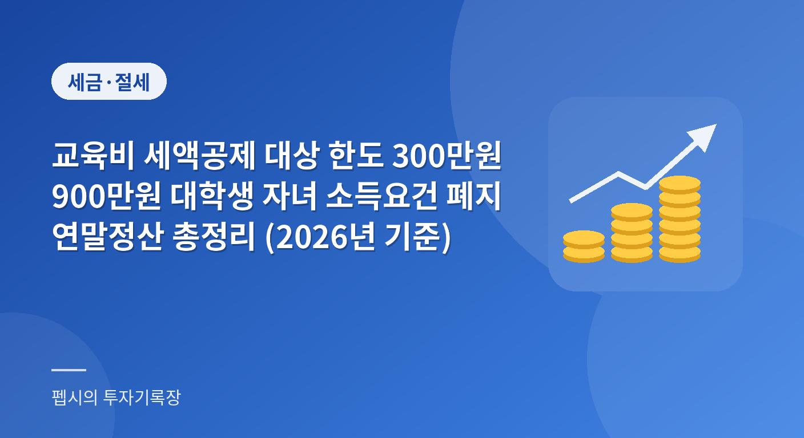

  

아이 학원비를 매달 꼬박꼬박 냈는데, 연말정산에서 얼마나 돌려받을 수 있는지 아시나요? 학원비는 다 공제될 것 같지만 실제로는 공제 안 되는 경우가 더 많습니다.

반대로 아르바이트를 하는 대학생 자녀 때문에 교육비 공제를 포기했던 분도 있을 겁니다. 올해부터는 이 부분이 달라졌다고 하니 꼭 짚고 넘어가야 합니다.

이 글에서는 **교육비 세액공제**의 공제율과 한도, 대상과 제외 항목, 그리고 올해 달라진 점을 순서대로 정리해 보겠습니다. 11월 지금이 12월 말 결제분까지 챙길 수 있는 마지막 점검 시기입니다.

**📌 한눈에 보기 (2026년 귀속 연말정산 기준)**

- 공제율은 교육비 지출액의 15%입니다.
- 취학 전 아동·초중고 학생은 1명당 연 300만 원, 대학생은 1명당 연 900만 원까지 인정됩니다.
- 근로자 본인 교육비는 한도가 없습니다.
- 교복구입비는 학생 1명당 연 50만 원, 체험학습비는 학생 1명당 연 30만 원까지 포함됩니다.
- 직계비속 소득요건이 폐지되어 아르바이트하는 대학생 자녀도 교육비 공제가 가능하다고 안내되었습니다.

**목차**

* TOC
{:toc}

## 교육비 세액공제란 무엇인가

교육비 세액공제는 본인이나 부양가족을 위해 쓴 교육비의 일정 비율을 내야 할 세금에서 직접 빼 주는 제도입니다. 소득에서 빼 주는 소득공제와 달리, 계산된 세금 자체를 줄여 주기 때문에 체감 효과가 분명합니다.

국세청 안내에 따르면 공제율은 교육비 납입금액의 15%입니다. 예를 들어 교육비를 100만 원 냈다면 15만 원만큼 세금이 줄어드는 구조입니다.

다만 낸 세금보다 더 많이 돌려받을 수는 없습니다. 이미 납부한 세금이 적은 근로자라면 공제 한도를 다 채워도 효과가 제한될 수 있습니다.

그리고 이 공제는 근로자 본인이 신청하는 항목입니다. 교육비를 낸 사람이 아니라, 해당 가족을 기본공제 대상자로 올린 근로자가 받는 방식입니다. 이 부분은 뒤의 맞벌이 항목에서 다시 설명하겠습니다.

## 공제 한도: 본인·자녀·대학생 구분

한도는 누가 공부하느냐에 따라 나뉩니다. 가장 많이 헷갈리는 부분이라 표로 먼저 정리해 보겠습니다.

| 구분 | 연간 한도 | 최대 공제액(15%) |
|---|---|---|
| 근로자 본인 | 한도 없음 | 지출액의 15% 전부 |
| 취학 전 아동 | 1명당 300만 원 | 45만 원 |
| 초·중·고등학생 | 1명당 300만 원 | 45만 원 |
| 대학생 | 1명당 900만 원 | 135만 원 |

표의 최대 공제액은 한도 금액에 15%를 곱해 제가 계산한 값입니다. 한도는 자녀 한 명 단위로 적용되므로 자녀가 둘이면 각각 따로 계산합니다.

본인 교육비는 한도가 없다는 점이 큰 장점입니다. 대학원 학비는 본인인 경우에만 공제 대상이고, 배우자나 자녀의 대학원 학비는 대상이 아니라는 것이 국세청 Q&A의 설명입니다.

장애인 특수교육비는 일정 요건을 갖추면 한도 없이 공제됩니다. 해당하는 분은 국세청 안내에서 기관 요건을 따로 확인해 보세요.

## 어떤 교육비가 공제 대상일까

학교에 낸 돈이라고 다 같은 취급은 아닙니다. 공제 대상으로 안내되는 대표 항목은 아래와 같습니다.

- 수업료, 입학금 등 학교에 납부한 교육비
- 급식비, 방과후학교 수강료, 교재 구입비 중 학교에 납부한 금액(학교 납부분 기준, 세부는 간소화 자료에서 확인)
- 중·고등학생 교복구입비 (학생 1명당 연 50만 원 한도)
- 초·중·고등학생 체험학습비 (학생 1명당 연 30만 원 한도)
- 대학생 학자금대출 원리금 상환액 (본인이 상환한 경우)
- 취학 전 아동의 학원·체육시설 교육비 (요건 충족 시)

체험학습비 한도는 국세청 Q&A에서 2017년 1월 1일 이후 지출분부터 적용된다고 설명합니다. 교복과 체험학습비는 별도 한도가 있지만, 초중고 교육비 전체 한도인 300만 원 안에서 함께 계산됩니다.

교재 구입비나 기숙사비처럼 세부 인정 범위가 애매한 항목은 이 글에서 단정하지 않겠습니다. 영수증을 보관하고 국세청 간소화 서비스나 회사 담당자에게 확인하는 편이 안전합니다.

## 공제 안 되는 항목 정리

공제를 기대했다가 빠지는 항목도 꽤 많습니다. 특히 학원비가 대표적입니다.

- 초·중·고등학생의 일반 학원비
- 어린이집 입소료, 차량 운행비, 현장학습비 등 일부 부대비용
- 비과세되는 학자금(장학금 등)으로 충당한 금액
- 직계존속(부모님)의 교육비
- 부모가 자녀의 학자금대출을 대신 갚은 금액 (자녀 본인이 상환해야 공제)
- 배우자나 자녀의 대학원 학비

국세청 안내에 따르면 취학 이후의 일반 학원비는 공제가 되지 않습니다. 취학 전 아동의 학원비는 주 1회 이상 월 단위로 교습을 받는 경우 공제 대상이라는 설명이 있습니다.

비과세 학자금 때문에 헷갈리는 경우도 있습니다. 장학금처럼 세금이 붙지 않는 돈으로 낸 학비는 본인이 부담한 교육비가 아니므로 공제 대상에서 빠집니다.

**⚠️ 교육비는 낸 연도 기준, 12월 말까지입니다**

교육비 공제는 해당 연도에 실제로 납부한 금액이 기준입니다. 2026년 귀속으로 반영하려면 2026년 안에 결제가 끝나야 하고, 내년 초 결제분은 2027년 귀속이 됩니다. 학원 등록이나 학자금 상환을 미루고 있었다면 일정을 한 번 확인해 보세요.

## 올해 달라진 점 1: 대학생 자녀 소득요건 폐지

가장 반가운 변화는 직계비속의 소득요건이 폐지되었다는 점입니다. 정책브리핑에 실린 국세청 연말정산 미리보기 관련 안내는 "직계비속의 소득요건 폐지로 교육비 세액공제 대상 확대"라고 적고 있습니다.

같은 안내에 "아르바이트하는 대학생 자녀 교육비 공제 가능"이라는 설명도 붙어 있습니다. 예전에는 자녀의 연간 소득이 일정 금액을 넘으면 교육비 공제 대상에서 빠지는 일이 흔했습니다.

다만 이 변화가 부양가족 기본공제나 다른 공제 항목에까지 똑같이 적용되는 것은 아닙니다. 교육비 공제 대상 범위에만 해당하는 안내로 읽는 것이 안전합니다.

기본공제 대상 요건, 특히 형제자매의 소득·동거 요건은 별도입니다. 국세청 Q&A는 형제자매의 경우 생계를 같이하는 주민등록표상 동거가족이어야 한다고 설명하는데, 이는 과거 사례 중심 안내라 올해 기준은 국세청에서 다시 확인해야 합니다.

## 올해 달라진 점 2: 9세 미만 예체능 학원비

또 하나는 예체능 학원비입니다. 같은 정책브리핑 안내에는 "9세 미만 또는 초등학교 2학년 이하 아동의 예능학원·체육시설 수강료 공제 가능"이라고 적혀 있습니다.

이전에는 취학 전 아동까지만 학원 교육비가 공제됐기 때문에, 초등학교 저학년 자녀의 태권도나 미술, 수영 수강료는 공제 밖이었습니다. 이 범위가 넓어진 것입니다.

그렇다고 모든 학원이 해당하는 것은 아닙니다. 영어·수학 같은 교과 학원은 여전히 대상이 아니고, 예능·체육 분야 중에서도 학원법이나 체육시설법에 따른 시설인지가 중요합니다.

언론 보도에 따르면 백화점 문화센터나 사회복지관 프로그램은 이런 법적 시설이 아니어서 공제되지 않을 수 있다고 합니다. 영유아 학원비에 대해서는 내년 이후 기준이 바뀔 수 있다는 보도도 있으니, 2027년 귀속부터의 기준은 그때 공식 자료로 따로 확인하세요.

## 계산 예시로 보는 공제액

이해를 돕기 위해 가상의 사례로 계산해 보겠습니다. 실제 공제액은 개인의 결정세액과 증빙 인정 여부에 따라 달라집니다.

| 가상 사례 | 지출 교육비 | 인정 한도 | 공제액(15%) |
|---|---|---|---|
| 초등학생 급식비·방과후 | 200만 원 | 300만 원 | 30만 원 |
| 고등학생 수업료·교복 등 | 450만 원 | 300만 원 | 45만 원 |
| 대학생 등록금 | 1,200만 원 | 900만 원 | 135만 원 |
| 본인 대학원 학비 | 600만 원 | 한도 없음 | 90만 원 |
| 취학 전 유치원·예능학원 | 400만 원 | 300만 원 | 45만 원 |

초등학생 사례는 한도에 못 미치므로 지출액 전체의 15%가 공제됩니다. 반면 고등학생과 취학 전 사례는 한도를 넘겨서 초과분은 공제되지 않습니다.

대학생 사례에서는 1,200만 원을 냈어도 900만 원까지만 인정되어 135만 원이 최대입니다. 본인 학비는 한도가 없어서 600만 원을 그대로 인정받아 90만 원이 됩니다.

한도를 이미 넘긴 자녀의 교육비는 더 챙겨도 효과가 없습니다. 반대로 한도가 남은 자녀가 있다면 12월 안에 놓친 영수증이 없는지 점검해 볼 만합니다.

## 맞벌이 부부와 대학생 자녀, 이렇게 챙기세요

맞벌이 부부는 누가 교육비 공제를 받을지 헷갈리기 쉽습니다. 국세청 Q&A는 자녀에 대해 기본공제를 받는 근로자가 교육비 세액공제도 받을 수 있다고 설명합니다.

남편이 자녀의 기본공제를 받고 아내가 교육비 공제를 받는 방식은 안 된다는 것도 같은 Q&A의 답변입니다. 한 자녀의 교육비를 부부가 나눠 공제받는 방식도 곤란합니다.

대학 입학금처럼 시기가 걸치는 경우도 있습니다. 국세청 Q&A는 2025년 8월 수시합격 후 미리 낸 입학금을 입학식 이후 대학생이 되는 2026년 귀속으로 공제할 수 있다고 안내했습니다.

학자금대출은 자녀가 취업한 뒤 본인이 직접 상환하는 경우에만 그 자녀가 공제를 받습니다. 부모가 대신 갚아 준 금액은 부모도 공제를 받을 수 없다는 점이 포인트입니다.

## 많이 하는 오해 4가지

### 1. "학원비는 전부 교육비 공제가 된다"

그렇지 않습니다. 취학 이후 일반 학원비는 공제 대상이 아니고, 취학 전 아동과 올해 확대된 9세 미만 아동의 예체능 수강료 정도가 예외입니다.

### 2. "부모님 교육비도 공제된다"

직계존속의 교육비는 일반적인 교육비 공제 대상이 아닙니다. 국세청 Q&A에도 직계존속의 교육비는 해당하지 않는다고 나와 있습니다. 장애인 특수교육비는 별도 요건이 있습니다.

### 3. "대학원 학비도 가족 것까지 된다"

대학원은 본인 학비만 공제됩니다. 배우자나 자녀의 대학원 학비는 대상이 아니라는 것이 국세청 설명입니다.

### 4. "한 자녀 교육비를 부부가 나눠 받아도 된다"

기본공제를 받는 근로자가 교육비 공제도 받는 것이 원칙입니다. 부부가 나눠서 신청하면 나중에 정정 대상이 될 수 있으니 처음부터 한쪽으로 정리해 두세요.

## 신청 순서와 준비물

교육비는 대부분 국세청 연말정산 간소화 서비스에서 자료가 조회됩니다. 다만 모든 항목이 자동으로 나오는 것은 아니라서 빠진 자료는 직접 챙겨야 합니다.

1. 홈택스 연말정산 간소화 서비스에서 교육비 자료를 조회합니다.
2. 자녀·본인별로 지출액과 한도를 비교해 봅니다.
3. 간소화에 없는 항목(학원, 해외 교육기관 등)은 납입증명서를 받아 둡니다.
4. 회사 연말정산 시스템에 자료를 올리거나 담당자에게 제출합니다.
5. 부양가족 등록과 기본공제 대상 여부를 한 번 더 확인합니다.

준비물은 아래와 같습니다.

- 교육비 납입증명서 또는 영수증
- 학자금대출 상환 확인서(해당자)
- 가족관계 확인 자료(부양가족 등록 시)
- 체험학습비·교복구입비 지출 증빙

간소화 서비스의 정확한 제공 일정은 해마다 국세청이 공지하니 시기가 가까워지면 공식 안내를 확인해 주세요.

## 정리

- 교육비 세액공제는 지출액의 **15%**이고, 취학 전·초중고는 **300만 원**, 대학생은 **900만 원**이 1인당 한도입니다.
- 본인 교육비는 한도가 없고, 일반 학원비와 직계존속 교육비는 대상이 아닙니다.
- 올해는 직계비속 소득요건 폐지와 9세 미만 예체능 수강료 공제 확대가 핵심 변화입니다.
- 공제 기준은 납부 연도이므로 12월 말 전에 결제 내역을 점검해야 합니다.

교육비 세액공제는 한도와 대상만 알아도 놓치는 금액을 꽤 줄일 수 있습니다. 특히 대학생 자녀가 있는 집은 소득요건 때문에 공제를 제외했던 적이 있는지 한 번 돌아보면 좋습니다.

다만 세부 요건은 해마다 조금씩 바뀝니다. 최종 판단은 국세청 안내와 회사 연말정산 담당자의 기준을 함께 확인하고 내리세요.

## 자주 묻는 질문

**Q1. 대학생 자녀가 아르바이트로 돈을 벌어도 교육비 공제가 되나요?**

A1. 정책브리핑에 실린 국세청 연말정산 미리보기 관련 안내에서는 직계비속 소득요건 폐지로 아르바이트하는 대학생 자녀 교육비도 공제 가능하다고 설명합니다. 다른 공제 항목의 요건은 별도이므로 국세청 안내를 확인하세요.

**Q2. 초등학생 자녀의 영어학원비는 공제되나요?**

A2. 취학 이후 일반 학원비는 공제 대상이 아닙니다. 올해부터 9세 미만 또는 초등학교 2학년 이하 아동의 예능학원·체육시설 수강료가 공제 대상이 된 것이므로, 교과 학원은 여기에 해당하지 않습니다.

**Q3. 대학 등록금을 1,200만 원 냈는데 전부 공제되나요?**

A3. 대학생은 1명당 연 900만 원까지만 인정되므로 최대 공제액은 900만 원의 15%인 135만 원입니다. 초과한 300만 원은 공제되지 않습니다.

**Q4. 부모가 자녀의 학자금대출을 대신 갚아 줬습니다. 공제되나요?**

A4. 국세청 Q&A에 따르면 부모가 대신 상환한 금액은 부모도 공제를 받을 수 없고, 자녀가 취업 후 본인이 상환할 때 자녀가 공제받을 수 있습니다.

**Q5. 올해 안 낸 교육비를 내년 1월에 내면 올해 공제되나요?**

A5. 안 됩니다. 교육비는 실제로 납부한 연도가 기준이어서 2026년 귀속으로 반영하려면 2026년 안에 납부가 끝나야 합니다.

## 참고 자료

- [국세청 연말정산 자주 묻는 Q&A (교육비 세액공제)](https://call.nts.go.kr/call/qna/selectQnaInfo.do?mi=1318&ctgId=CTG11910)
- [국세청 연말정산 안내](https://www.nts.go.kr/nts/cm/cntnts/cntntsView.do?cntntsId=7874)
- [정책브리핑 — 연말정산 미리보기 관련 안내 (2026.10.23)](https://www.korea.kr/briefing/policyBriefingView.do?newsId=148974171)
- [국가법령정보센터 — 소득세법 제59조의4](https://www.law.go.kr/법령/소득세법/제59조의4)

2026년 11월 기준입니다. 세법과 국세청 안내는 바뀔 수 있으니 신청 전 최신 내용을 확인하세요.

> 이 글은 일반적인 정보 제공을 위한 것으로, 개인 상황에 따라 적용이 다를 수 있습니다. 정확한 내용은 관련 기관에 확인하세요.
