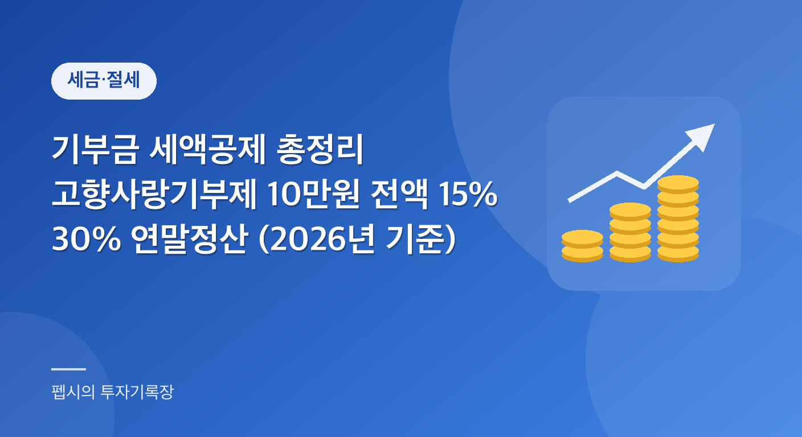

  

연말이 되면 길거리 모금함이나 문자로 오는 기부 요청이 부쩍 늘어납니다. 그런데 "이거 기부하면 연말정산에서 얼마나 돌려받지?" 하고 궁금해진 적 있으신가요?

기부금 세액공제는 어디에, 얼마를, 누구 이름으로 냈느냐에 따라 공제율이 완전히 달라집니다. 특히 고향사랑기부제는 올해부터 구간별 공제율이 바뀌어서 기존 정보를 그대로 믿으면 계산이 어긋날 수 있습니다.

올해 기부는 **12월 31일**까지 한 것만 2026년 귀속분으로 잡힙니다. 연말 막판에 몰아서 기부하기 전에, 기부 종류별 공제율과 주의점을 한 번에 정리해 보겠습니다.

**📌 한눈에 보기 (2026년 기준)**

- 특례·일반·우리사주조합 기부금은 공제율 15%, 1천만원 초과분은 30%입니다.
- 정치자금 기부금은 10만원 이하 100/110, 10만원 초과~3천만원 이하 15%, 3천만원 초과 25%입니다.
- 고향사랑기부금은 10만원까지 전액, 10만원 초과~20만원 이하 44%, 20만원 초과분 16.5%입니다.
- 고향사랑기부금 연간 한도는 1인당 2,000만원, 답례품은 기부액의 30% 이내입니다.
- 2026년 1월 1일~12월 31일 사이에 낸 기부금이 이번 연말정산 대상입니다.

**목차**

* TOC
{:toc}

## 기부금 세액공제, 기본 구조부터

기부금 세액공제는 해당 과세기간에 기부금을 낸 거주자가 받을 수 있는 공제입니다. 소득에서 빼주는 소득공제가 아니라, 계산된 세금 자체에서 직접 깎아주는 세액공제라는 점이 중요합니다.

국세청 안내에 따르면 근로자는 모든 종류의 기부금이 공제 대상입니다. 반면 사업소득만 있는 사람은 이 공제 대상에서 빠집니다.

기부금은 크게 정치자금, 고향사랑, 특례, 우리사주조합, 일반 기부금으로 나뉘고, 종류마다 공제율이 다릅니다. 같은 10만원을 내도 어디에 냈느냐에 따라 돌려받는 금액이 달라지는 이유입니다.

## 기부금 종류별 공제율 한눈에 비교

먼저 국세청 안내 기준 공제율을 표로 모았습니다. 고향사랑기부금은 아래에서 따로 자세히 다룹니다.

| 기부금 종류 | 공제율 |
|---|---|
| 정치자금 (10만원 이하) | 100/110 |
| 정치자금 (10만원 초과~3천만원 이하) | 15% |
| 정치자금 (3천만원 초과) | 25% |
| 특례기부금·우리사주조합·일반기부금 | 15% (1천만원 초과분 30%) |

표에서 보듯 일반적인 기부금 세액공제는 15%가 기본이고, 1년 기부 합계가 1천만원을 넘는 부분부터 30%가 적용됩니다. 1천만원 전체가 아니라 초과분에만 30%가 붙는다는 점을 기억해 두세요.

정치자금 기부금은 10만원까지는 거의 전액(100/110)을 돌려받는 구조라 소액 후원에 유리하지만, 어디까지나 공제 구조 설명이며 기부를 권하는 이야기는 아닙니다.

## 공제 대상 기부자: 가족이 낸 기부금도 될까?

기부금 세액공제는 본인이 낸 기부금뿐 아니라 기본공제대상자가 낸 기부금도 받을 수 있습니다. 다만 범위가 정해져 있습니다.

- 본인이 낸 기부금: 근로자는 모든 종류가 공제 대상입니다.
- 기본공제대상자가 낸 기부금: 특례기부금과 일반기부금만 해당합니다.
- 배우자, 직계존속, 직계비속, 형제자매: 소득요건을 충족해야 합니다.

즉 부모님이나 자녀 명의로 낸 기부금을 합치려면 그 가족이 부양가족 공제 요건(소득요건)을 충족해야 합니다. 소득요건의 구체적인 기준은 앞서 쓴 부양가족 공제 글이나 국세청 안내에서 확인해 주세요.

또 하나, 고향사랑기부금은 기부자 본인에게만 세액공제가 적용됩니다. 부모님 명의로 기부하고 내 연말정산에 넣을 수는 없습니다.

## 고향사랑기부제: 올해부터 달라진 점

고향사랑기부제는 주소지가 아닌 다른 지자체에 기부하고 세액공제와 답례품을 받는 제도입니다. 행정안전부 안내 기준으로 공제율은 아래와 같습니다.

| 기부 구간 | 세액공제율 |
|---|---|
| 10만원 이하 | 전액 공제 |
| 10만원 초과~20만원 이하 | 44% |
| 20만원 초과분 (일반 지자체) | 16.5% |
| 20만원 초과분 (특별재난지역 지자체) | 33% |

정책브리핑(2025년 12월 보도)에 따르면 10만원 초과 20만원 이하 구간의 공제율은 기존 16.5%에서 **44%**로 확대되었고, 2026년 2월 보도에서도 "올해부터" 적용된다고 안내했습니다. 그래서 20만원을 기부하면 10만원 전액에 더해 나머지 10만원의 44%인 4.4만원, 합계 14.4만원이 공제됩니다.

연간 기부 한도는 1인당 2,000만원이며, 법인은 기부할 수 없습니다. 지자체는 기부금의 30% 이내에서 답례품을 줄 수 있습니다.

**⚠️ 고향사랑기부금은 이월공제가 안 됩니다**

국세청 안내에 따르면 정치자금·고향사랑·우리사주조합 기부금은 이월공제가 허용되지 않습니다. 또 공제는 산출세액 기준으로 이뤄지므로, 공제받을 세액이 없으면 기부해도 돌려받을 금액이 없을 수 있습니다.

## 계산 예시로 이해하기

실제로 얼마나 공제되는지 가상의 예시로 계산해 보겠습니다. 모두 산출세액이 충분하다는 가정이고, 제가 계산한 값입니다.

| 상황 (가상) | 계산 | 공제액 |
|---|---|---|
| 일반기부금 300만원 | 300만원 × 15% | 45만원 |
| 일반기부금 1,200만원 | 1,000만원 × 15% + 200만원 × 30% | 210만원 |
| 고향사랑 20만원 (일반 지자체) | 10만원 + 10만원 × 44% | 14.4만원 |
| 고향사랑 100만원 (일반 지자체) | 10만원 + 10만원 × 44% + 80만원 × 16.5% | 27.6만원 |
| 고향사랑 100만원 (특별재난지역) | 10만원 + 10만원 × 44% + 80만원 × 33% | 40.8만원 |

일반기부금은 금액이 클수록 공제율이 올라가는 구조입니다. 다만 일반기부금과 특례기부금에는 소득 대비 인정 한도가 있어서, 위 계산은 한도에 걸리지 않을 때의 단순 값입니다. 기부금 종류별 한도의 정확한 비율은 국세청이나 홈택스에서 확인하세요.

고향사랑 100만원 기부 시 일반 지자체 27.6만원, 특별재난지역 40.8만원 공제라는 숫자는 행정안전부 안내에도 같은 예시로 나와 있어 계산이 일치합니다.

여기서 눈여겨볼 점은 고향사랑기부금의 효율이 구간마다 다르다는 것입니다. 10만원까지는 전액 공제라 부담이 가장 적고, 20만원을 넘으면 공제율이 16.5%로 떨어집니다.

## 증빙은 어떻게 챙길까

기부금 세액공제는 영수증이 있어야 합니다. 보통은 연말정산 간소화 서비스에서 조회되지만, 조회되지 않을 때가 있습니다.

1. 홈택스 연말정산 간소화 서비스에서 기부금 항목이 조회되는지 확인합니다.
2. 조회되지 않으면 기부금 단체에 기부금 영수증을 요청합니다.
3. 영수증과 기부금명세서를 회사에 제출합니다.

고향사랑기부 영수증은 국세청 홈택스에서 발급되며, 기부 후 약 1~2개월 걸린다고 고향사랑e음이 안내하고 있습니다. 연말에 기부하면 영수증 반영이 늦어질 수 있으니 시점을 미리 고려해 두세요.

기부처가 공제 대상 단체가 맞는지도 중요합니다. 공제 대상이 아닌 곳에 낸 후원금은 아무리 큰 금액이어도 세액공제가 되지 않습니다.

## 공제 순서와 이월공제

기부금이 여러 종류일 때는 공제 순서가 정해져 있습니다. 국세청이 안내한 2026년 기준 순서는 다음과 같습니다.

1. 이월된 특례기부금 → 당해연도 특례기부금
2. 이월된 종교단체 외 일반기부금 → 당해연도 종교단체 외 일반기부금
3. 이월된 종교단체 일반기부금 → 당해연도 종교단체 일반기부금

이월 기부금이 당해연도 기부금보다 먼저 공제된다는 점이 핵심입니다. 안내문에는 2016~2025년 이월분이 표시되어 있어, 특례·일반 기부금은 한도를 넘겨 공제받지 못한 금액을 이후 연도로 넘길 수 있는 구조임을 알 수 있습니다.

반대로 정치자금, 고향사랑, 우리사주조합 기부금은 이월이 안 됩니다. 그해 공제받지 못하면 그냥 사라지니, 산출세액이 거의 없는 해에는 이 기부금의 효과가 작을 수 있습니다.

참고로 2021~2022년 귀속 기부금은 한시적으로 1천만원 이하 20%, 초과분 35%로 상향된 적이 있어, 그 시기의 이월분만 상향된 공제율이 적용됩니다. 대부분의 사람에게는 해당 없는 내용입니다.

## 많이 하는 오해 4가지

### 1. "기부한 금액만큼 돌려받는다"

세액공제는 기부금 전액이 환급되는 것이 아닙니다. 일반기부금은 15%(1천만원 초과분 30%), 고향사랑은 10만원까지만 전액입니다.

그 외에는 기부액의 일부만 세금에서 빠지는 구조입니다. 기부를 환급 목적으로만 보면 기대와 차이가 생깁니다.

### 2. "고향사랑기부는 많이 낼수록 이득이다"

공제는 10만원까지가 전액이고, 10만원 초과 20만원 이하는 44%, 20만원 초과분은 16.5%로 구간마다 줄어듭니다. 금액이 클수록 실질 부담이 커집니다.

또 산출세액이 적으면 공제받을 세액 자체가 없어 혜택이 줄어듭니다. 답례품은 기부액의 30% 이내라는 점도 함께 따져야 합니다.

### 3. "부모님 명의로 기부하고 내 연말정산에 넣으면 된다"

고향사랑기부금은 기부자 본인에게만 세액공제가 적용됩니다. 가족 명의로 내고 내 연말정산에 넣을 수 없습니다.

일반·특례기부금은 기본공제대상자가 낸 것도 합칠 수 있지만, 그 가족이 소득요건을 충족해야 합니다.

### 4. "영수증은 어디서든 자동으로 잡힌다"

간소화 서비스에서 조회되는 경우가 많지만, 조회되지 않는 기부금도 있습니다. 이때는 기부금 단체에서 직접 영수증을 받아 제출해야 합니다.

고향사랑기부 영수증은 발급까지 1~2개월 걸릴 수 있습니다. 12월 말에 급히 기부했다면 반영 시점을 미리 확인해 두세요.

## 연말 전 점검 순서

기부를 계획하고 있다면 아래 순서로 점검해 보세요. 이미 낸 기부금이 있다면 그 내역부터 확인하면 됩니다.

1. 올해 이미 낸 기부금 내역과 영수증 보유 여부를 정리합니다.
2. 기부처가 공제 대상 단체인지 확인합니다.
3. 연말정산 미리보기에서 예상 산출세액이 있는지 확인합니다.
4. 고향사랑기부를 한다면 구간(10만원·20만원)별 공제율을 계산해 봅니다.
5. 12월 31일 이전에 기부가 완료되도록 일정을 잡습니다.

산출세액이 이미 0에 가깝다면 세액공제 효과가 작을 수 있습니다. 이 경우에는 기부를 세금 혜택보다 순수한 마음의 문제로 판단하는 편이 낫습니다.

## 정리

- 일반·특례·우리사주조합 기부금 세액공제율은 15%이고, 1천만원 초과분은 30%입니다.
- 정치자금 기부금은 10만원 이하 100/110, 10만원 초과~3천만원 이하 15%, 3천만원 초과 25%입니다.
- 고향사랑기부금은 10만원까지 전액, 10만원 초과~20만원 이하 44%, 20만원 초과분 16.5%이고 이월공제가 안 됩니다.
- 영수증은 간소화 서비스에서 확인하고, 조회되지 않으면 기부 단체에서 발급받아야 합니다.

기부금 세액공제는 종류별로 공제율과 이월 여부가 달라서, 같은 금액이라도 결과가 꽤 다릅니다. 연말 전에 내 기부 내역을 정리해 두면 놓치는 공제를 줄일 수 있습니다.

기부는 혜택 계산만으로 결정할 일은 아닙니다. 다만 이왕 낼 기부라면 공제 구조를 알고 내는 편이 좋겠습니다.

## 자주 묻는 질문

**Q1. 기부금 세액공제는 연말정산에서 언제까지 기부한 것이 대상인가요?**

A1. 해당 과세기간인 1월 1일부터 12월 31일까지 낸 기부금이 대상입니다. 2026년 기부분은 2027년 초 연말정산에서 공제받습니다.

**Q2. 고향사랑기부금을 20만원 냈다면 얼마가 공제되나요?**

A2. 10만원까지는 전액, 나머지 10만원은 44%인 4.4만원이 공제되어 합계 14.4만원입니다. 산출세액이 충분하다는 전제입니다.

**Q3. 고향사랑기부금도 한도를 넘으면 이월되나요?**

A3. 국세청 안내에 따르면 정치자금·고향사랑·우리사주조합 기부금은 이월공제가 허용되지 않습니다. 해당 연도에 공제받지 못하면 넘길 수 없습니다.

**Q4. 영수증이 간소화 서비스에 안 보이면 어떻게 하나요?**

A4. 기부금 단체에 기부금 영수증을 요청해 발급받고, 기부금명세서와 함께 회사에 제출하면 됩니다.

**Q5. 국세청과 행정안전부의 고향사랑 공제율 표기가 다르게 보이는데요?**

A5. 이 글은 고향사랑기부제를 운영하는 행정안전부와 고향사랑e음 안내(10만원 전액, 44%, 16.5%)를 기준으로 썼습니다. 국세청 안내 페이지에는 일부 다른 수치가 표기되어 있어, 신고 전 홈택스나 국세상담센터(126)에서 최종 확인하시길 권합니다.

## 참고 자료

- [국세청 - 기부금 세액공제](https://www.nts.go.kr/nts/cm/cntnts/cntntsView.do?cntntsId=239040)
- [고향사랑e음 - 연말정산 세액공제 안내](https://ilovegohyang.go.kr/donation/guide3.html)
- [행정안전부 - 고향사랑기부제](https://www.mois.go.kr/frt/sub/a06/b06/hometownLovedonation/screen.do)
- [정책브리핑 - 고향사랑기부로 설 선물 준비+세액공제](https://www.korea.kr/news/policyNewsView.do?newsId=148959271)
- [정책브리핑 - 고향사랑기부 1000억 원 돌파, 내년엔 세액공제 혜택 더 늘어](https://www.korea.kr/news/policyNewsView.do?newsId=148956582)

2026년 11월 기준

> 이 글은 일반적인 정보 제공을 위한 것으로, 개인 상황에 따라 적용이 다를 수 있습니다. 정확한 내용은 관련 기관에 확인하세요.
