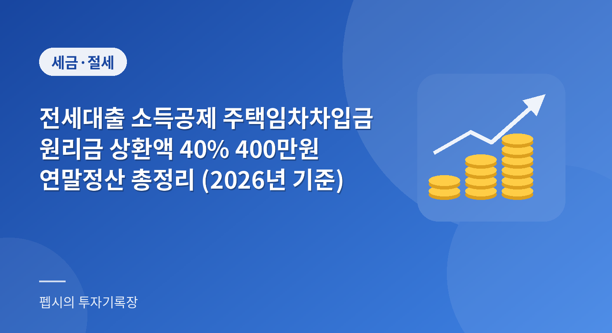

  

전세대출 이자를 매달 꼬박꼬박 내고 있는데, 연말정산에서 이 돈을 돌려받을 수 있다는 얘기를 들어보셨나요? 월세는 세액공제가 있다고 아는데 전세는 왜 아무 얘기가 없지 싶었던 분들이 꽤 많을 거예요.

사실 전세에도 공제가 있습니다. 이름이 어려워서 놓치기 쉬운 **주택임차차입금 원리금 상환액 소득공제**가 그 주인공이에요.

12월이 지나면 서류를 다시 챙기기 번거로워지니, 지금 11월 말에 내가 대상인지 미리 점검해 두면 좋겠죠. 이 글에서는 전세대출 소득공제의 대상, 한도, 요건, 필요한 서류를 국세청 안내 기준으로 차근차근 정리해 볼게요.

**📌 한눈에 보기 (2026년 기준)**

- 공제 금액은 전세대출 원리금 상환액의 **40%** 입니다.
- 주택청약종합저축 공제와 합쳐서 연 **400만원** 까지만 인정됩니다.
- 12월 31일 현재 무주택 세대주가 기본 대상입니다.
- 전용면적 85㎡ 이하 국민주택규모 주택이어야 합니다(수도권 밖 읍·면 지역은 100㎡ 이하).
- 입주일·전입일 중 빠른 날 전후 3개월 이내에 빌린 돈이어야 하고, 대출금은 임대인 계좌로 직접 입금돼야 합니다.

**목차**

* TOC
{:toc}

## 전세대출 소득공제란 무엇일까

전세대출 소득공제는 무주택 근로자가 전셋집을 구하려고 대출을 받았을 때, 그 원금과 이자를 갚은 금액의 일부를 소득에서 빼 주는 제도예요. 정식 명칭은 주택임차차입금 원리금 상환액 소득공제입니다.

세액공제와 달리 소득공제는 세금을 계산하는 기준이 되는 소득 자체를 줄여 줍니다. 그래서 내 세율이 높을수록 줄어드는 세금도 커지는 구조예요.

핵심은 이자만이 아니라 원금과 이자를 합친 **원리금** 상환액이 대상이라는 점입니다. 전세대출은 보통 만기에 원금을 한 번에 갚는 구조라 한 해 동안 낸 돈이 대부분 이자인 경우가 많은데, 이자도 당연히 포함됩니다.

월세를 내는 분들은 월세 세액공제가 따로 있어요. 이 부분은 이미 월세 세액공제 글에서 다뤘으니, 이 글은 전세대출을 쓰는 분들 기준으로 읽어 주세요.

## 공제 금액과 400만원 합산 한도

공제 금액은 한 해 동안 갚은 원리금 상환액의 40%입니다. 예를 들어 1년간 원리금으로 500만원을 갚았다면 200만원이 소득에서 빠지는 식이에요.

여기서 꼭 알아야 할 것이 한도입니다. 국세청 안내에 따르면 주택청약종합저축 공제금액(납입액의 40%)과 주택임차차입금 원리금 상환 공제금액(상환액의 40%)을 합산해 연 400만원을 넘는 부분은 공제되지 않아요.

즉 청약통장을 같이 쓰고 있다면 두 공제가 400만원 한도를 나눠 쓰는 셈입니다. 주택청약종합저축 공제 자체의 내용은 이전 글에서 정리했으니 함께 보시면 좋아요.

아래 표는 제가 가상의 숫자로 계산한 예시입니다. 실제 세금은 개인의 소득과 세율에 따라 달라져요.

| 구분 | 연 원리금 상환액 | 연 청약저축 납입액 | 청약 공제(40%) | 임차 공제(40%) | 합산 | 인정 공제액 |
|---|---|---|---|---|---|---|
| 사례 A | 500만원 | 0원 | 0원 | 200만원 | 200만원 | 200만원 |
| 사례 B | 1,000만원 | 0원 | 0원 | 400만원 | 400만원 | 400만원 |
| 사례 C | 1,500만원 | 0원 | 0원 | 600만원 | 600만원 | 400만원 |
| 사례 D | 1,000만원 | 240만원 | 96만원 | 400만원 | 496만원 | 400만원 |

사례 B부터는 한도에 딱 걸리기 시작합니다. 상환액이 1,000만원을 넘으면 더 갚아도 공제액은 늘지 않아요.

사례 D처럼 청약저축도 함께 납입하면 합산액이 한도를 넘어, 청약 쪽 공제 일부가 사실상 의미가 없어질 수 있습니다. 이럴 때는 어느 쪽 공제가 유리한지 따져 볼 필요가 있어요.

## 누가 받을 수 있나: 대상자 요건

기본 대상은 근로소득이 있는 거주자로서, 과세기간 종료일인 12월 31일 현재 **무주택 세대의 세대주**입니다. 외국인 근로자도 요건을 갖추면 포함돼요.

세대주가 이 공제들을 받지 않는 경우에는 근로소득이 있는 세대원이 대신 받을 수 있다고 국세청은 안내합니다. 세대원이 받을 때의 구체적인 요건은 공식 사이트에서 확인이 필요해요.

대상자를 점검할 때 아래 항목을 하나씩 살펴보세요.

- 근로소득이 있는 거주자인가
- 12월 31일 기준으로 무주택 세대인가
- 내가 세대주인가(세대주가 아니라면 세대원 요건 확인)
- 세대주가 같은 해 주택임차차입금·장기주택저당차입금·청약저축 공제를 이미 받고 있지는 않은가

특히 무주택 여부는 연말 시점 기준이에요. 한 해 중 무주택이었더라도 12월 31일 현재 주택이 있다면 대상에서 빠질 수 있으니 주의하세요.

## 공제받을 수 있는 주택과 대출 요건

공제 대상이 되는 집은 주택법상 국민주택규모 주택입니다. 주거용 오피스텔도 포함돼요.

국민주택규모란 주거전용면적 85㎡ 이하를 말하고, 수도권을 제외한 도시지역이 아닌 읍·면 지역은 100㎡ 이하입니다. 다가구주택은 가구당 전용면적을 기준으로 봅니다.

대출 쪽 요건도 있습니다. 국세청 안내와 관련 자료를 종합하면 흐름은 아래와 같아요.

- 임대차계약증서상 입주일과 주민등록표등본상 전입일 중 빠른 날부터 전후 3개월 이내에 빌린 돈일 것
- 대출금이 대출기관에서 임대인 계좌로 직접 입금될 것
- 임대차계약을 연장하거나 갱신하면서 빌린 돈도 인정되는 경우가 있음

이 중 3개월 기준은 많이 놓치는 부분이에요. 입주 한참 뒤에 생활비 용도로 받은 대출은 이름이 전세대출이어도 공제가 안 될 수 있습니다.

**⚠️ 대출 시기와 입금 방식을 꼭 확인하세요**

입주·전입일 전후 3개월을 벗어나 빌렸거나, 대출금이 임대인 계좌로 직접 입금되지 않았다면 공제가 안 될 수 있습니다. 또 주택청약종합저축 공제와 합쳐 연 400만원이 한도이니, 이미 청약 공제를 받고 있다면 추가 혜택이 크지 않을 수 있어요.

이자율 조건이나 개인 간 차입(친척·지인에게 빌린 경우) 요건처럼 세부 조건은 이 글에서 확인하지 못했어요. 해당되는 분은 반드시 국세청 안내나 126 국세상담센터에서 확인하세요.

## 필요한 서류와 신청 방법

공제는 연말정산 때 회사에 서류를 제출하면서 신청해요. 보통 아래 서류가 필요합니다.

- 주택자금상환 등 증명서(주택임차차입금 원리금 상환증명서)
- 주민등록표등본
- 임대차계약증서 사본
- 원리금 상환 증빙(계좌이체 영수증 또는 무통장입금증)

연말정산 간소화 서비스에서 자료가 조회되면 그대로 내려받아 제출하면 됩니다. 조회가 안 될 때는 대출을 받은 금융회사에서 증명서를 직접 발급받을 수 있다고 국세청은 안내하고 있어요.

신청 순서는 이렇게 정리할 수 있습니다.

1. 12월 31일 기준 무주택 세대주인지 확인합니다.
2. 전세대출 계약일과 입주·전입일이 3개월 이내인지 확인합니다.
3. 홈택스 연말정산 간소화 서비스에서 자료 조회 여부를 봅니다.
4. 조회가 안 되면 금융회사에서 상환증명서를 발급받습니다.
5. 임대차계약서 사본, 주민등록표등본과 함께 회사에 제출합니다.

회사에 제출하는 시기는 2026년 귀속분의 경우 보통 2027년 1월 연말정산 때예요. 구체적인 일정은 회사 안내와 국세청 공지를 확인해 주세요.

## 얼마나 돌려받을까: 계산 예시

공제를 받으면 실제로 얼마나 세금이 줄어드는지도 궁금하죠. 아래는 적용 세율이 15%라고 가정한 단순 계산입니다. 지방소득세는 별도이고, 실제 결과는 개인별로 달라요.

| 구분 | 상환액 | 소득공제액(40%) | 줄어드는 소득세(세율 15% 가정) |
|---|---|---|---|
| 사례 A | 500만원 | 200만원 | 30만원 |
| 사례 B | 1,000만원 | 400만원 | 60만원 |
| 사례 C | 1,500만원 | 400만원(한도) | 60만원 |

제가 계산한 값이라 정확한 환급액과는 차이가 날 수 있어요. 실제로는 공제 외에도 다른 공제·기납부세액이 함께 반영되기 때문입니다.

소득공제의 특징은 세율이 높은 분일수록 효과가 커진다는 점이에요. 같은 400만원을 공제받아도 적용 세율이 24%인 분은 이론상 96만원, 15%인 분은 60만원 줄어드는 식입니다.

## 많이 하는 오해 4가지

### 1. "전세대출 이자만 내도 무조건 공제된다"

대출을 받았다고 자동으로 공제되는 건 아니에요. 무주택 세대주, 85㎡ 이하, 3개월 이내 차입, 임대인 계좌 직접 입금 같은 요건을 모두 맞춰야 합니다.

### 2. "원금은 공제 대상이 아니다"

이 공제는 이자만이 아니라 원금과 이자를 합친 원리금 상환액이 대상이에요. 중간에 원금 일부를 갚았다면 그 금액도 상환액에 들어갑니다.

### 3. "청약저축 공제와 따로따로 400만원씩 받는다"

두 공제는 합쳐서 연 400만원 한도예요. 각각 400만원이 아니라는 점을 기억해 두세요.

### 4. "월세 세액공제와 똑같다"

월세는 세액공제이고 전세대출은 소득공제라 구조가 달라요. 월세 세액공제의 공제율이나 소득 기준을 전세대출 공제에 그대로 적용하면 안 됩니다.

## 연말 전에 점검할 체크리스트

공제 대상일 가능성이 있다면 12월이 가기 전에 아래를 확인해 보세요. 연말 이후에는 되돌릴 수 없는 항목이 있어요.

- 무주택 세대주 여부: 12월 31일 기준이므로 주택 취득·세대 구성 변동을 점검합니다.
- 대출 계약서: 대출 실행일이 입주·전입일 전후 3개월 이내인지 확인합니다.
- 상환 증빙: 이자 납부 내역과 원금 상환 내역을 모아 둡니다.
- 청약저축 납입액: 합산 한도 400만원을 고려해 어느 공제가 유리한지 계산해 봅니다.
- 간소화 서비스 조회: 자료가 빠져 있다면 금융회사에 증명서 발급을 요청합니다.

특히 전세대출을 갈아타거나 연장한 해에는 대출 실행 시점이 여러 번 생겨 서류가 복잡해질 수 있어요. 이럴 때는 금융회사에서 발급한 증명서에 어떤 대출이 어떻게 잡혀 있는지 꼭 확인하세요.

## 정리

- 전세대출 소득공제는 원리금 상환액의 40%를 소득에서 빼 주는 제도입니다.
- 청약저축 공제와 합쳐 연 400만원 한도가 적용됩니다.
- 12월 31일 기준 무주택 세대주, 85㎡ 이하 주택, 입주·전입 전후 3개월 이내 차입, 임대인 계좌 직접 입금이 핵심 요건입니다.
- 간소화 서비스에서 조회가 안 되면 금융회사에서 증명서를 발급받아 제출하세요.

전세대출은 부담이 큰 만큼, 받을 수 있는 공제는 놓치지 않는 게 좋아요. 연말정산 때 한 번에 챙기려면 지금부터 서류 상태를 점검해 두는 것을 권해요.

다만 세대원 요건, 이자율 조건처럼 이 글에서 확인하지 못한 부분은 공식 사이트에서 꼭 다시 확인해 주세요.

## 자주 묻는 질문

**Q1. 전세대출 이자만 냈는데도 공제가 되나요?**

A1. 네, 원리금 상환액이 대상이라 이자만 낸 경우에도 그 이자 납부액이 상환액으로 계산됩니다. 다만 앞서 정리한 요건을 모두 충족해야 해요.

**Q2. 세대주가 아니면 공제를 못 받나요?**

A2. 기본 대상은 세대주입니다. 국세청은 세대주가 관련 공제들을 받지 않는 경우 근로소득이 있는 세대원이 받을 수 있다고 안내하며, 세부 요건은 공식 사이트에서 확인이 필요합니다.

**Q3. 청약저축 공제와 동시에 받을 수 있나요?**

A3. 동시에 받을 수는 있지만 두 공제의 합계가 연 400만원을 넘으면 초과분은 인정되지 않습니다.

**Q4. 간소화 서비스에 자료가 안 나와요.**

A4. 대출을 받은 금융회사에서 주택자금상환 증명서를 발급받아 임대차계약서 사본, 주민등록표등본과 함께 제출하면 됩니다.

**Q5. 85㎡를 조금 넘는 집도 되나요?**

A5. 전용면적 기준 85㎡ 이하(수도권 밖 읍·면 지역은 100㎡ 이하)여야 하므로 넘으면 대상이 아닙니다. 계약서의 전용면적을 확인하세요.

## 참고 자료

- [국세청 - 주택임차차입금 원리금 상환액 소득공제 (연말정산)](https://www.nts.go.kr/nts/cm/cntnts/cntntsView.do?mi=40609&cntntsId=239021)
- [국세청 - 주택마련저축 소득공제](https://www.nts.go.kr/nts/cm/cntnts/cntntsView.do?mi=40610&cntntsId=239022)
- [국세청 - 연말정산 종합 안내](https://www.nts.go.kr/nts/cm/cntnts/cntntsView.do?mi=2304&cntntsId=238938)
- 2026년 11월 기준

> 이 글은 일반적인 정보 제공을 위한 것으로, 개인 상황에 따라 적용이 다를 수 있습니다. 정확한 내용은 관련 기관에 확인하세요.
