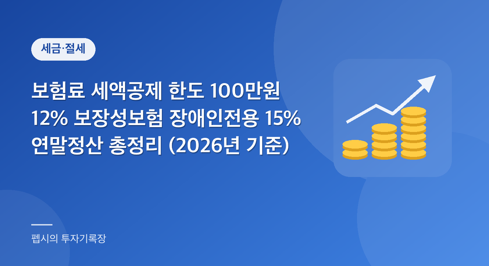

  

매달 빠져나가는 보험료, 연말정산에서 얼마나 돌려받을 수 있는지 계산해 본 적 있으신가요? 보험료를 많이 내는데도 환급액에는 별 변화가 없어서 고개를 갸웃한 분도 계실 겁니다.

보험료 세액공제는 이름만 들으면 "보험 많이 들수록 유리하겠네" 싶지만, 실제로는 한도가 정해져 있어서 어느 선을 넘으면 더 내도 공제액이 늘지 않습니다.

11월 말이면 연말정산 점검을 마무리해야 하는 시기입니다. 이 글에서는 보험료 세액공제의 한도와 공제율, 대상이 되는 보험, 계산 방법, 자주 하는 오해를 차근차근 정리해 보겠습니다.

**📌 한눈에 보기 (2026년 기준)**

- 일반 보장성보험료는 연 **100만원 한도**에서 **12%** 세액공제를 받습니다.
- 장애인전용 보장성보험료는 연 100만원 한도에서 **15%** 세액공제를 받습니다.
- 최대 공제액은 일반 12만원, 장애인전용 15만원으로 계산됩니다.
- 공제 대상은 근로소득이 있는 거주자가 기본공제대상자를 위해 낸 보험료입니다.

**목차**

* TOC
{:toc}

## 보험료 세액공제란 무엇인가

보험료 세액공제는 연말정산의 특별세액공제 항목 중 하나입니다. 근로소득이 있는 사람이 기본공제대상자를 위해 한 해 동안 보험료를 냈다면, 그 금액의 일부를 내야 할 세금에서 직접 깎아 주는 제도입니다.

소득에서 빼 주는 소득공제와 달리, 세액공제는 계산된 세금 자체에서 빼 줍니다. 그래서 소득이 높든 낮든 같은 보험료라면 공제받는 금액이 같다는 특징이 있습니다.

국세청 안내에는 의료비 세액공제와 보험료 세액공제가 같은 페이지에 묶여 설명되어 있습니다. 둘 다 특별세액공제로 분류되기 때문입니다.

## 공제율과 한도 한눈에 보기

보험료 세액공제는 보험의 종류에 따라 공제율이 다릅니다. 국세청 안내 기준으로 한도는 두 종류 모두 연 100만원입니다.

| 구분 | 연간 한도 | 공제율 | 최대 공제액 |
|---|---|---|---|
| 일반 보장성보험료 | 100만원 | 12% | 12만원 |
| 장애인전용 보장성보험료 | 100만원 | 15% | 15만원 |

최대 공제액은 한도에 공제율을 곱한 값으로, 제가 계산한 값입니다. 보험료를 아무리 많이 내도 일반 보장성보험으로는 12만원을 넘겨 공제받을 수 없다는 뜻입니다.

장애인전용 보장성보험은 일반 보장성보험과 한도가 따로 안내되어 있습니다. 두 가지를 모두 가입한 경우의 합산 방식은 홈택스나 회사 연말정산 안내로 한 번 더 확인해 보세요.

## 어떤 보험료가 공제 대상일까

국세청 안내에 나오는 공제 대상은 생명보험, 상해보험 같은 보장성보험료입니다. 여기에 장애인을 피보험자 또는 수익자로 하는 장애인전용 보장성보험료가 더해집니다.

보장성보험은 말 그대로 사고나 질병, 사망 같은 위험을 보장하는 데 목적이 있는 보험입니다. 만기에 돌려받는 돈이 중심인 저축 성격의 보험과는 구분해서 생각해야 합니다.

저축성보험이 구체적으로 어디까지 제외되는지, 특정 상품이 보장성에 해당하는지는 상품별로 다를 수 있습니다. 가입한 보험사의 납입증명서나 홈택스 조회 내용으로 확인하는 것이 가장 정확합니다.

### 대상자는 기본공제대상자

공제 대상은 본인이 낸 보험료 중에서도 기본공제대상자를 위한 보험료입니다. 즉 피보험자가 기본공제대상자여야 한다는 점이 중요합니다.

예를 들어 소득이 많아 부양가족 공제 대상에서 빠지는 가족을 피보험자로 한 보험료는 공제 대상이 아닐 수 있습니다. 기본공제대상자의 소득 요건은 해마다 한 번씩 꼭 확인해 두세요.

### 보험료를 낸 사람 기준

보험료를 누가 냈는지도 따져야 합니다. 근로소득이 있는 거주자가 보험료를 지급한 경우에 공제를 받는 구조이기 때문에, 계약자와 납부자가 누구인지에 따라 공제받을 사람이 달라질 수 있습니다.

가족끼리 보험을 서로 나누어 가입했다면 누구 명의로 공제받는 것이 맞는지 미리 정리해 두는 편이 좋습니다.

## 계산 예시로 이해하기

실제로 얼마가 공제되는지 가상의 예시로 확인해 보겠습니다. 아래 금액은 모두 설명을 위해 임의로 정한 것이며, 계산은 한도 100만원과 공제율 12%·15%를 적용한 값입니다.

| 상황 | 연간 납입 보험료 | 공제 대상 금액 | 세액공제액 |
|---|---|---|---|
| A: 보장성보험 월 5만원 | 60만원 | 60만원 | 7만 2천원 |
| B: 보장성보험 월 10만원 | 120만원 | 100만원(한도) | 12만원 |
| C: 보장성보험 월 20만원 | 240만원 | 100만원(한도) | 12만원 |
| D: 장애인전용 월 5만원 | 60만원 | 60만원 | 9만원 |
| E: 장애인전용 월 10만원 | 120만원 | 100만원(한도) | 15만원 |

B와 C를 보면 보험료를 두 배로 내도 공제액은 똑같습니다. 연 100만원, 월로 치면 약 8만 3천 원을 넘는 보험료는 이 공제에서 추가 혜택이 없다는 이야기입니다.

물론 보험은 세금 혜택 때문에 가입하는 것이 아니라 보장이 필요해서 드는 것입니다. 공제액은 덤으로 따라오는 정도로 보시는 것이 맞습니다.

## 표준세액공제와의 관계 확인하기

연말정산에서는 특별소득공제나 특별세액공제 등을 신청하지 않으면 근로자에게 표준세액공제가 적용되는 구조가 있습니다. 그래서 보험료 공제액이 크지 않다면 표준세액공제와 비교해 어느 쪽이 유리한지 따져 봐야 합니다.

보험료 세액공제 하나만 놓고 보면 최대 12만원이라 크지 않습니다. 하지만 의료비, 교육비, 기부금 등 다른 특별공제 항목이 함께 있다면 합산해서 판단해야 합니다.

표준세액공제 금액과 적용 방식은 이번 확인 범위에서 공식 출처로 확인하지 못했습니다. 홈택스 연말정산 미리보기나 회사 연말정산 담당자에게 확인하시기 바랍니다.

**⚠️ 피보험자 요건을 놓치면 공제가 안 됩니다**

보험료를 냈더라도 피보험자가 기본공제대상자가 아니면 공제 대상에서 빠질 수 있습니다. 가족의 소득이나 나이 요건이 바뀌었는지 연말 전에 꼭 확인하세요. 확인 없이 공제받았다가 나중에 정정하게 되면 가산세가 붙을 수도 있습니다.

## 연말정산에서 보험료 공제 받는 순서

보험료 공제는 자료 확인부터 시작해서 회사 제출까지 몇 단계로 이루어집니다. 아래 순서대로 점검하면 빠뜨리는 일이 줄어듭니다.

1. 홈택스 연말정산 간소화 서비스에서 보험료 납입 내역을 조회합니다.
2. 피보험자가 기본공제대상자인지 확인합니다.
3. 장애인전용 보험이라면 장애인 요건 증빙이 필요한지 확인합니다.
4. 조회되지 않는 보험이 있다면 보험사에서 납입증명서를 따로 받습니다.
5. 소득·세액공제신고서와 증빙 자료를 회사에 제출합니다.

간소화 서비스에서 자료가 누락되는 경우도 있습니다. 보험사가 자료를 국세청에 제출하지 않은 경우가 대표적이니, 조회가 안 되는 보험은 직접 증명서를 챙기는 것이 안전합니다.

## 많이 하는 오해 4가지

### 1. "보험료를 많이 낼수록 환급도 늘어난다"

그렇지 않습니다. 일반 보장성보험은 연 100만원까지만 공제 대상 금액으로 인정되기 때문에, 그 이상 낸 보험료는 환급액에 영향을 주지 않습니다.

### 2. "모든 보험이 공제 대상이다"

공제 대상은 보장성보험료입니다. 보험이라는 이름이 붙었다고 모두 대상이 되는 것은 아니며, 저축 성격이 강한 상품은 따로 확인해야 합니다.

### 3. "누구의 보험이든 내가 냈으면 공제된다"

피보험자가 기본공제대상자여야 합니다. 부모님이나 자녀 보험을 대신 내 주었더라도 그분들이 기본공제대상자가 아니라면 공제가 어려울 수 있습니다.

### 4. "공제율이 13.2%라는 글을 봤다"

일부 오래된 안내 글에는 13.2%, 16.5%라는 숫자가 나옵니다. 2017년 정책브리핑 기사에서 확인되는 표기인데, 국세청 안내의 공제율은 12%와 15%입니다. 차이는 지방소득세 포함 여부로 보이지만, 정확한 설명은 공식 기관에 확인해 보세요.

## 장애인전용 보장성보험은 무엇이 다를까

장애인전용 보장성보험은 장애인을 피보험자 또는 수익자로 하는 보장성보험입니다. 공제율이 15%로 일반 보장성보험보다 높게 적용됩니다.

한도는 마찬가지로 연 100만원이라, 최대 15만원까지 공제됩니다. 일반 보장성보험과 한도가 별도로 안내되어 있으므로 두 종류에 모두 가입했다면 각각 확인해 보세요.

장애인전용보험으로 인정받으려면 보험 상품이 장애인전용으로 분류되어 있어야 하고, 장애인 요건에 대한 증빙이 필요한 경우가 있습니다. 구체적인 증빙 서류는 이번에 공식 출처에서 확인하지 못했으니 회사나 국세청에 문의하시기 바랍니다.

## 보험료 공제와 함께 챙길 항목

보험료 세액공제만으로는 금액이 크지 않습니다. 그래서 다른 항목과 함께 연말 전에 한꺼번에 점검하는 것이 효율적입니다.

- 의료비 세액공제: 총급여 일정 비율을 넘는 지출이 대상입니다.
- 교육비 세액공제: 본인과 자녀 교육비가 해당합니다.
- 기부금 세액공제: 고향사랑기부제 등이 있습니다.
- 월세 세액공제: 무주택 세입자 요건을 충족해야 합니다.
- 연금저축·IRP 세액공제: 연말 전 납입 여부가 중요합니다.

이 블로그에 각 항목별 총정리 글이 있으니 필요한 부분은 함께 읽어 보시면 좋습니다. 12월 31일이 지나면 납입할 수 없는 항목도 있으니 지금 점검하는 것이 좋습니다.

## 정리

- 보장성보험료 세액공제는 연 **100만원 한도** 내에서 12%, 장애인전용은 15%입니다.
- 최대 공제액은 일반 12만원, 장애인전용 15만원이며 한도를 넘는 보험료는 추가 혜택이 없습니다.
- 피보험자가 기본공제대상자인지, 보험이 보장성인지 확인해야 합니다.
- 홈택스 조회 후 누락된 보험은 납입증명서를 따로 챙기세요.

보험료 세액공제는 금액이 크지 않지만 확인하는 데 오래 걸리지 않는 항목입니다. 홈택스에서 납입 내역만 열어 봐도 대략 감이 잡힙니다.

연말정산은 결국 항목 하나하나를 빠뜨리지 않는 싸움입니다. 이번 주에 한 번 점검해 보고, 부족한 부분은 12월 안에 보완해 두세요.

## 자주 묻는 질문

**Q1. 보험료 세액공제 한도는 얼마인가요?**

A1. 국세청 안내 기준으로 일반 보장성보험료와 장애인전용 보장성보험료 모두 연 100만원이 한도입니다. 공제율은 각각 12%, 15%입니다.

**Q2. 월 보험료가 20만원인데 공제도 두 배가 되나요?**

A2. 아닙니다. 연간 납입액이 한도 100만원을 넘으면 초과분은 공제 대상 금액에 들어가지 않습니다. 일반 보장성보험이라면 최대 12만원까지입니다.

**Q3. 부모님 보험료를 대신 내 주면 공제되나요?**

A3. 부모님이 기본공제대상자이고 근로소득이 있는 본인이 보험료를 낸 경우 공제 대상이 될 수 있습니다. 부모님의 소득과 나이 요건은 해마다 달라질 수 있으니 확인이 필요합니다.

**Q4. 홈택스에서 조회되지 않는 보험은 어떻게 하나요?**

A4. 가입한 보험사에서 납입증명서를 발급받아 회사에 제출하면 됩니다. 발급 방법은 보험사 홈페이지나 고객센터에서 안내합니다.

## 참고 자료

- 국세청 의료비·보험료 세액공제(특별세액공제): https://www.nts.go.kr/nts/cm/cntnts/cntntsView.do?mi=6595&cntntsId=7874
- 국가법령정보센터 소득세법 제59조의4(특별세액공제): https://www.law.go.kr/법령/소득세법/제59조의4
- 정책브리핑 보험상품 절세 노하우(2017년 기사, 공제율 표기 비교용): https://www.korea.kr/news/policyNewsView.do?newsId=148845669

2026년 11월 기준으로 확인한 내용이며, 세법은 매년 개정될 수 있습니다.

> 이 글은 일반적인 정보 제공을 위한 것으로, 개인 상황에 따라 적용이 다를 수 있습니다. 정확한 내용은 관련 기관에 확인하세요.
