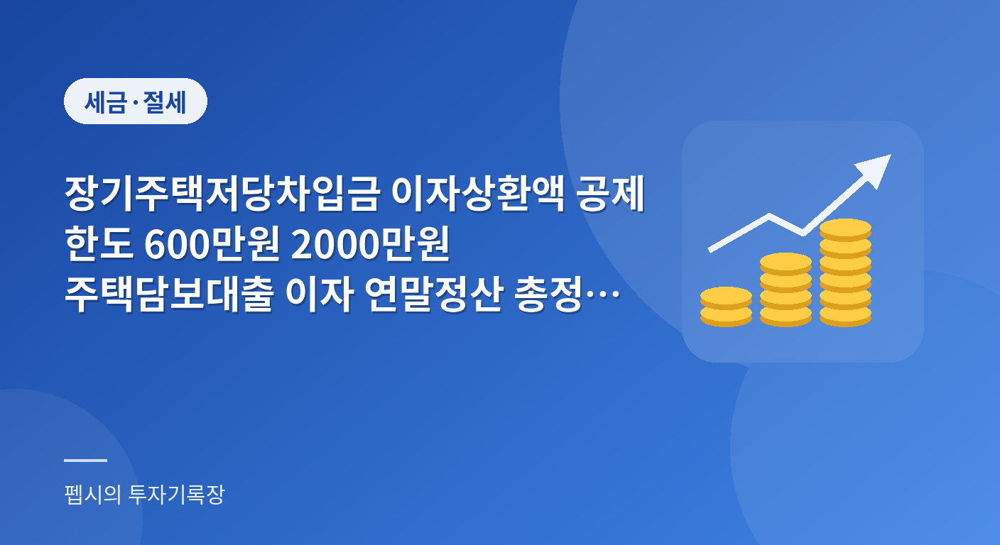

  

매달 은행에 내는 주택담보대출 이자, 연말정산에서 돌려받을 수 있다는 건 알고 계셨나요? 이자가 꽤 큰 금액인데도 "나는 해당 안 되겠지" 하고 넘기는 분이 의외로 많습니다.

문제는 이 공제가 대출을 받은 시점, 상환 방식, 집값 기준에 따라 한도가 600만 원에서 2000만 원까지 크게 달라진다는 점입니다. 내 대출이 어느 구간인지 모르면 공제를 놓치거나 반대로 잘못 신청할 수 있어요.

이 글에서는 장기주택저당차입금 이자상환액 공제의 대상, 집값 기준, 한도 표, 제출 서류를 국세청 안내 자료 기준으로 차근차근 정리해 보겠습니다.

**📌 한눈에 보기 (2026년 11월 기준)**

- 대상은 근로소득이 있는 무주택 또는 1주택 세대의 세대주입니다.
- 주택은 취득 당시 기준시가 6억 원 이하여야 합니다(2024.1.1. 이후 취득분).
- 한도는 상환기간·금리 방식에 따라 600만 / 800만 / 1,800만 / 2,000만 원입니다.
- 대출은 주택 소유권이전등기일에서 3개월 이내에 받아야 합니다.
- 증빙은 홈택스에서 받는 장기주택저당차입금 이자상환증명서와 주민등록표등본 등입니다.

**목차**

* TOC
{:toc}

## 장기주택저당차입금 이자상환액 공제란?

이름이 길고 어렵지만 뜻은 단순합니다. 집을 사려고 빌린 주택담보대출의 이자를 그해 근로소득금액에서 빼 주는 제도예요.

세액공제가 아니라 소득공제라는 점이 중요합니다. 낸 이자만큼 세금에서 바로 깎아 주는 것이 아니라, 세금을 계산하는 기준이 되는 소득을 줄여 주는 방식이에요.

그래서 실제로 돌려받는 금액은 공제금액에 내 적용 세율을 곱한 만큼입니다. 같은 이자를 내도 소득이 높은 사람이 더 많이 환급받는 구조예요.

근거 법령은 소득세법 제52조와 같은 법 시행령 제112조입니다. 국세청은 이 내용을 주택자금공제 안내 책자로 정리해 매년 배포하고 있어요.

## 공제 대상자: 누가 받을 수 있나

기본 조건은 세 가지입니다. 근로소득이 있는 거주자일 것, 과세기간 종료일 현재 무주택이거나 1주택을 가진 세대일 것, 그리고 그 세대의 세대주일 것이에요.

여기서 "세대"에는 본인과 배우자뿐 아니라 같은 주소에서 생계를 같이하는 직계존비속, 형제자매도 포함됩니다. 세대 구성원이 가진 주택까지 합쳐서 2주택 이상이면 공제를 받을 수 없어요.

세대주 여부와 주택 수는 모두 12월 31일, 즉 과세기간 종료일 현재 상황으로 판단합니다. 중간에 2주택이었더라도 연말에 1주택이면 그해에는 공제가 가능합니다.

국세청 책자에는 세대주의 경우 실제 거주 여부와 관계없이 적용되고, 단독세대주도 공제할 수 있다고 적혀 있습니다. 다만 이 부분은 뒤에서 설명할 세제개편안과 연결되니 꼭 같이 확인하세요.

### 세대원이 받는 경우

세대주가 근로소득이 없거나, 있어도 주택자금 관련 공제를 전혀 받지 않는 경우에는 근로소득이 있는 세대원이 받을 수 있습니다.

이때는 세대원 본인 명의의 주택이어야 하고, 세대원이 그 집에 실제로 살고 있어야 해요. 남편이 공제를 받지 않았다고 해서 남편 소유 주택의 대출 이자를 아내가 공제받을 수는 없습니다.

### 외국인 근로자

일정 요건을 갖춘 외국인 근로자도 2021.1.1. 이후 이자를 지급하는 분부터 공제 대상에 들어갑니다. 구체적인 요건은 국세청 안내문을 확인하는 편이 안전해요.

## 공제 대상 주택: 취득 당시 기준시가 6억 원

주택 요건은 취득 당시 기준시가 6억 원 이하입니다. 이 기준은 2024.1.1. 이후 취득한 주택부터 5억 원에서 6억 원으로 올라갔어요.

이전 취득분은 기준이 달라서, 2019.1.1.~2023.12.31. 차입분은 5억 원, 2014.1.1.~2018.12.31. 차입분은 4억 원, 2013.12.31. 이전 차입분은 3억 원(국민주택규모 주택)입니다.

| 적용 시기 | 주택 규모 | 취득 당시 기준시가 |
|---|---|---|
| 2024.1.1. 이후 취득 | 규모 제한 없음 | 6억 원 |
| 2019.1.1.~2023.12.31. 차입 | 규모 제한 없음 | 5억 원 |
| 2014.1.1.~2018.12.31. 차입 | 규모 제한 없음 | 4억 원 |
| 2013.12.31. 이전 차입 | 국민주택규모 | 3억 원 |

표 아래에 하나만 덧붙이면, 2024.1.1. 이후 차입하는 분부터는 국민주택규모를 초과하는 주택도 공제가 가능합니다. 또 거주용 오피스텔은 이 공제에서 제외된다고 국세청 책자에 표시되어 있어요.

기준시가는 개별주택가격이나 공동주택가격으로 봅니다. 공시되기 전에 차입했다면 차입일 이후 처음 공시된 가격을 기준으로 해요.

## 공제 대상 차입금 요건

집값만 맞는다고 끝이 아닙니다. 빌린 돈도 요건을 갖춰야 해요. 국세청 책자 기준으로 다음 두 가지를 모두 충족해야 합니다.

1. 주택 소유권이전등기일 또는 보존등기일부터 3개월 이내에 차입할 것
2. 차입금의 채무자가 해당 저당권이 설정된 주택의 소유자일 것

그리고 돈을 빌려준 곳은 금융회사 등이거나 주택도시기금이어야 하고, 해당 주택에 저당권이 설정되어 있어야 합니다.

타인 명의의 주택이나 타인 명의의 차입금에 대한 이자는 근로자 본인이 공제받을 수 없어요. 부부 중 한 명만 대출을 받았다면 그 사람 이름으로 공제를 판단합니다.

### 명의와 공제 여부

| 주택 소유자 | 차입자 | 공제 여부 |
|---|---|---|
| 근로자 | 근로자 | 가능 |
| 근로자 | 배우자 등 | 불가 |
| 배우자 등 | 근로자 | 불가 |
| 근로자와 배우자 | 근로자 | 가능 |
| 근로자 | 근로자와 타인 공동 | 근로자 채무 부담분만 가능 |

공동으로 대출을 받았는데 별도 약정이 없다면 채무 분담 비율은 균등한 것으로 봅니다. 예를 들어 부부 공동 차입이면 이자의 절반씩 본인 몫으로 계산하는 식이에요.

## 한도: 600만 원부터 2,000만 원까지

이 공제의 핵심은 한도입니다. 2015.1.1. 이후 차입한 대출은 상환기간과 금리·상환 방식에 따라 한도가 네 단계로 나뉘어요.

2024.1.1. 이후 이자를 지급하는 분부터는 한도가 올랐습니다. 아래 표가 국세청 책자에 실린 구간입니다.

| 장기주택저당차입금 조건 | 한도 |
|---|---|
| 상환기간 10년 이상, 고정금리 또는 비거치식 분할상환 | 600만 원 |
| 상환기간 15년 이상 (그 밖의 경우) | 800만 원 |
| 상환기간 15년 이상, 고정금리 또는 비거치식 분할상환 | 1,800만 원 |
| 상환기간 15년 이상, 고정금리이면서 비거치식 분할상환 | 2,000만 원 |

표만 보면 헷갈릴 수 있으니 풀어 볼게요. 15년 이상 대출이면서 고정금리와 비거치식 분할상환을 둘 다 갖춰야 2,000만 원이고, 둘 중 하나만 갖추면 1,800만 원입니다.

둘 다 갖추지 못한 15년 이상 대출은 800만 원이에요. 10년 이상 15년 미만이면서 고정금리나 비거치식 중 하나를 충족하면 600만 원입니다.

**⚠️ 합산 한도를 꼭 확인하세요**

이자상환액 공제는 전세대출 원리금 상환액 공제, 주택마련저축(청약저축) 공제와 합친 금액이 위 한도를 넘으면 초과분이 공제되지 않습니다. 또 2012.1.1. 이전에 차입했거나 만기를 연장한 대출은 별도 구간이 적용되니 국세청 안내 자료에서 확인하세요.

### 고정금리와 비거치식의 기준

국세청 책자에 나온 정의는 이렇습니다. 고정금리 방식은 차입금의 70% 이상을 고정금리(5년 이상 단위로 금리를 바꾸는 경우 포함) 이자로 지급하는 경우예요.

비거치식 분할상환 방식은 이자만 갚는 거치기간이 1년 이내이고, 이후 매년 일정 금액 이상의 원금을 갚는 경우를 말합니다. 상환 금액은 차입금의 70%를 상환기간 연수로 나눈 값에 해당 과세기간의 상환월수를 12로 나눈 값을 곱한 식으로 계산해요. 이 계산식은 2025.2.28. 시행령 개정으로 명확해졌습니다.

## 계산 예시로 보는 공제 효과

가상의 예시로 감을 잡아 보겠습니다. 아래 사례는 모두 설명을 위해 제가 임의로 만든 숫자이고, 세율은 15%와 24%를 가정한 값입니다. 지방소득세는 빼고 계산했어요.

| 사례 | 연간 이자 | 적용 한도 | 공제액 | 가정 세율 | 절세액(대략) |
|---|---|---|---|---|---|
| A | 500만 원 | 600만 원 | 500만 원 | 15% | 75만 원 |
| B | 900만 원 | 600만 원 | 600만 원 | 15% | 90만 원 |
| C | 900만 원 | 1,800만 원 | 900만 원 | 24% | 216만 원 |
| D | 2,200만 원 | 2,000만 원 | 2,000만 원 | 24% | 480만 원 |

A는 이자가 한도보다 적어서 낸 이자 전부가 공제됩니다. B는 이자가 900만 원이어도 한도가 600만 원이라 600만 원까지만 인정돼요.

같은 이자 900만 원인 B와 C를 비교하면 한도 구간의 차이가 확연합니다. 한도가 1,800만 원이면 이자 전액이 공제 대상이 되니까요. 실제 환급액은 본인의 과세표준 구간과 다른 공제 상황에 따라 달라지므로, 위 숫자는 어디까지나 감을 잡기 위한 계산입니다.

## 대환(갈아타기)과 승계 때 주의할 점

대출을 갈아타면 공제가 끊기는 건 아닐까 걱정하는 분이 많습니다. 국세청 책자에 따르면 일정 요건을 지키면 이어서 공제가 가능해요.

기존 대출을 다른 금융회사 대출로 갈아탈 때, 새 차입금의 상환기간이 15년 이상이어야 합니다. 이때 상환기간은 기존 장기주택저당차입금을 처음 빌린 날을 기준으로 계산해요.

방식은 두 가지가 있습니다. 금융회사가 기존 대출을 직접 상환하고 저당권을 설정하는 방식, 또는 차입자가 새로 받은 대출로 기존 대출을 즉시 상환하고 저당권을 설정하는 방식이에요. 여러 번 갈아타도 공제는 가능하지만 최초 차입금 잔액이 한도입니다.

대환 후 새 대출의 이자 중 공제 대상 금액은 "신규 차입금 이자상환액 × (기존 차입금 원금 잔액 ÷ 신규 차입금 금액, 최대 100%)"로 계산합니다. 대출금을 더 늘려서 갈아탔다면 늘어난 부분의 이자는 공제 대상에서 빠져요.

**⚠️ 상환기간을 줄이면 공제가 사라질 수 있어요**

차입 시점에 요건을 충족했더라도 그 후 요건을 갖추지 못하게 되면 그 사유가 생긴 날부터 공제 규정이 적용되지 않습니다. 대환이나 만기 조정을 하기 전에 상환기간이 15년 이상 유지되는지 확인하세요.

## 많이 하는 오해 5가지

### 1. "세액공제라서 낸 이자만큼 세금이 줄어든다"

앞에서 말한 대로 소득공제입니다. 이자 800만 원을 냈다고 세금이 800만 원 줄지 않고, 소득이 800만 원 줄어든 것으로 세금을 다시 계산해요.

### 2. "대출이 있으면 누구나 받을 수 있다"

세대주여야 하고, 무주택이거나 1주택 세대여야 하고, 취득 당시 기준시가 6억 원 이하여야 합니다. 대출 시점도 소유권이전등기일에서 3개월 이내여야 해요.

### 3. "한도는 전부 2,000만 원이다"

2,000만 원은 가장 높은 구간일 뿐입니다. 상환기간이 10년 이상 15년 미만이거나 고정금리·비거치식 요건을 못 채우면 600만 원, 800만 원으로 줄어들어요.

### 4. "배우자 명의 집의 대출을 내가 받았으니 내가 공제받는다"

주택 소유자와 차입자가 모두 근로자 본인이어야 합니다. 주택은 배우자 명의, 대출은 본인 명의라면 공제가 되지 않아요(공동명의는 본인 지분 관련 대출이면 가능).

### 5. "홈택스에 자료가 뜨면 자동으로 공제 대상이다"

국세청 책자에도 홈택스 자료는 금융기관이 제공한 이자상환액을 보여 주는 것일 뿐이라고 되어 있습니다. 근로자 스스로 요건을 검토하고 해당될 때만 신청해야 해요.

## 신청 방법과 제출 서류

회사에 다니는 근로자는 연말정산 때 원천징수의무자(회사)에게 서류를 내면 됩니다. 신청 순서는 다음과 같아요.

1. 홈택스 연말정산 간소화 서비스에서 장기주택저당차입금 이자상환증명서를 조회·출력합니다.
2. 주민등록표등본, 주택 가격 확인 서류 등 필요한 서류를 준비합니다.
3. 소득·세액공제신고서의 주택자금 항목을 작성합니다.
4. 서류를 회사 연말정산 담당자에게 제출합니다.

국세청 책자에 적힌 제출 증명서류는 다음과 같습니다.

- 장기주택저당차입금 이자상환증명서(홈택스에서 출력 가능)
- 주민등록표등본
- 주택 가액 확인 서류(개별주택가격확인서·공동주택가격확인서, 또는 건물등기부등본·분양계약서 사본, 2006.1.1. 이후 차입분)
- 조특법 제99조 신축주택 관련 차입금을 상환하는 경우: 사용승인서 등
- 대환·연장하는 경우: 기존 및 신규 차입금의 대출계약서 사본

한 번 서류를 낸 뒤 변동 사항이 없으면 다음 과세기간부터는 해당 서류를 다시 내지 않아도 된다고 안내되어 있어요(소득세법 시행규칙 제58조).

## 2026년 세제개편안: 실거주 요건 추가 움직임

올해 8월 3일 발표된 2026년 세제개편안의 비과세·감면 정비 항목에 "장기주택저당차입금 이자상환액 소득공제 거주 요건 추가 등"이 재설계 대상으로 올라 있습니다. 재정경제부 세제개편안 페이지에서 확인되는 내용이에요.

다만 제가 확인한 공식 페이지에는 구체적인 한도 변화나 시행 시기가 나와 있지 않았습니다. 국회 통과 여부도 확인하지 못했어요. 그래서 언제부터, 어떤 예외와 함께 적용되는지는 이 글에서 단정하지 않겠습니다.

현재 국세청 안내(2025년 10월 발간) 기준으로 세대주는 실제 거주 여부와 관계없이 공제가 가능합니다. 그러나 앞으로 규정이 바뀔 수 있으니 이사나 임대를 계획 중이라면 최종 확정 내용을 꼭 확인하세요.

## 정리

핵심만 다시 짚어 보겠습니다.

- 대상은 무주택 또는 1주택 세대의 세대주(근로소득자)이며, 취득 당시 기준시가 6억 원 이하 주택이 기본입니다.
- 한도는 600만 / 800만 / 1,800만 / 2,000만 원이고, 15년 이상 고정금리이면서 비거치식이면 최대입니다.
- 대출은 소유권이전등기일에서 3개월 이내에 받아야 하고, 전세대출·청약저축 공제와 합산 한도가 있습니다.
- 증빙은 홈택스 이자상환증명서와 주민등록표등본 등이며, 요건 판단은 본인 책임입니다.

주택담보대출은 한 번 받으면 수십 년 이어지는 만큼, 내 대출이 어느 구간인지 한 번만 정리해 두면 매년 연말정산이 훨씬 편해집니다. 대출 계약서의 상환기간, 금리 방식, 상환 방식부터 확인해 보세요.

세제개편안처럼 앞으로 바뀔 수 있는 부분은 국회 확정 후 다시 정리해서 알려드리겠습니다.

## 자주 묻는 질문

**Q1. 집을 산 지 3개월이 지나서 대출을 받았는데 공제가 되나요?**

A1. 국세청 책자 기준으로 소유권이전등기일(또는 보존등기일)에서 3개월 이내에 차입해야 하는 것이 원칙입니다. 이 요건을 못 채우면 공제 대상 차입금이 아니라서, 예외 사유에 해당하는지 국세청에 확인하세요.

**Q2. 아내와 공동명의 집인데 제가 대출을 받았어요. 공제가 되나요?**

A2. 근로자와 배우자가 주택을 함께 소유하고 근로자가 차입자라면 공제가 가능하다고 안내되어 있습니다. 다만 세대주 요건 등 다른 조건은 별도로 충족해야 해요.

**Q3. 연말에 2주택이 되면 그해 공제를 못 받나요?**

A3. 주택 수는 과세기간 종료일 현재로 판단합니다. 연말에 2주택 이상이면 그해에는 적용되지 않고, 연중에 2주택이었어도 연말에 1주택이면 공제가 가능해요.

**Q4. 전세대출 공제와 같이 받을 수 있나요?**

A4. 두 공제는 합산 한도가 적용되어, 합친 금액이 한도를 넘으면 초과분은 공제되지 않습니다. 본인에게 해당하는 요건은 국세청 안내 자료를 확인하세요.

**Q5. 대출을 갈아타면 공제를 못 받게 되나요?**

A5. 새 대출의 상환기간이 처음 차입일 기준 15년 이상이고 요건을 지키면 이어서 받을 수 있습니다. 갈아타기 전에 대출 계약 조건을 은행에 꼭 확인하세요.

## 참고 자료

- [국세청 「연말정산 월세액·주택자금공제의 이해」 (2025년 10월 발간)](https://www.nts.go.kr/nts/cm/cntnts/cntntsView.do?mi=2304&cntntsId=238938)
- [정책브리핑: 올 연말정산 장기주택저당차입금 이자상환 최대 2000만원 공제 (국세청, 2025.1.20.)](https://www.korea.kr/news/policyNewsView.do?newsId=148938799)
- [재정경제부 2026년 세제개편안](https://www.mofe.go.kr/2026/taxlaw.do)
- 국가법령정보센터: 소득세법 제52조, 같은 법 시행령 제112조 (원문은 직접 확인 필요)

2026년 11월 기준으로 작성했으며, 한도·요건은 국세청 안내(2025년 10월 발간본) 기준입니다. 이후 개정은 공식 사이트에서 확인하세요.

> 이 글은 일반적인 정보 제공을 위한 것으로, 개인 상황에 따라 적용이 다를 수 있습니다. 정확한 내용은 관련 기관에 확인하세요.
