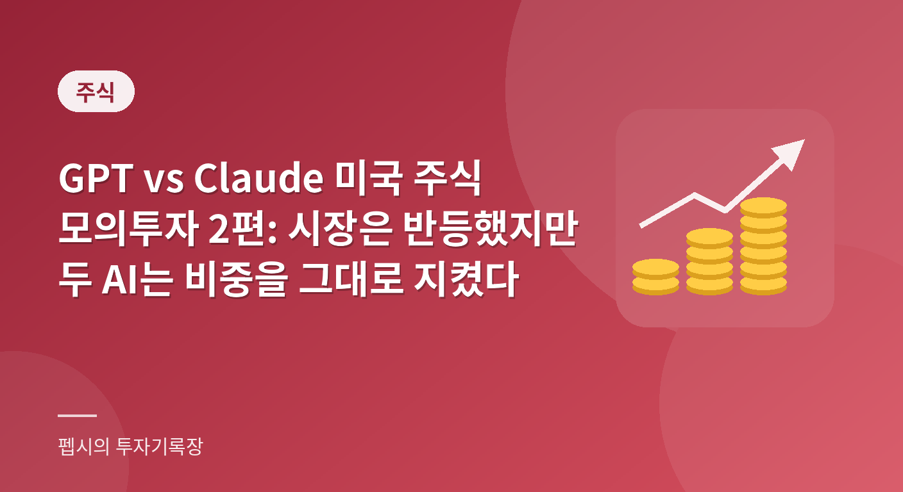
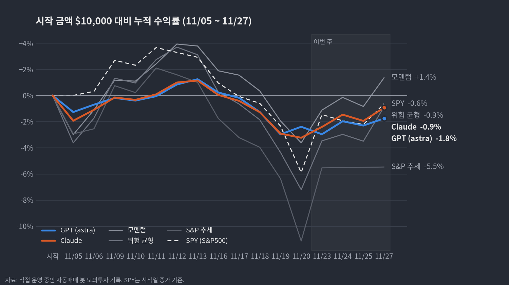
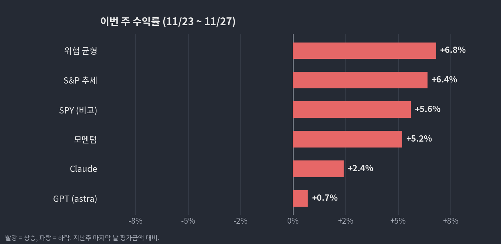
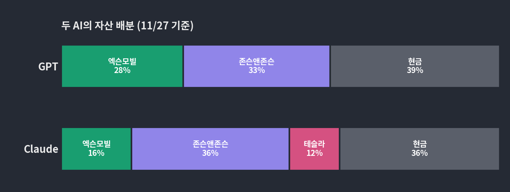

  

이번 주(2026-11-21 ~ 2026-11-27) SPY는 종가 기준 +5.6% 올랐습니다. 이번 주 거래일은 4일이었습니다.

실험이 어떻게 설계됐는지는 [0편 실험 설계](/economy/AI_주식_모의투자_GPT_vs_Claude_0편_실험_설계/)에, 지난 결과는 [1편](/economy/AI_주식_모의투자_GPT_vs_Claude_1편_2주차_결과/)에 정리했습니다.

**📌 한눈에 보기 (2026-11-21 ~ 2026-11-27)**

- 이번 주 1위는 위험 균형(+6.8%), 두 AI는 Claude +2.4%, GPT +0.7%로 4~5위였습니다.
- 누적 1위는 모멘텀(+1.4%), 그다음이 Claude(-0.9%)이고 GPT는 -1.8%입니다.
- 두 AI 모두 주중 비중 변경이 없었고, 현금은 GPT 39%, Claude 36%였습니다.
- SPY는 주간 +5.6%, 시작일 대비 누적 -0.6%입니다.

**목차**

* TOC
{:toc}

## 이번 주 성적표

| 구분 | 이번 주 | 누적 | 평가금액 | 최대 낙폭 |
|---|---|---|---|---|
| GPT (astra) | +0.7% | -1.8% | $9,824 | -4.2% |
| Claude | +2.4% | -0.9% | $9,906 | -4.3% |
| 모멘텀 | +5.2% | +1.4% | $10,136 | -7.3% |
| 위험 균형 | +6.8% | -0.9% | $9,913 | -10.5% |
| S&P 추세 | +6.4% | -5.5% | $9,453 | -13.0% |
| SPY | +5.6% | -0.6% | - | - |

시장이 크게 오른 주였기 때문에, 현금 비중이 큰 두 AI는 SPY보다 덜 올랐습니다. 반면 최대 낙폭은 두 AI가 -4.2%, -4.3%로 봇들보다 작았습니다.

## 두 AI의 이번 주 판단

두 AI는 주초와 주말의 비중이 같았습니다. GPT는 엑슨모빌 28%, 존슨앤존슨 33%, 현금 39%였고, Claude는 엑슨모빌 16%, 테슬라 12%, 존슨앤존슨 36%, 현금 36%였습니다.

월요일에 기술주가 급등했을 때 GPT는 이렇게 적었습니다.

> "S&P 500이 50일선과 250일선을 하회하고 VIX가 35.89로 1년 고점 수준이어서, 오늘 기술주 급등만으로 추세 회복을 판단하지 않습니다."

주 마지막 날에도 판단은 비슷했습니다.

> "장기금리 하락과 일부 기술주의 회복은 긍정적이지만 위험 노출을 확대할 근거는 아직 부족합니다."

Claude도 같은 날 급등을 하루짜리 움직임으로 봤습니다.

> "오늘 장 초반 TQQQ(+18.7%), TSLA(+12.4%), PLTR(+9.3%)가 크게 반등했지만 하루 움직임일 뿐이고 중기 하락 추세는 그대로입니다."

주 마지막 날에는 제외 종목의 이유를 이렇게 정리했습니다.

> "TQQQ는 200일선보다 30% 낮아 하락 추세가 뚜렷하고, PLTR도 50일선 아래라 계속 제외합니다."

이번 주 종목별 수익률(오전 10시 판단 가격 기준)은 팔란티어 +10.1%, 테슬라 +4.9%, 나스닥 3배 -4.6%였습니다. 두 AI가 미보유로 둔 팔란티어는 가장 크게 올랐고, 나스닥 3배는 내렸습니다.

## 두 AI가 갈린 지점

가장 큰 차이는 테슬라였습니다. GPT는 0%, Claude는 12%를 들고 있었습니다.

GPT는 테슬라의 흐름을 긍정적으로 보면서도 진입하지 않았습니다.

> "주요 이동평균선 상회와 양의 60일 수익률은 긍정적이며, 미보유의 기회비용도 관찰됩니다."

Claude는 이미 편입한 포지션을 작은 비중으로 유지했습니다.

> "50일선과 200일선 위에 있고 RSI 61.5로 상대적 강세이며, 편입 후 +9% 수익입니다."

기록을 보면 같은 지표를 보고도 GPT는 확인 후 진입, Claude는 작은 비중 유지로 갈린 것으로 보입니다. 엑슨모빌 비중도 28%와 16%로 달랐습니다.

## 규칙 기반 봇은?

- **모멘텀**: 주간 +5.2%, 누적 +1.4%로 누적 1위입니다. 최대 낙폭은 -7.3%였습니다.
- **위험 균형**: 주간 +6.8%로 이번 주 1위입니다. 누적은 -0.9%이고 최대 낙폭은 -10.5%였습니다.
- **S&P 추세**: 주간 +6.4%였지만 누적은 -5.5%로 가장 낮습니다. 최대 낙폭은 -13.0%였습니다.

**⚠️ 아직은 짧은 기록입니다**

시작일 이후 거래일은 16일뿐이고, 이번 주도 4거래일이었습니다. 모의투자 결과이며 몇 번의 급등락만으로 순위가 쉽게 바뀔 수 있어, 어느 쪽이 더 낫다고 결론 내릴 수 없습니다.

## 정리

- 이번 주 순위는 위험 균형, S&P 추세, 모멘텀, Claude, GPT 순이었습니다.
- 누적 순위는 모멘텀, Claude, 위험 균형, GPT, S&P 추세 순입니다.
- 두 AI는 반등에도 비중을 바꾸지 않았고, 테슬라 보유 여부가 가장 큰 차이였습니다.

다음 주에는 두 AI가 판단 근거로 반복해 적은 S&P 500의 50일선·250일선 회복 여부와 VIX 흐름을 지켜볼 예정입니다. 비중이 처음으로 바뀌는지도 기록하겠습니다.

## 자주 묻는 질문

**Q1. 이번 주 두 AI는 비중을 바꿨나요?**

A1. 바꾸지 않았습니다. GPT와 Claude 모두 주초와 주말의 비중이 같았습니다.

**Q2. 두 AI의 가장 큰 차이는 무엇이었나요?**

A2. 테슬라입니다. GPT는 0%, Claude는 12%를 보유했습니다.

**Q3. 누적 수익률 1위는 누구인가요?**

A3. 모멘텀 봇이 +1.4%로 1위입니다. 두 AI 중에서는 Claude가 -0.9%로 GPT(-1.8%)보다 앞섰습니다.

> 이 글은 개인적인 모의투자 실험 기록이며 투자 권유가 아닙니다. 투자 판단과 그 결과의 책임은 투자자 본인에게 있습니다.
