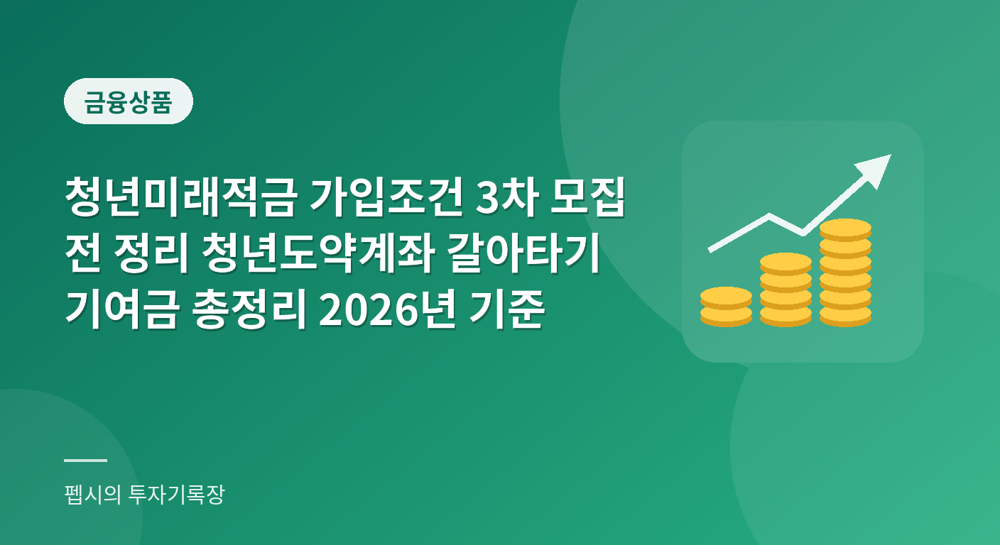

  

올해 6월에 나온 청년 적금이 벌써 2차 모집까지 끝났다는 소식, 들으셨나요? 주변에서 "나는 대상인가?", "청년도약계좌 갖고 있는데 바꿀 수 있나?" 하는 질문이 계속 나오는 상품입니다.

2차 계좌개설 기간이 11월 27일에 끝났기 때문에, 지금은 "놓쳤다면 다음 기회는 언제일까"를 궁금해하는 분이 많을 때입니다.

이 글에서는 금융위원회 공식 보도자료를 기준으로 청년미래적금의 가입조건, 기여금, 갈아타기 절차, 앞으로의 일정을 차근차근 정리해 봅니다. 3차 모집 공고가 나오기 전에 미리 자격을 점검해 두면 좋습니다.

**📌 한눈에 보기 (2026년 기준)**

- 대상은 만 19~34세, 총급여 7,500만 원 이하(또는 연매출 3억 원 이하 소상공인)이면서 가구 중위소득 200% 이하입니다.
- 3년 만기 자유적립식이고, 매월 최대 50만 원까지 넣을 수 있습니다.
- 정부 기여금은 일반형 6%, 우대형 12%이며 이자소득세는 면제됩니다.
- 1차(6월)와 2차(10월) 모집은 끝났고, 3차 모집 일정은 아직 확정되지 않았습니다.
- 청년도약계좌와는 중복 가입이 안 되고, 갈아타기는 3단계 절차를 따라야 합니다.

**목차**

* TOC
{:toc}

## 청년미래적금, 어떤 상품인가

청년미래적금은 청년의 목돈 마련을 돕기 위해 2026년 6월 22일 출시된 정책형 적금입니다. 청년이 매달 저축하면 정부가 기여금을 얹어 주는 구조입니다.

만기는 3년이고 자유적립식이라 매달 정해진 금액을 꼭 넣지 않아도 됩니다. 납입 한도는 월 50만 원, 최소 금액은 1천 원으로 안내되었습니다.

금리는 은행이 정하는 3년 고정금리입니다. 2차 모집 안내 기준으로 기본 5%에 우대금리가 최대 2~3%포인트 붙는 구조로 설명되었고, 기관별 세부 내용은 은행연합회 소비자포털에서 비교하라고 안내되어 있습니다.

여기에 이자소득세가 면제되고 정부 기여금까지 더해지기 때문에, 금융위원회는 실질 가입 효과를 일반형 연 13.2~14.4%, 우대형 연 18.2~19.4% 수준의 단리 적금과 비슷하다고 설명합니다. 이 숫자는 금리 7~8%를 가정해 계산한 값이라, 실제 금리에 따라 달라집니다.

## 가입조건 한눈에 정리

가입조건은 나이, 본인 소득, 가구 소득 세 가지를 함께 봅니다. 하나라도 어긋나면 가입이 어렵습니다.

나이는 만 19~34세입니다. 병역을 이행한 기간은 최대 6년까지 나이 계산에서 빼 주기 때문에, 군 복무를 마친 분은 실제 나이보다 가입 가능 범위가 넓어질 수 있습니다.

소득은 직전년도(2025년) 소득으로 심사합니다. 서류를 따로 내는 것이 아니라 전산으로 연계해 확인하고, 필요하면 추가 서류를 요청하는 방식입니다.

| 구분 | 본인 소득 기준 | 가구 중위소득 | 정부 기여금 |
|---|---|---|---|
| 일반형 | 총급여 6,000만 원 이하 또는 소상공인 연매출 3억 원 이하 | 200% 이하 (맞벌이 250% 이하) | 6% |
| 우대형 | 중소기업 재직·신규 취업자 총급여 3,600만 원 이하 또는 소상공인 연매출 1억 원 이하 | 150% 이하 (맞벌이 200% 이하) | 12% |
| 기여금 없음 | 총급여 6,000만 원 초과 7,500만 원 이하 | 200% 이하 (맞벌이 250% 이하) | 없음 (이자 비과세만) |

표에서 눈여겨볼 부분은 마지막 줄입니다. 총급여가 6,000만 원을 넘으면 가입은 되지만 정부 기여금은 받지 못하고, 비과세 혜택만 누리게 됩니다.

또 직전 3개년도 중 한 번이라도 금융소득종합과세 대상이었다면 가입이 제한됩니다. 육아휴직급여나 병 급여가 있는 경우에는 가입할 수 있다고 안내되었습니다.

## 일반형과 우대형, 기여금은 얼마나 받을까

기여금은 본인이 납입한 금액에 비율을 곱해 정부가 지급하는 돈입니다. 일반형은 6%, 우대형은 12%입니다.

아래 표는 매달 같은 금액을 36개월 동안 넣는다고 가정해 제가 계산한 기여금입니다. 이자는 금리에 따라 달라지므로 뺐습니다.

| 월 납입액 | 3년 총 납입액 | 일반형 기여금(6%) | 우대형 기여금(12%) |
|---|---|---|---|
| 10만 원 | 360만 원 | 21만 6천 원 | 43만 2천 원 |
| 30만 원 | 1,080만 원 | 64만 8천 원 | 129만 6천 원 |
| 50만 원 | 1,800만 원 | 108만 원 | 216만 원 |

월 50만 원을 꽉 채우면 우대형은 기여금만 216만 원입니다. 같은 금액이라도 어느 유형으로 가입하느냐에 따라 두 배 차이가 납니다.

다만 이 표는 어디까지나 단순 계산 예시입니다. 중간에 납입을 거르거나 해지하면 금액이 달라질 수 있으니 참고용으로만 보세요.

## 우대형은 재직 요건을 꼭 확인하세요

우대형은 기여금이 두 배라서 매력적이지만 조건이 더 까다롭습니다. 특히 중소기업 재직 기간 요건을 놓치기 쉽습니다.

가입 시점부터 만기 한 달 전까지 총 29개월 이상 중소기업에 재직해야 하고, 이직은 최대 2회까지 허용됩니다. 이 요건을 채우지 못하면 만기에 일반형으로 전환될 수 있다고 안내되었습니다.

소상공인으로 가입하려면 신청 전에 소상공인확인서를 먼저 받아야 합니다. 중소기업현황정보시스템에서 발급하며 평균 약 7일이 걸리고, 유효기간은 1년입니다.

사업장이 두 곳 이상이면 운영 중인 모든 사업장의 확인서가 필요합니다. 발급이 늦어지면 종합소득 기준으로 심사받을 수 있으니, 3차 모집 공고가 나기 전에 미리 준비하는 편이 안전합니다.

**⚠️ 갈아타기는 순서를 어기면 납입이 막힙니다**

청년도약계좌에서 갈아타려면 새 계좌를 연 뒤 정해진 기간 안에 특별중도해지까지 마쳐야 합니다. 이 절차를 끝내지 않으면 청년미래적금에 납입할 수 없고, 납입이 중지된 새 계좌는 해지해야 합니다.

## 청년도약계좌 갈아타기 3단계

두 상품은 중복 가입이 안 됩니다. 청년도약계좌가 만기된 뒤에도 청년미래적금에는 가입할 수 없다고 안내되어 있습니다.

대신 청년도약계좌를 가지고 있는 분이 새 상품으로 옮기는 길은 열려 있습니다. 2차 모집에서는 갈아타기 기회가 추가로 제공되었는데, 설문에서 응답자의 54%가 갈아타기 의향을 보였다는 점이 근거로 제시되었습니다.

절차는 아래 순서입니다.

1. 청년미래적금 가입을 신청하고 심사를 거쳐 "가입 가능" 안내를 받습니다.
2. 안내받은 기간에 취급기관 앱에서 청년미래적금 계좌를 개설합니다.
3. 청년도약계좌 취급은행 앱에서 "청년미래적금 가입 목적의 특별중도해지"를 신청합니다.

특별중도해지는 접수하면 바로 자동 해지 처리됩니다. 새 계좌에는 특별중도해지가 끝난 다음 영업일 오전 9시부터 납입할 수 있습니다.

기존 청년도약계좌에 이미 받은 정부 기여금과 이자소득 비과세는 그대로 유지된다고 공지되었습니다. 그래서 "갈아타면 지금까지 받은 혜택을 토해내야 하나?" 하는 걱정은 하지 않아도 됩니다.

다만 갈아타는 게 모두에게 유리하다는 뜻은 아닙니다. 남은 만기, 기존 금리, 본인의 유형(일반형·우대형)에 따라 계산이 달라지므로 신중하게 비교해야 합니다.

## 신청부터 계좌개설까지 흐름

2차 모집을 기준으로 하면 전체 과정이 약 한 달 반 걸렸습니다. 3차 때도 비슷한 틀이 이어질지는 공고를 봐야 하지만, 흐름을 알아 두면 준비가 수월합니다.

| 단계 | 2차 모집 일정 | 내용 |
|---|---|---|
| 가입 신청 | 10월 7일~16일 | 취급기관 앱에서 비대면 신청, 선착순 아님 |
| 심사 | 10월 19일~11월 13일 | 전산 연계 심사, 필요 시 추가 서류 |
| 결과 안내 | 11월 12일~13일 | 가입 가능 여부 개별 안내 |
| 계좌개설 | 11월 16일~27일 | 이 기간이 지나면 개설 불가 |

신청 단계에서는 가입 유형(일반소득자, 중소기업 재직자, 소상공인)을 직접 고르게 되었습니다. 유형을 잘못 고르면 심사에서 불리해질 수 있으니 본인 상황에 맞게 선택해야 합니다.

취급기관은 2차 기준으로 농협, 신한, 우리, 하나, 기업, 국민, 수협, iM, 부산, 광주, 전북, 경남, 카카오뱅크, 우정사업본부 14곳이었습니다. 토스뱅크는 3차부터 참여 예정이라고 안내되었습니다.

## 중도해지하면 어떻게 되나

3년은 길어서 중간에 사정이 생길 수 있습니다. 이 적금은 중도해지 후 해지 시점 기준 2개월이 지나야 다시 신청할 수 있습니다.

재가입하면 기여금이 일부 줄어듭니다. 기존 가입기간을 뺀 나머지 개월 수를 36개월로 나눈 비율만큼 곱해지는 방식입니다. 예를 들어 12개월을 유지하다 해지한 뒤 다시 가입하면 (36-12)/36, 즉 3분의 2 수준으로 계산됩니다.

납입을 잠시 멈춘 기간도 가입기간으로 인정됩니다. 형편이 어려운 달에는 무리해서 넣기보다 쉬어 가는 쪽이 해지보다 낫습니다.

## 2027년 예산안과 3차 모집, 무엇이 달라질까

금융위원회는 2027년 청년미래적금 예산안이 국회에 제출되어 있다고 밝혔습니다. 가입 대상을 모든 청년으로 넓히고 우대형 기여금 비율을 올리는 내용입니다.

우대형 기여금은 12%에서 15%로 오르고, 지방 중소기업에 재직하면 25%라는 안이 제시되었습니다. 예산이 확정되면 기존 가입자에게도 올라간 우대형 기여금을 소급해 지급할 예정이라고 합니다.

가입 대상 확대는 국회 승인 이후 2027년 모집부터 적용됩니다. 3차 모집은 예산안이 확정되고 조세특례제한법령 등 정비를 거친 뒤 진행한다고 하며, 구체적인 날짜는 공개되지 않았습니다.

즉 지금 단계의 2027년 내용은 어디까지나 정부안입니다. 국회 심의에서 바뀔 수 있으니 확정된 것처럼 받아들이지 않는 게 좋습니다.

## 많이 하는 오해 4가지

### 1. "청년도약계좌가 있어도 같이 가입할 수 있다"

불가능합니다. 두 상품은 중복 가입이 안 되고, 청년도약계좌가 만기된 뒤에도 가입할 수 없습니다. 옮기고 싶다면 앞서 본 갈아타기 3단계를 따라야 합니다.

### 2. "소득이 높으면 아예 가입이 안 된다"

총급여 7,500만 원 이하까지는 가입이 가능합니다. 다만 6,000만 원을 넘으면 정부 기여금은 없고 이자 비과세 혜택만 받습니다.

### 3. "먼저 신청한 사람이 유리하다"

선착순이 아닙니다. 신청 기간 안에 접수하면 심사를 받고, 홀짝제나 5부제는 앱이 몰리는 것을 나누기 위한 장치입니다.

### 4. "우대형으로 가입하면 끝까지 12%가 보장된다"

재직 요건을 채워야 합니다. 총 29개월 이상 중소기업 재직이 안 되면 만기에 일반형으로 전환될 수 있습니다.

## 3차 모집 전에 점검할 순서

공고가 나면 신청 기간이 짧기 때문에, 미리 준비할 수 있는 것부터 챙겨 두면 좋습니다. 아래 순서로 확인해 보세요.

1. 만 나이와 병역 이행 기간으로 연령 요건을 계산합니다.
2. 2025년 총급여 또는 사업 매출과 가구 소득을 확인해 유형(일반·우대·기여금 없음)을 가늠합니다.
3. 청년도약계좌를 갖고 있다면 남은 기간과 금리를 정리해 갈아타기 여부를 정합니다.
4. 소상공인이라면 소상공인확인서를 미리 발급받습니다.
5. 금융소득종합과세 대상이었던 적이 있는지 확인합니다.

준비물은 신분 확인이 가능한 본인 명의 스마트폰과 취급기관 앱입니다. 서류를 따로 내지 않는 대신 앱 설치와 본인 인증은 미리 해 두는 편이 편합니다.

## 정리

- 청년미래적금은 만 19~34세, 총급여 7,500만 원 이하, 가구 중위소득 200% 이하가 기본 요건이며 월 최대 50만 원, 3년 만기입니다.
- 정부 기여금은 일반형 6%, 우대형 12%이고, 총급여 6,000만 원 초과 구간은 기여금 없이 비과세만 적용됩니다.
- 청년도약계좌와는 중복이 안 되며, 갈아타려면 가입 안내→계좌 개설→특별중도해지 순서를 지켜야 합니다.
- 3차 모집 일정은 미정이고, 2027년 확대안(우대형 15% 등)은 국회 확정 전의 정부안입니다.

적금은 가입 자체보다 3년간 꾸준히 이어 가는 일이 더 중요합니다. 기여금 숫자만 보고 무리하게 한도를 채우기보다, 생활비를 감당할 수 있는 선에서 금액을 정하세요.

공고가 나오면 금융위원회와 서민금융진흥원 안내를 먼저 확인하시길 권합니다. 일정과 조건은 예산 확정 과정에서 바뀔 수 있습니다.

## 자주 묻는 질문

**Q1. 2차 모집을 놓쳤는데 지금 가입할 수 있나요?**

A1. 2차 계좌개설 기간은 11월 27일에 끝났고, 이후에는 개설할 수 없다고 안내되었습니다. 3차 모집은 2027년 예산안 확정과 법령 정비 뒤에 진행할 예정이며 날짜는 아직 공개되지 않았습니다.

**Q2. 청년도약계좌 만기 후에 가입할 수 있나요?**

A2. 안 됩니다. 두 상품은 중복 가입이 안 되고, 청년도약계좌가 만기된 뒤에도 청년미래적금에는 가입할 수 없다고 안내되어 있습니다.

**Q3. 군 복무를 했는데 나이 기준이 달라지나요?**

A3. 병역 이행 기간은 최대 6년까지 연령 계산에서 빼 줍니다. 그래서 만 34세를 넘겼더라도 대상이 될 수 있으니, 본인 기준으로 계산해 보세요.

**Q4. 금리는 어디서 비교하나요?**

A4. 은행마다 기본금리와 우대금리 조건이 다르므로 은행연합회 소비자포털에서 기관별 내용을 확인하라고 안내되었습니다.

## 참고 자료

- 금융위원회, [청년미래적금 출시, 6월 22일부터 7.3일까지 가입신청](https://www.fsc.go.kr/no010101/87158) (2026년 6월 22일 게시)
- 금융위원회, [10월 7일부터 청년미래적금 2차 가입 신청을 받습니다](https://fsc.go.kr/no010101/87726) (2026년 9월 16일 게시)
- 금융위원회, [청년미래적금 2차 가입 전 달라진 절차와 주요일정 안내](https://fsc.go.kr/no010101/87820) (2026년 9월 30일 게시)
- 2026년 11월 기준으로 작성했으며, 3차 모집 조건은 공고 시점에 달라질 수 있습니다.

> 이 글은 일반적인 정보 제공을 위한 것으로, 개인 상황에 따라 적용이 다를 수 있습니다. 정확한 내용은 관련 기관에 확인하세요.
